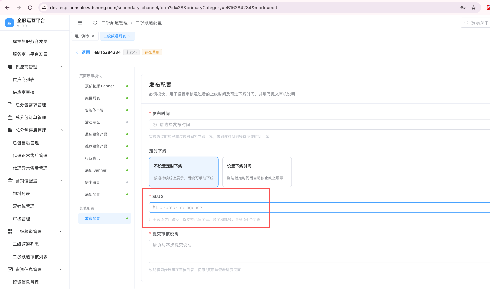
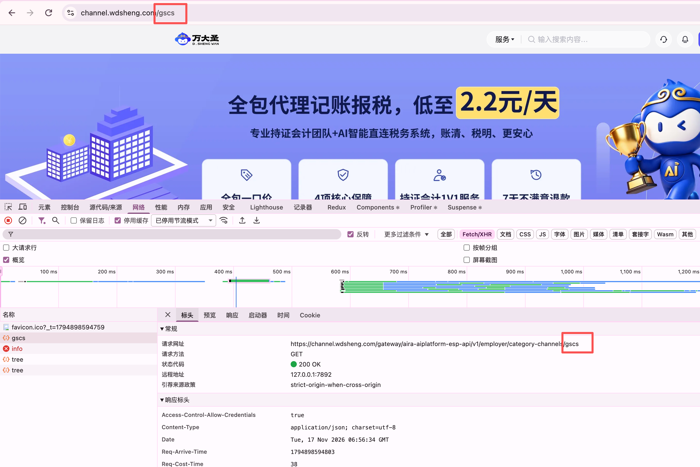
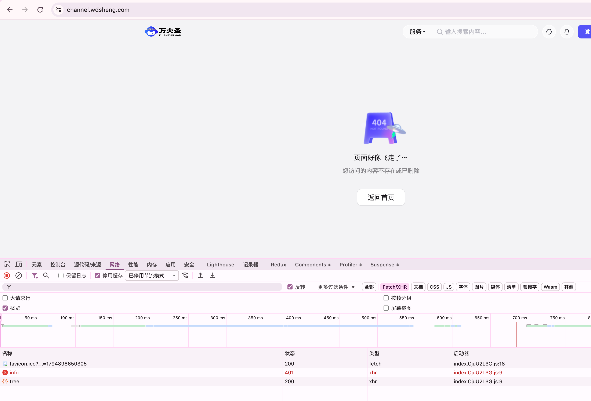

# 二级频道 SLUG 下拉选择综合方案

本期将运营后台的 SLUG 手动输入改为**从已登记的路径中选择**。运营从可选项中选择 SLUG。品牌专区和活动需要新路径时，可按需登记。

本文供产品、业务和研发共同评审。建议本期先覆盖工商财税及已确认的频道地址，评审确认后再纳入实施范围。

## 目录

- [已确认的访问规则](#已确认的访问规则)
- [运营配置方案](#运营配置方案)
- [业务收益](#业务收益)
- [现状](#现状)
- [潜在风险](#潜在风险)
- [技术说明](#技术说明)
- [发布与换址验收](#发布与换址验收)
- [评审需拍板](#评审需拍板)

## 已确认的访问规则

工商财税频道在新域名沿用现有 SLUG `gscs`，完整地址为 `https://cs.wdsheng.com/gscs`。两个域名的频道内容相互隔离，`cs.wdsheng.com` 仅开放工商财税。TDK 在构建前静态预置，具体文案待产品提供。

## 运营配置方案

| 场景 | 操作与规则 |
|---|---|
| 新建频道 | 发布配置保留「SLUG」字段，控件由手动输入改为下拉选择。选项按域名提供，例如工商财税对应 `gscs`，保存时仍提交现有 SLUG 字段。 |
| 地址已分配 | 显示占用状态，禁止分配给其他页面。服务端保存时再次校验，防止多人同时选中同一地址。 |
| 日常更新内容 | 回显并保留历史 SLUG，包括尚未登记进清单的值。更换内容、Banner 或模块顺序时，运营可以继续沿用当前地址。 |
| 新品牌或活动 | 负责人登记业务名称、域名、路径和用途，登记完成即可在后台选择。 |
| 已上线频道换址 | 审核时展示原地址和新地址。上线前确认旧链接继续服务或跳转，并明确投放入口的更新责任。 |

**TDK 随地址登记一起准备。** 需要静态 TDK 的页面，登记时同步提交页面访问地址、标题、描述和关键词，由研发确认匹配方式并纳入打包配置。地址进入下拉清单与静态 TDK 生效是两个节点，后者需要完成构建和部署。下拉让运营直接选用已核对的地址，减少上线时地址与预置配置不一致的风险。

## 业务收益

- **减少发布错误。** 运营直接选择已登记的 SLUG，避免手填时把 `gscs` 写成 `gcss`。
- **保障投放地址稳定。** 内容变更可以直接沿用已有地址。换址时集中核对新旧链接，减少发布完成后再处理历史物料。
- **保留活动灵活性。** 路径仍可按业务需求新增。登记时一次确认用途、可用性和归属，之后配置、审核和投放都使用同一条记录。
- **便于分步落地。** 首批从已确认的频道地址开始登记，接入下拉与历史回显。业务可先由指定负责人维护清单，地址规模扩大后再评估维护入口。

## 现状

SLUG 是访问地址里的路径标识，前台会用它查询对应频道。目前运营在发布配置中手动填写，后台校验小写字母、数字、减号和长度。例如 `gscs` 和 `gcss` 均符合格式，实际会用于不同的频道查询。

**图 1｜后台发布配置中的 SLUG 输入框**

**图 2｜打开 /gscs 时，频道查询使用同一个 SLUG**

当访问路径没有匹配到频道、且查询接口成功返回空对象时，现有前台会跳转到主站首页。接口失败时会显示加载错误。附件中的 404 截图对应频道域名根路径，地址缺少 SLUG；现场反馈还有白屏现象，触发条件待复核。

**图 3｜打开没有 SLUG 的频道域名根路径时显示 404**

## 潜在风险

| 风险 | 业务影响 |
|---|---|
| 路径填错 | 误填的 SLUG 仍可能通过格式校验。投放链接若查不到对应频道，访客可能被带到主站首页，无法看到投放承诺的内容。 |
| 路径冲突 | 若两个页面使用相同的查询标识，可能无法按预期区分频道。域名归属与路径占用均由服务端核验。 |
| 上线后换址 | 广告、二维码、历史分享和搜索收录可能仍指向旧地址，需要提前确定链接过渡方式。 |
| 静态 TDK 配置与实际地址不一致 | 需要静态 TDK 的页面可能无法命中对应预置配置，影响上线验收。 |

工商财税这次有自己的域名，访问地址就沿用 `https://cs.wdsheng.com/gscs`。系统靠最后这段 `gscs` 找到工商财税页面，所以这个值固定下来。后台把它放进下拉框，配置时直接选 `gscs`，省去手填。运营和业务照常更新频道内容、提交发布。

## 技术说明

- **SLUG 是频道查询的标识。** 用户打开 `/gscs` 后，前台会请求 `GET /v1/employer/category-channels/gscs`。后台换成下拉后，保存时仍提交原有的 `slug` 字段。
- **域名隔离需要在访问时校验。** 下拉约束运营能选哪些值。用户直接访问 `cs.wdsheng.com` 下的其他频道路径时，入口或接口还要校验频道归属，确保只返回工商财税内容。具体校验位置和错误响应由研发对齐。
- **静态 TDK 随构建发布。** 产品提供标题、描述和关键词，研发在打包前配置。验收时检查页面初次返回的 HTML 是否包含正确内容。

## 发布与换址验收

首次发布时，核对后台选中的 SLUG 与实际投放路径一致，并验证页面内容及静态 HTML 中的 TDK。已上线页面日常改内容时沿用当前地址。确需换址时，由审核人员核对新旧完整链接；若决定跳转，上线验收应覆盖历史入口和已有查询参数。另需验证直接访问 `cs.wdsheng.com` 下的其他频道 SLUG 时，页面和接口均不会返回其他频道内容。

## 评审需拍板

1. **工商财税旧链接过渡。** 建议旧链接跳转至对应新地址并保留必要查询参数，具体规则由产品确认。
2. **地址清单与 TDK 交付。** 确认首批可选地址、地址登记负责人，以及由谁提供各页标题、描述和关键词。

**研发对齐事项**包括域名归属校验由入口还是频道接口执行，以及访问未经分配的 SLUG 时返回什么。两个域名内容隔离、`cs.wdsheng.com` 仅开放工商财税，均已确认。

建议评审通过后，按「首批地址登记 → 后台下拉与历史回显 → 验证新旧地址」推进。

---
**文档版本** v2.0  
**最后更新** 2026年11月  
**整理人** 王新骏
