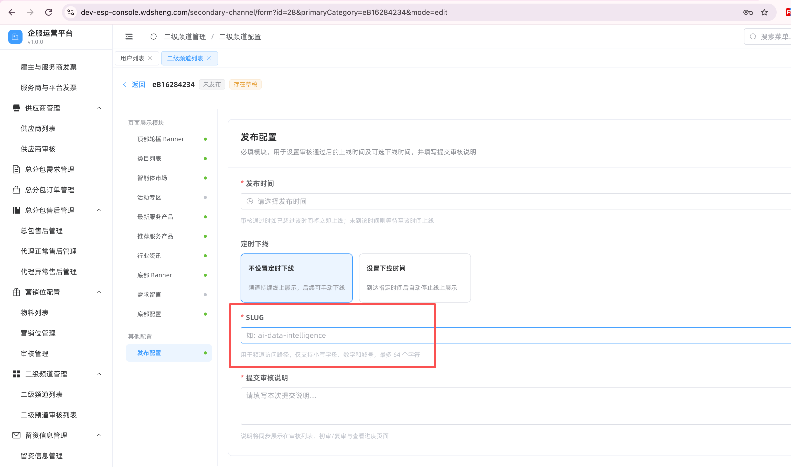
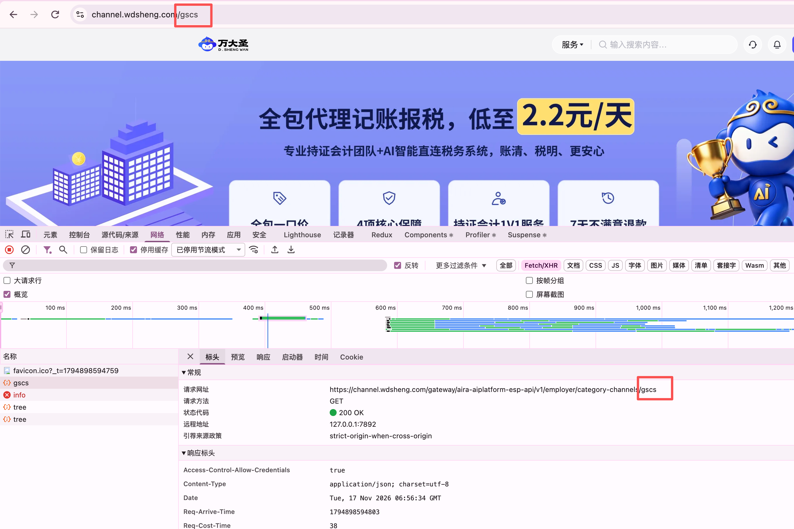
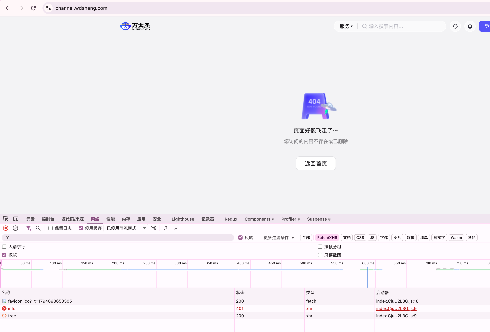

# 二级频道 SLUG 下拉选择说明（产品与业务版）

建议把发布配置里的 **SLUG 从手动填写改为下拉选择**。比如配置工商财税频道时，运营直接选 `gscs`。本期只调整这一项的填写方式。

## 目录

- [现在怎么填](#现在怎么填)
- [填错会怎样](#填错会怎样)
- [改成下拉后怎么用](#改成下拉后怎么用)
- [评审需要确认什么](#评审需要确认什么)

## 现在怎么填

SLUG 就是网址最后一段。工商财税的新地址已确认是 `https://cs.wdsheng.com/gscs`，最后的 `gscs` 就是运营在后台填写的值。访客打开链接后，系统用它找到对应的频道页面。两个域名各自展示对应的频道内容，`cs.wdsheng.com` 只开放工商财税。

**图 1｜后台目前手填 SLUG**

**图 2｜打开 /gscs 后，系统用 gscs 找到工商财税页面**

## 填错会怎样

比如把 `gscs` 写成 `gcss`，后台只检查字符和长度，两种写法都能通过。如果访客打开的路径查不到频道，按现有逻辑，系统在查询结果为空时会把人带到主站首页，访客就看不到广告或分享链接里的工商财税内容。直接打开没有路径的频道域名会看到 404 页面。现场也反馈过白屏，具体触发条件待复核。

**图 3｜只打开频道域名、地址没有路径时显示 404**

已经发出去的广告链接、二维码和分享链接都依赖原来的 SLUG。频道换址时，需要提前决定这些旧链接怎么处理。

## 改成下拉后怎么用

| 运营场景 | 建议操作 |
|---|---|
| 配置频道 | 从当前域名的可选项里选 SLUG。比如工商财税直接选 `gscs`。 |
| 更新已有频道 | 后台带出原来的 SLUG，更新 Banner 或其他内容时可以继续沿用。 |
| 新活动需要路径 | 由指定负责人登记新路径，加入清单后运营就可以选。 |

下拉把容易输错的路径变成可直接选择的选项。需要新活动地址时，可以继续扩充清单。工商财税上线验收时，用 `/gscs` 核对页面内容，并检查在 `cs.wdsheng.com` 下输入其他频道路径时无法访问其他频道。

搜索结果使用的页面标题、描述和关键词由产品提供，研发在打包前统一配置。

## 评审需要确认什么

1. **本期是否采用下拉。** 建议先用已确认的频道路径作为首批选项。
2. **工商财税旧链接怎么处理。** 确认旧的 `channel.wdsheng.com/gscs` 是继续可用，还是跳到新地址。如果跳转，一并确认链接上已有的活动参数如何保留。
3. **谁维护首批选项。** 确认地址清单、后续新增路径的登记负责人，以及产品交付各页标题、描述和关键词的时间。

---
**文档版本** v1.0  
**最后更新** 2026年11月  
**整理人** 王新骏
