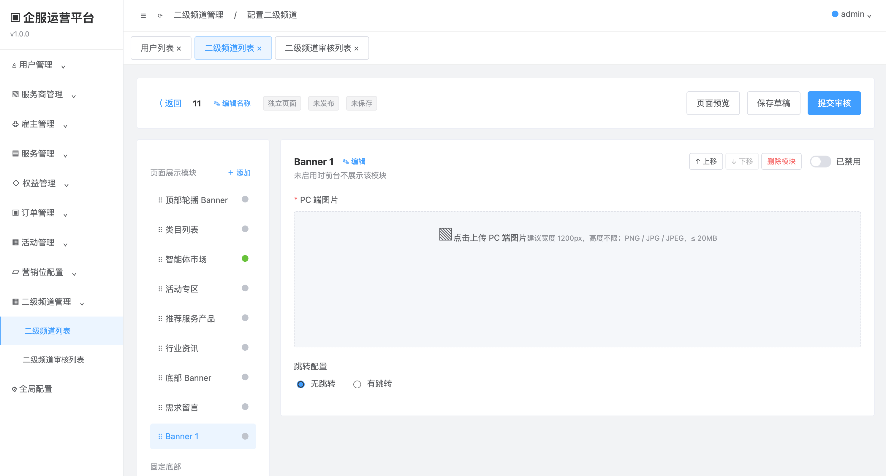

# REQ\-045/161 二级频道页模块优化 PRD

## 项目信息

## 文档版本

## 一、背景与目标

现有二级频道页必须关联一级类目，无法灵活承接品牌专区、活动专区等运营场景。本次增加**独立页面类型**，支持**多个 Banner、智能体市场模块**及**模块排序**，并增加每页独立 **TDK、子域名和访问路径配置**。

**本文仅描述本次变化。未明确调整的模块配置、权限、草稿、初审／复审、发布与上下线、操作记录等，均沿用现有平台规则。**

## 二、需求规则

|**页面**|**需求说明**|
|---|---|
| |点击“配置二级频道”后，先选择“类目频道页”或“独立页面”，确认后进入配置页。 - 类目频道页沿用平台现有“选择一级类目”环节，选择后进入原有模块配置，顶部直接展示类目名称；已配置类目进入对应记录，不重复新建。 - 选择“独立页面”后，在当前类型选择弹窗下方展开必填“页面名称”输入框；      - 规则及校验：          - 名称为空时在字段下提示“请输入页面名称”；         - 字数限制30字，超出不能输入；         - 点击下一步，需校验名称是否重复，若重复则保存失败，给toast提示【当前名称已存在，请重新编辑】         - 切换类型保留本次输入，关闭弹窗后重新打开则清空；     - 填写有效名称后进入模块配置，不需要关联一级类目。 独立页面在顶部名称后提供修改入口，修改随草稿审核生效。  |
| |**页面列表调整** - “一级类目”列改为“名称”，类目频道页显示类目名称，独立页面显示自定义名称。 - 增加“类型”列，展示“类目频道页／独立页面”。 筛选： - 增加页面类型筛选：“全部页面类型／类目频道页／独立页面”。 - 名称搜索覆盖两类页面名称，搜索提示改为“搜索页面名称…”。 - 两类页面在同一列表中展示；独立页面接入现有线上状态、变更状态及审核流程。 其余列表字段与操作规则沿用现有平台，不新增独立日志入口。 |
|  |**配置页调整** - 顶部状态补充     - 增加页面类型【类目频道页／独立页面】     - 若为独立页面：         - 支持名称修改，点击后进入编辑态，可确认/取消；             - 取消后本次编辑无效；             - 确定后同步到当前顶部名称显示位置以及二级频道列表的名称显示位置。                 - 需校验名称是否重复，若重复则给toast提示【当前名称已存在，请重新编辑】             - 输入规范：字数限制30字，超出不能输入。         - 独立页面模块类目列表和推荐服务产品增加**启用禁用开关**，并去掉**最新服务产品**模块 - 多模块配置（Banner、智能体市场支持添加多个模块）     - 点击【添加】按钮：         - 给弹窗【添加展示模块】（左图2），提供 Banner/智能体市场的下拉选择，新增模块默认关闭状态。     - 规则：         - Banner、智能体市场各最多 5 个，按类型分别计数（已添加的已禁用模块仍计数；删除后释放数量）         - 已有的顶部轮播 Banner、底部 Banner 均不计入 Banner 数量         - 达到上限时对应类型不可选，两类均满时禁用添加按钮；  |
| |#### 新增模块的列表名称 - 新增成功后，模块追加到左侧“页面展示模块”列表末尾，自动选中并展示对应配置。 - 新增 Banner 默认名称为“Banner 1、Banner 2…”；新增智能体市场默认名称为“智能体市场 1、智能体市场 2…”，两类分别编号。 - **名称仅用于后台识别**。通过模块标题后“编辑”修改（所有模块均增加），确认后同步左侧列表，前台展示名称不随之改变。     - 编辑输入规范：字数限制30字，超出不能输入。   **Banner 图片尺寸调整** - Banner 配置改为限定图片宽度1200px、不限制高度，不固定高度裁切。 - 图片格式及大小：PNG / JPG / JPEG，≤20MB - 跳转配置沿用现有底部banner规则：“无跳转／有跳转给跳转链接字段|
| |当选择**独立页面**时，类目列表模块：删掉标准模式，保留图片模式，即去掉展示形式部分，保留图片配置模式。 |
| |**模块排序与交互调整** - **排序范围：**除固定底部的底部配置外，页面展示模块支持自定义排序。底部配置始终位于页面底部。 - **排序操作：**支持拖拽、上移、下移；第一项禁用上移，最后一项禁用下移。前台按启用模块的配置顺序展示。 原有模块不提供删除，仅支持启用／禁用和排序（底部配置仍固定）。 新增 Banner、智能体市场模块支持删除，须二次确认； - **删除模块二次确认文案：**     - 标题：删除模块。     - 正文：确定删除“\{模块名称\}”吗？删除后，该模块及其配置内容将从当前草稿中移除，审核通过后生效，当前线上页面不受影响。     - 按钮：取消／确认删除。取消保留模块，确认删除仅修改当前编辑内容，需保存草稿或提交审核。 |
| |**访问地址配置（二级频道页/独立页面均支持）** - 将原 SLUG 配置调整为一个必填的“访问地址”配置项，同一行展示： `https://` **\[子域名输入框\]** `.``wdsheng.com/` **\[访问路径输入框\]** 子域名与访问路径分别必填。 - 输入及规则     - 子域名：         - 示例：channel         - 支持小写字母、数字、减号，首尾不能为减号；建议最多 63 字符     - 访问路径         - 示例：gscs 或 gscs?categoryId=4         - 可包含查询参数（最多100个字符）；         - 问号前的路径沿用原 SLUG 规则，小写字母、数字和减号，最多 64 字符 - 校验规则：     - 子域名为空提示“请输入子域名”；路径为空提示“请输入访问路径”。输入过程中实时展示完整地址预览。     - 子域名首尾为减号时，校验提示：“子域名首尾不能为减号”。  **TDK设置（二级频道页/独立页面均支持）** 目的：帮助搜索引擎快速理解网页的核心内容，从而在搜索结果中获得更好的排名展现，并吸引用户点击。 - 页面标题：定义页面主题，影响排名     - 必填，支持最多输入60字     - 默认带入“页面名称－万大圣”，允许修改 - 页面描述：概括页面内容，吸引点击     - 非必填，支持最多输入200字 - 页面关键词：标注核心词汇     - 非必填，支持最多输入100字 |

