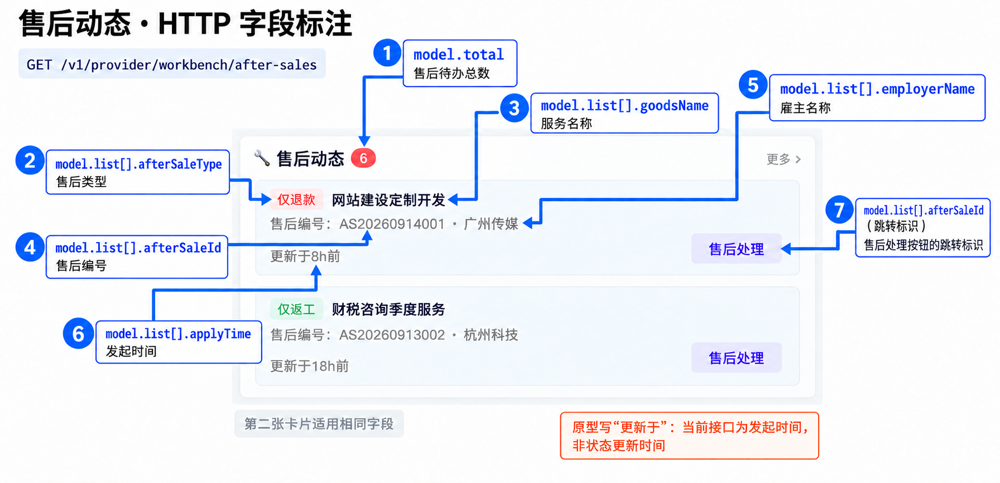
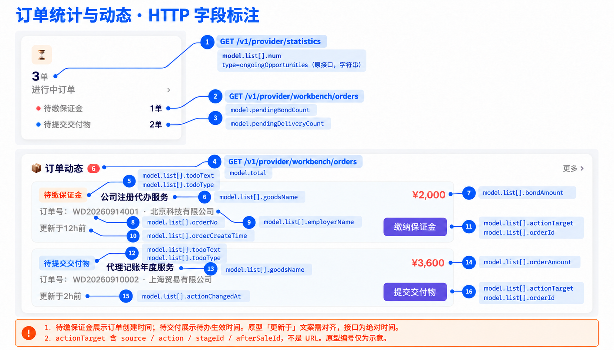
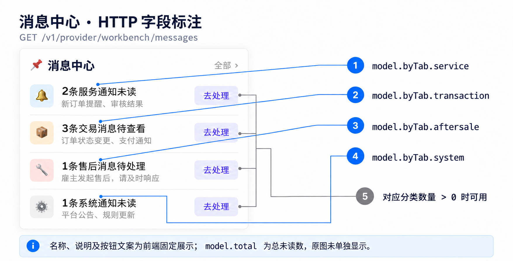
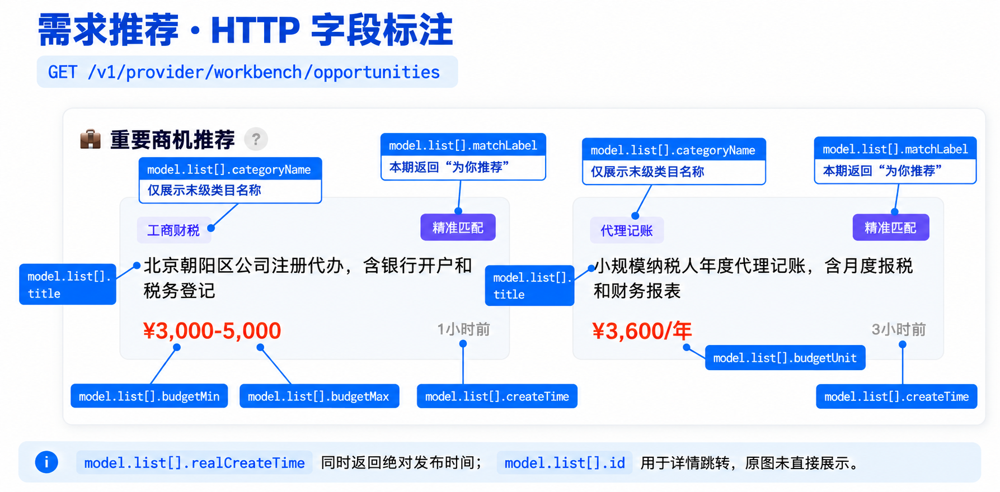

# REQ\-132 服务商工作台\-技术方案

工作台按售后、订单、消息、需求分别获取；进行中订单沿用原统计接口。下表链接已通过 Apifox MCP 核对，属于「万大圣」项目主分支（2026\-10\-22）。

|用途|HTTP 接口|Apifox|
|---|---|---|
|售后动态|`GET /v1/provider/workbench/after-sales`|[查看接口](https://app.apifox.com/link/project/8677491/apis/api-527558245)|
|订单动态|`GET /v1/provider/workbench/orders`|[查看接口](https://app.apifox.com/link/project/8677491/apis/api-527558248)|
|消息未读数量|`GET /v1/provider/workbench/messages`|[查看接口](https://app.apifox.com/link/project/8677491/apis/api-527558246)|
|需求推荐|`GET /v1/provider/workbench/opportunities`|[查看接口](https://app.apifox.com/link/project/8677491/apis/api-527558247)|
|进行中订单统计（沿用）|`GET /v1/provider/statistics`|[查看接口](https://app.apifox.com/link/project/8677491/apis/api-497663520)|

四个新接口已注册路由，当前仅返回 HTTP `501`，尚未接入业务取数。Apifox 尚未同步三个列表的 `page/pageSize`，需求类目仍为旧字段 `fullCategoryName`；最新契约以 `esp-api:api/v1/provider_workbench_vo.go`、`esp-api:internal/handler/provider_workbench_handler.go` 及下文为准。

- 入参：均传 `providerId`，接入时校验登录身份及服务商权限；商机、订单、售后仅认证通过时展示。

- 分页：需求、订单、售后使用 `int32` 的 `page`（默认 `1`，最小 `1`）和 `pageSize`（默认 `6`，范围 `1～6`）；消息不分页。无匹配时 `total=0/list=[]`，超出末页时 `list=[]`，`total` 仍为全量数。

- 响应：`model` 直接承载业务字段；失败使用外层 `succeed=false/code/message`，`model=null`。ID 为字符串，计数为 `int64`，原统计 `num` 保持字符串。页面可并行请求，失败分别处理。

- 标注：图中字段从 `model` 开始，表中字段相对 `model`；原型编号与旧文案仅示意。

## 一、售后（`after-sales`）

原图“更新于”按 `model.list[].applyTime` 发起时间展示，非状态更新时间。

### 接口与入参

HTTP：`GET /v1/provider/workbench/after-sales`。复用 `ListNormalAfterSales`，已有分页能力；组合筛选 `101` 待定义和实现。数据来自售后单及异常售后、阶段退款关联表。

|HTTP 入参／内部条件|gRPC 映射与传值|
|---|---|
|`providerId`|校验归属后传 `provider_id`|
|`page` / `pageSize`|分别转 `int64`，传 `page` / `page_size`|
|待办范围|`after_sale_status=101`：待处理 \+ 待提交交付物（拟定组合值）|
|保留平台介入记录|`show_normal_status_transferred_to=true`|
|客服范围|`provider_account_id` 暂不传，过滤规则待确认|

### 返回字段

|HTTP 字段|中文含义|gRPC 来源|取值／处理|
|---|---|---|---|
|`total`|售后待办总数|`total`|同一筛选条件的分页前全量数量|
|`list[]`|售后动态列表|`list[]`|当前页最多 `pageSize` 条，页面默认展示 2 条|
|`list[].afterSaleId` / `list[].orderId`|售后编号／订单 ID|`after_sale_id` / `order_id`|原 ID 转字符串|
|`list[].goodsName`|服务名称|`goods_name`|售后快照名称原值|
|`list[].employerName`|雇主名称|`employer_name`|售后单中的雇主名称快照原值|
|`list[].afterSaleType` / `list[].afterSaleTypeCode`|售后类型／类型编码|`after_sale_type` / `after_sale_type_code`|均为 `int32`；`0` 未指定、`1` 仅退款、`2` 仅返工、`3` 退款\+返工|
|`list[].applyTime`|发起时间|`apply_time`|北京时间 `yyyy-MM-dd HH:mm:ss`|
|`list[].afterSaleStatus` / `list[].afterSaleStatusText`|售后展示状态／文案|`after_sale_status` / `after_sale_status_text`|服务端派生的真实 `int32` 状态及文案|
|`list[].exceptionAfterSaleStatus` / `list[].exceptionAfterSaleStatusText`|平台介入子状态／文案|`exception_after_sale_status` / `exception_after_sale_status_text`|保留 `int32` 状态及原文案|

### 处理规则

- 按 `apply_time DESC` 展示；`101` 只作查询组合值，卡片使用真实状态。

- 待交付包含修改中、验收驳回及平台介入下对应场景；组合筛选由 gRPC 实现。

## 二、订单（`orders`）

保证金卡使用 `model.list[].orderCreateTime`，交付卡使用 `model.list[].actionChangedAt`，时间格式按字段表；进行中总数来自原统计接口。

### 接口与入参

HTTP：`GET /v1/provider/workbench/orders`。`ListProviderWorkbenchOrderDynamics` 对接契约已提供，本地 Proto／依赖待同步；附件仅有 `limit`（默认及最大为 `6`），无 `page/offset/cursor`，翻页能力待下游补齐。

|HTTP 入参／内部条件|gRPC 映射与传值|
|---|---|
|`providerId`|校验归属后传正 `int64` 的 `provider_id`|
|`page`|目标页码；现有契约无页定位字段，待下游补齐|
|`pageSize`|目标每页条数，与现有 `limit` 的 `1～6` 范围一致；完整映射待下游确认|
|客服范围|`provider_account_id` 仅由可信登录身份解析：已验证主账号传 `0`，客服传实际账号 ID|

### 返回字段

|HTTP 字段|中文含义|gRPC 来源|取值／处理|
|---|---|---|---|
|`pendingBondCount` / `pendingDeliveryCount`|待缴保证金数／待交付数|`pending_bond_count` / `pending_delivery_count`|两类分页前完整统计，沿用 REQ\-129|
|`total`|订单待办总数|`total`|两类按订单 ID 去重后的全量并集，不受分页限制|
|`list[]`|订单动态列表|`list[]`|目标为当前页最多 `pageSize` 个不同订单，每订单保留最新有效待办；依赖下游分页|
|`list[].orderId` / `list[].orderNo`|订单 ID／编号|`order_id` / `order_no`|ID 转字符串；编号当前同订单 ID 字符串|
|`list[].goodsName` / `list[].employerName`|服务名称／雇主名称|`service_name` / `employer_name`|原值|
|`list[].todoType` / `list[].todoText`|待办类型／标签|`pending_category`|`PENDING_BOND_PAYMENT` → `payBond`／“待缴履约保证金”；`PENDING_DELIVERY` → `submitDelivery`／“待提交交付物”|
|`list[].rejected`|是否驳回等需重新提交|`is_acceptance_rejected`|原布尔值|
|`list[].bondAmount` / `list[].orderAmount`|保证金／订单实付金额|`bond_amount` / `order_amount`|两金额均返回；分字符串精确转元、固定两位，如 `"50000"` → `"500.00"`，不使用浮点数|
|`list[].orderCreateTime`|订单创建时间|`order_create_time`|RFC3339 转北京时间 `yyyy-MM-dd HH:mm:ss`|
|`list[].actionChangedAt`|当前待办生效时间|`action_changed_at`|同上；历史未知保留空串，不用其他时间填充|
|`list[].actionTarget.source` / `list[].actionTarget.action`|待办来源／动作|`action_target.source` / `action_target.action`|订单缴保证金 `ORDER/PAY_BOND`；阶段交付 `ORDER_STAGE/SUBMIT_DELIVERY`；售后返工 `AFTER_SALE_REWORK/SUBMIT_DELIVERY`|
|`list[].actionTarget.stageId` / `list[].actionTarget.afterSaleId`|阶段 ID／售后单 ID|`action_target.stage_id` / `action_target.after_sale_id`|转字符串，无关联为 `"0"`；客户端据业务标识跳转，不返回 URL|

进行中订单总数继续调用原 `GET /v1/provider/statistics`，取完整路径 `model.list[type=ongoingOpportunities].num`：源于 `ProviderStatistics.ongoingOpportunities`，原值为字符串，保持服务商全量统计，不按客服过滤；不在新订单响应中增加统计字段。

### 处理规则

- 主账号／客服身份必须先验证，账号解析失败不能回退为主账号 `0`。动态按账号权限取数，原进行中总数仍为服务商范围。

- 下游先按订单确定最新有效待办、去重及按 `action_changed_at DESC, order_id DESC` 排序，再分页；两分类计数及 `total` 保持全量，不以子项之和或列表长度替代。

- 订单 RPC 补齐分页契约前不能翻页，BFF 不截取现有最多 6 条模拟后续页。

## 三、消息（`messages`）

### 接口与入参

HTTP：`GET /v1/provider/workbench/messages`，只传 `providerId`，不分页。复用 `Notify.GetInAppUnreadCount`。数据表为 `esp_notify_inapp_notifications`，统计未读记录（`read=0`）。

|HTTP 入参／内部条件|gRPC 映射与传值|
|---|---|
|`providerId`|校验归属后作为 `external_id`，保留字符串|
|消息来源|`external_type="esp"`|
|分类范围|`tab=""`，一次取全部分类|

### 返回字段

|HTTP 字段|中文含义|gRPC 来源|取值／处理|
|---|---|---|---|
|`total`|总未读数|`total`|当前服务商全部分类未读计数|
|`byTab.service`|服务通知未读数|`by_tab["service"]`|按分类取值，缺项补 `0`|
|`byTab.transaction`|交易消息未读数|`by_tab["transaction"]`|同上|
|`byTab.aftersale`|售后消息未读数|`by_tab["aftersale"]`|同上|
|`byTab.system`|系统通知未读数|`by_tab["system"]`|同上|

### 处理规则

- 使用未读计数 RPC，不使用消息列表接口的消息总条数。

- 某分类未读数为 `0` 时禁用对应“去处理”按钮。

## 四、需求（`opportunities`）

原图“精准匹配”改为 `model.list[].matchLabel="为你推荐"`，类目展示使用末级名称 `model.list[].categoryName`。

### 接口与入参

HTTP：`GET /v1/provider/workbench/opportunities`。先调 `ListProviderProductCategories`，再调已有分页能力的 `SearchTaskHallDemandsByMultipleConditions`。已上架服务类目来自产品／类目表，需求实际检索 ES 索引（源表 `esp_demand`）。

|HTTP 入参／内部条件|gRPC 映射与传值|
|---|---|
|`providerId`|校验归属后传类目 RPC 的 `provider_id`|
|`page` / `pageSize`|保留 `int32`，分别传检索 RPC 的 `page` / `page_size`|
|匹配类目|按现有逻辑展开 `pairs[].category_id/category_level` 为检索 `categories[]`，类目 ID 转字符串|
|关键词、地区、预算、周期|均不传；可选参数不补 `0`|

### 返回字段

|HTTP 字段|中文含义|gRPC 来源|取值／处理|
|---|---|---|---|
|`total`|匹配需求总数|`total`|同一条件在分页前的 ES 全量命中数|
|`list[]`|推荐需求列表|`demands[]`|当前页最多 `pageSize` 条|
|`list[].id` / `list[].title`|需求 ID／标题|`demands[].id` / `title`|ID 转字符串，标题原值|
|`list[].categoryId` / `list[].categoryLevel`|类目 ID／层级|`demands[].categoryId` / `categoryLevel`|原值，ID 为字符串|
|`list[].categoryPath`|完整类目名称路径|按 `categoryId` 补齐|复用类目缓存，根到叶排列；无路径时为空数组|
|`list[].categoryName`|末级类目名称|`categoryPath` 最后一项|例如“数据标注与清洗”；无路径时为空字符串|
|`list[].budgetMin` / `list[].budgetMax` / `list[].budgetUnit`|预算下限／上限／单位|`demands[].budgetMin` / `budgetMax` / `budgetUnit`|金额已由 gRPC 转为元，不再除以 `100`；单位原字符串|
|`list[].deliveryCycleMin` / `list[].deliveryCycleMax` / `list[].deliveryCycleUnit`|周期下限／上限／单位|`demands[].deliveryCycleMin` / `deliveryCycleMax` / `deliveryCycleUnit`|上下限保留 `null`；单位原字符串，如自然日|
|`list[].realCreateTime`|发布时间|`demands[].createTime`|Unix 秒转北京时间 `yyyy-MM-dd HH:mm:ss`|
|`list[].createTime`|发布时间文案|同一 `demands[].createTime`|复用 `helper.DisplayTime`，如刚刚、3分钟前、日期|
|`list[].matchLabel`|推荐标签|BFF 固定文案|“为你推荐”|

### 处理规则

- 没有已上架服务类目时直接返回 `total=0/list=[]`，不以空类目查询全大厅。

- 仅按类目匹配，按 `create_time DESC, id DESC` 排序；双时间来自同一时间戳。

