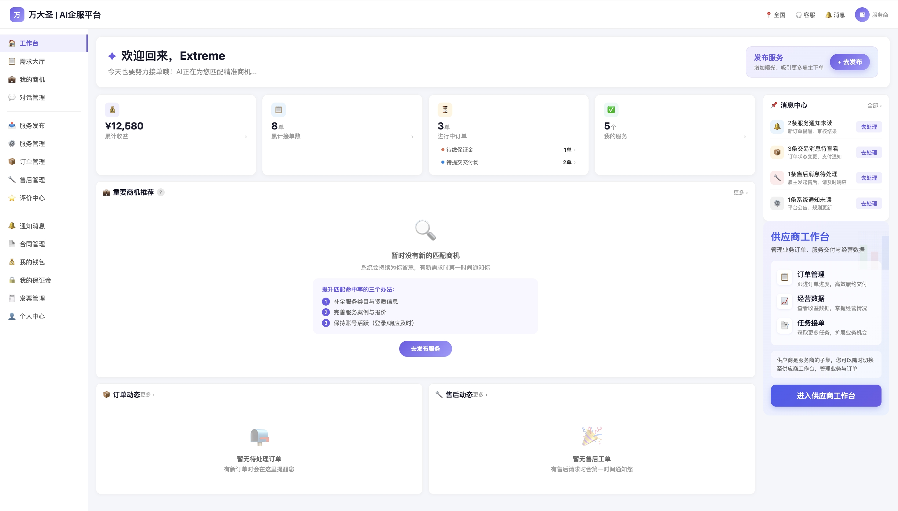
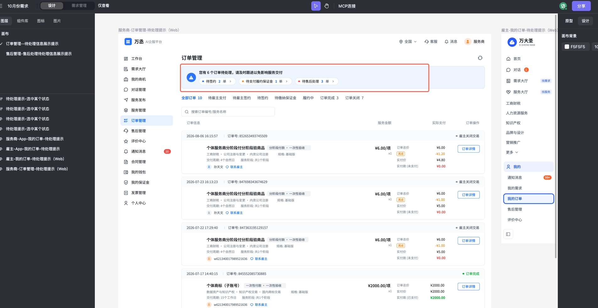
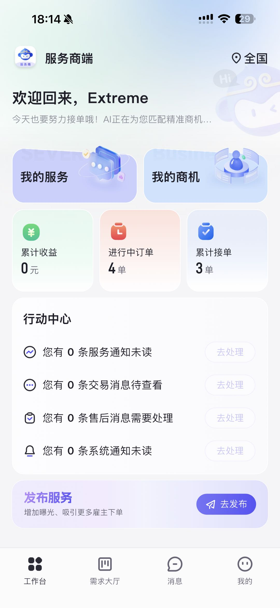
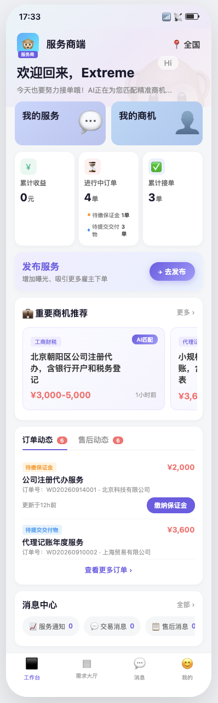
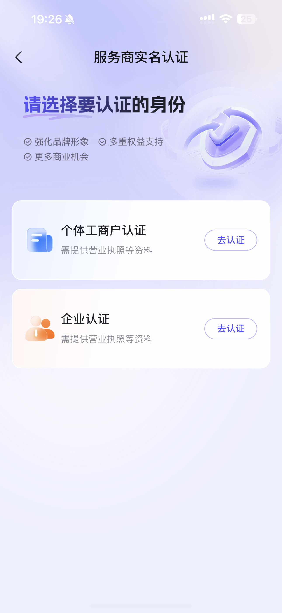

# REQ\-132 服务商工作台展示订单/售后动态

# 项目信息

1. 项目名称：服务商工作台订单/售后动态及商机推荐

2. 需求编号：REQ\-132

3. 云效ID：RZMP\-9033

4. 产品经理：傅杰彬

# 文档版本

|版本号|变更时间|变更内容|
|---|---|---|
|V1\.0|2026\.09\.18|新建：服务商工作台订单动态、售后动态、商机推荐及整体布局最终方案|

# 需求背景\&目标

## **背景：**

服务商工作台当前信息展示不足，服务商难以及时掌握订单履约进展、售后反馈及高价值商机，导致响应滞后、错失接单机会。

## **目标：**

在工作台聚合展示订单动态、售后动态及重要商机推荐，帮助服务商快速处理待办事项、提升履约效率与接单转化。

## **需求痛点：**

1. 服务商需多次跳转订单管理、售后管理等页面才能了解待处理事项，操作路径长；

2. 订单关键节点（缴纳保证金、提交交付物）缺乏醒目提示，易导致履约超时；

3. 售后工单缺乏工作台入口提醒，24小时响应时效难以保障；

4. 高匹配度商机缺乏主动推荐，服务商错失接单机会。

## **业务价值：**

1. 提升服务商履约效率，降低订单超时率；

2. 保障售后响应时效，提升雇主满意度；

3. 提高商机匹配转化率，增加服务商接单量与平台交易额。

# 名词解释

|名词|释义|
|---|---|
|服务商|在万大圣平台注册并提供企业服务的供应商主体|
|履约保证金|服务商接单后需缴纳的保证金，用于保障订单履约|
|提交验收|服务商完成服务后向雇主提交验收申请的操作|
|验收驳回|雇主对服务商提交的验收申请不予通过，需服务商整改后重新提交|
|售后工单|雇主发起的售后诉求，需服务商在24小时内响应处理|
|商机|平台基于服务商类目匹配等维度推荐的高匹配度需求|
|行动中心|服务商工作台现有模块，聚合服务通知、交易消息、售后消息、系统通知等待办|

# 需求概述

## 需求范围

**本期功能列表：**

1. 服务商工作台新增「订单动态」模块，展示待缴纳履约保证金、待提交交付物（含多次验收及验收驳回）的订单信息并可跳转；

2. 服务商工作台新增「售后动态」模块，展示需服务商处理的售后工单信息；

3. 服务商工作台新增「重要商机推荐」模块，展示基于类目匹配的高匹配度需求卡片；

4. 订单动态、售后动态、重要商机推荐各模块支持按更新时间倒序排列、点击进入详情页、「查看更多」入口；

5. 发布服务独立单独模块；

6. 进行中订单卡片增加缴纳保证金、待提交交付物状态；

7. Web端与APP端展示内容、排序逻辑、交互流程保持一致。

## 需求影响

### **影响业务范围：**

- 服务商订单履约流程（保证金缴纳、验收提交）

- 服务商售后处理流程

- 服务商商机获取与接单流程

### **影响系统范围：**

- 服务商工作台（Web \+ APP）

- 进行中订单卡片

- 订单管理模块

- 售后管理模块

- 商机/需求推荐模块

- 行动中心模块

- 发布服务模块

- 通知消息

## Web端需求详述

### 整体方案说明

在服务商工作台首页，于现有「行动中心」模块下方新增三个动态模块：重要商机推荐、订单动态、售后动态。各模块数据分别来源于当前订单管理系统、售后管理系统、商机推荐系统，模块内容按更新时间倒序展示，支持点击跳转详情页及「查看更多」进入完整列表页；进行中订单增加待缴纳保证金、待提交交付物订单数据展示及跳转；发布服务独立，行动中心移至右上角改名消息中心。

### 业务流程图

**进行中订单业务流程：**

1. 服务商登录工作台 → 系统自动拉取当前订单待缴纳保证金、待提交交付物状态及订单数；

2. 点击「待缴纳保证金」→ 跳转订单列表页并筛选待缴纳保证金订单；（待缴纳保证金 tab）

3. 点击「待提交交付物」→ 跳转订单列表页并筛选待提交交付物订单；（对接天保新功能）

**订单动态业务流程：**

1. 服务商登录工作台 → 系统自动拉取当前服务商待处理订单；

2. 订单状态为「待缴纳保证金」→ 展示订单信息 \+ 「缴纳保证金」按钮；

3. 点击「缴纳保证金」→ 跳转订单详情页；

4. 订单状态为「履约中（待提交交付物）」→ 展示订单信息 \+ 「提交交付物」按钮；

（对接天保新功能，增加 待提交交付物 状态）

5. 点击「提交交付物」→ 跳转对应订单详情页；

6. 点击「查看更多」→ 跳转订单管理列表页。

**售后动态业务流程：**

1. 服务商登录工作台 → 系统自动拉取当前服务商待处理售后工单；

2. 展示售后工单信息 \+ 「售后处理」按钮；

3. 点击「售后处理」→ 跳转对应售后详情页；

4. 点击「查看更多」→ 跳转售后管理列表页。

**商机推荐业务流程：**

1. 服务商登录工作台 → 系统基于服务商类目匹配等维度推送高匹配度需求；

2. 展示需求信息卡片（需求标题、预算、周期、类目等）；

3. 点击需求卡片 → 跳转需求详情页；

4. 点击「查看更多」→ 跳转「我的商机」列表页。

### 5\.3\.3 功能结构图

服务商工作台新增模块结构如下：

- 订单动态模块

    - 待缴纳保证金订单卡片

    - 待提交交付物订单卡片（含验收驳回标识）

    - 查看更多入口

- 售后动态模块

    - 待处理售后工单卡片

    - 查看更多入口

- 重要商机推荐模块

    - 高匹配度需求卡片

    - 查看更多入口

- 进行中订单

    - 待缴纳保证金

    - 待提交交付物

## 需求规则说明

### 触发条件/前置条件

- 服务商已登录平台并进入工作台页面；

- 服务商账号状态正常（非封禁、非注销）；

- 订单动态：当前服务商存在状态为「待缴纳保证金」或「待提交交付物」的订单；

- 售后动态：当前服务商存在待处理状态的售后工单；

- 商机推荐：平台存在与服务商类目匹配的有效需求（先保持当前匹配规则）。

### 业务规则

#### 订单动态规则

**展示内容：**

|订单状态|展示信息|操作按钮|
|---|---|---|
|待缴纳履约保证金|订单编号、服务名称、雇主名称、保证金金额、订单创建时间|「缴纳保证金」按钮 |
|待提交交付物 |订单编号、服务名称、雇主名称、订单金额|「提交交付物」按钮 |

**排序规则：**按状态更新时间倒序 

**展示数量：**工作台默认展示最多2条，超过2条支持上下滑动，最多不超过6条，通过「查看更多」进入订单列表页查看全部。

**空状态：**无待处理订单时，模块展示空状态提示「

暂无待处理订单

有新订单时会在这里提醒您」，保留展示「查看更多」入口，区域保持2条数据的一致高度。

**按钮交互：**

- 「缴纳保证金」：点击后跳转对应订单详情，用户在详情页点击缴纳保证金按钮跳转后页面定位到缴纳保证金按钮区域）；

- 「提交交付物」：点击后跳转对应订单详情页，定位至提交交付物区域；

- 订单卡片其他区域点击：均跳转对应订单详情页。

#### 售后动态规则

**展示内容：**

|字段|说明|
|---|---|
|售后编号|售后工单唯一编号|
|关联订单|售后对应的订单编号及服务名称|
|售后类型|仅返工、仅退款、退款\+返工（以后台枚举为准）|
|发起时间|雇主发起售后的时间|

**排序规则：**按售后工单发起时间倒序**；**

**展示数量：**工作台默认展示最多2条，超出6条，通过「查看更多」进入售后管理列表页查看。

**空状态：**无待处理售后时，模块展示空状态提示「

暂无待处理售后

有售后请求时会第一时间通知您」，保持展示「查看更多」入口，区域保持2条数据的一致高度。

**按钮交互：**

- 「售后处理」按钮：点击后跳转对应售后详情页；

- 售后卡片其他区域点击：均跳转对应售后详情页。

#### 重要商机推荐规则

**推荐维度：**本期保持基于服务商已发布服务的类目匹配进行推荐，后续可扩展更多匹配维度（如地域、预算、历史成交类目等）。

**展示内容：**

|字段|说明|
|---|---|
|需求标题|雇主发布的需求标题|
|需求类目|需求所属服务类目|
|预算范围|雇主设定的预算金额区间|
|需求周期|雇主要求的服务周期|
|发布时间|需求发布时间|
|匹配度标识|高匹配度需求展示「精准匹配」标签|

**排序规则：**按需求发布时间倒序排列，最新发布的需求排在最前。

**展示数量：**工作台默认展示1行高匹配度需求（根据展示3到4个，超过3个可左右滑动，数据不超过6个），通过「查看更多」进入「我的商机」列表页查看所有。

**空状态：**无匹配商机时，模块展示空状态提示「

暂时没有新的匹配商机。系统会持续为你留意，有新需求时第一时间通知你。

提升匹配命中率的三个办法：

① 补全服务类目与资质信息

② 完善服务案例与报价

③ 保持账号活跃（登录/响应及时）

」，并提供「去发布服务」按钮引导发布服务，区域保持一致高度和宽度。

**卡片交互：**鼠标hover展示查看详情、立即抢单按钮，保持与当前商机的功能一致，点击查看详情点击跳转需求详情页，点击立即抢单弹出立即报价弹窗。

#### 行动中心规则

- 行动中心位置移至右上角，保留现有的功能；

- 独立出来发布服务按钮，功能不变；

- 「去处理」按钮如无消息情况下不可点击；

#### 展示与交互通用规则

1. Web端与APP端展示内容、排序逻辑、交互流程保持一致；

2. 各模块右上角支持「查看更多」入口，点击进入对应完整列表页；

3. 各模块支持手动刷新，刷新后重新拉取最新数据；

4. 模块标题旁展示待处理数量角标（如订单动态展示待处理订单总数）；

5. 数据实时性：页面加载时拉取最新数据，后续每5分钟自动刷新一次，或服务商手动刷新。

6. 发布服务按钮经可能强化突出；

### 后置条件/输出

- 服务商通过工作台动态模块快速定位并处理待办订单/售后，提升处理效率；

- 服务商通过商机推荐模块获取高匹配度需求，提升接单转化率；

- 点击操作后跳转至对应详情页/列表页，完成具体业务操作。

### 其他规则要求

数字边界：各模块默认展示数量（订单/售后最多6条，商机最多6条）、数据刷新频率（5分钟自动刷新）。

涉及多角色权限的：本模块仅展示当前登录服务商自身的订单/售后/商机数据，不涉及跨服务商数据权限。

## 功能清单

|模块|功能点|说明|
|---|---|---|
|进行中订单|增加履约缴保证金数据及跳转|展示 待缴保证金订单数，点击跳转对应列并筛选待缴保证金订单|
||增加提交交付物数据展示及跳转|展示待提交交付物订单数，点击跳转对应列并筛选待提交交付物订单|
|订单动态|待缴纳保证金订单展示|展示未缴纳保证金的订单信息及缴纳按钮|
||待提交交付物订单展示 |展示履约中（待提交交付物）订单（含多次验收及验收驳回信息）及提交按钮|
||订单详情跳转|点击订单卡片或按钮跳转订单详情页|
||查看更多|跳转订单管理完整列表页|
|售后动态 |待处理售后展示|展示需服务商处理的售后工单信息|
||售后详情跳转|点击售后卡片或按钮跳转售后详情页|
||查看更多|跳转售后管理完整列表页|
|重要商机推荐|高匹配度需求展示|基于类目匹配推荐需求信息卡片|
||需求详情跳转|点击需求卡片跳转需求详情页|
||查看更多|跳转「我的商机」完整列表页|
|通用能力|数据刷新|手动刷新 \+ 5分钟自动刷新|
|空状态展示|无数据时展示对应空状态提示及引导操作||

## 功能说明（产品原型设计及说明）

### 原型图

调整前

调整后

发布按钮UI方面尽量强化明显些；

空状态

商机推荐提示文案

点击“缴纳保证金”按钮进入订单详情缴纳保证金

点击“提交交付物”按钮进入订单详情提交交付物：

进行中订单开票点击“待提交交付物”状态落地天保当前在做的新功能页面筛选待提交交付物

售后动态点击“去处理”按钮进入售后详情页：

### 信息

**核心布局：**

通栏欢迎语（右侧发布服务） \+ 分栏内容（中间指标/商机推荐/订单/售后 \+右侧消息中心/供应商）。

**模块标题栏：**

- 左侧：模块名称 \+ 待处理数量角标（如「订单动态 \(3\)」）

- 右侧：「查看更多」文字链接 \+ 刷新图标按钮

**订单动态卡片信息元素：**

- 订单状态标签（待缴纳保证金/待提交交付物，不同颜色区分）

- 服务名称（主标题，最多20字符，超出省略）

- 订单编号（次要信息）

- 雇主名称（次要信息）

- 关键金额（保证金金额/订单金额）

- 时间信息（更新于xx时间前：1小时以内按分钟，文案：更新于xx分钟前，超过1小时算1小时，文案：更新于xx小时前，超过24小时算1天，文案：展示与xx天前） 

- 操作按钮（右侧固定，「缴纳保证金」/「提交交付物」）

**售后动态卡片信息元素：**

- 售后类型标签

- 售后编号（主标题）

- 关联订单服务名称（次要信息）

- 发起时间（更新于xx时间前：1小时以内按分钟，文案：更新于xx分钟前，超过1小时算1小时，文案：更新于xx小时前，超过24小时算1天，文案：展示与xx天前） 

- 操作按钮（右侧固定，「售后处理」）

**商机推荐卡片信息元素：**

- 「精准匹配」标签（右上角）

- 需求标题（主标题，最多24字符，超出省略）

- 需求类目（标签形式）

- 预算范围

- 需求周期

- 发布时间（更新于xx时间前：1小时以内按分钟，文案：更新于xx分钟前，超过1小时算1小时，文案：更新于xx小时前，超过24小时算1天，文案：展示与xx天前） 

### 交互与体验

|子项|说明|
|---|---|
|原型链接|可执行HTML原型文件： [provider\_dashboard\_empty\.html](图片和附件/provider_dashboard_empty.html) [provider\_dashboard\_prototype\.html](图片和附件/provider_dashboard_prototype.html)|
|页面流程|工作台 → 点击进行中订单 → 订单列表页对应状态； 工作台 → 点击订单卡片/按钮 → 订单详情页； 工作台 → 点击「查看更多」→ 订单列表页； 工作台 → 点击售后卡片/按钮 → 售后详情页； 工作台 → 点击商机卡片 → 需求详情页 工作台 → 去发布服务 → 发布服务|
|交互说明|订单状态、售后状态、推荐商机空状态：插画 \+ 提示文案 \+ 引导按钮 顶部「成为供应商」/「进入供应商」引导条：hover展示卡片，点击进入对应申请入驻或供应商工作台页面； 商机模块：保持与现有的功能一致，鼠标hover展示「查看详情」和「立即抢单」按钮。|
|Toast / 弹窗文案|数据加载失败：「数据加载失败，请稍后重试」\+ 重试按钮；|

### 状态

**订单状态（本模块涉及）：**

- 待缴纳保证金：订单已生成，服务商需缴纳保证金后开始履约

- 待提交交付物：服务商履约中，完成服务后向雇主提交交付物申请

- 验收驳回：雇主驳回验收申请，服务商需整改后重新提交（归属于「待提交交付物」分类，展示驳回标识）

**售后状态（本模块涉及）：**

- 待处理：雇主已发起售后，服务商尚未响应处理

**模块自身状态：**

- 加载中：骨架屏展示

- 有数据：正常展示卡片列表

- 空数据：空状态插画 \+ 提示文案

- 加载失败：错误提示 \+ 重试按钮

### 数据来源

|数据项|数据来源|
|---|---|
|订单动态数据|订单管理系统，按服务商ID \+ 订单状态（待缴纳保证金、待提交交付物）筛选，不展示其他状态|
|售后动态数据|售后管理系统，按服务商ID \+ 售后状态（待处理）筛选，不展示其他状态|
|商机推荐数据|需求/商机推荐系统，基于服务商类目匹配算法返回高匹配度需求|
|待处理数量角标|各系统对应状态的计数接口|

**根据当前订单状态定义读取规则**

|**模块**|**对应取值规则**|
|---|---|
|**订单动态\-待缴纳保证金**|状态取值当前订单状态为待缴纳保证金的状态；|
|**订单动态\-待提交交付物** |订单状态维度：订单状态为履约中且阶段状态为履约中/验收驳回； 售后单状态：售后状态为修改中/验收驳回或 平台介入\-修改中/验收驳回；|
|**售后动态**|售后状态为待处理； 售后单类型涉及所有类型：仅返工、仅退款、退款\+返工（包括平台介入下 仅返工、仅退款、退款\+返工）|

### 异常情况

1. **接口超时/失败：**展示错误状态「数据加载失败」，提供「重试」按钮，不影响其他模块正常展示；

2. **订单状态实时变更：**服务商处理订单后，手动刷新或等待5分钟自动刷新后更新列表；若订单已处理完毕，从动态列表中移除；

3. **~~售后响应超时：~~**~~剩余响应时间不足4小时时标红提醒，超时后售后状态变更为「平台介入中」，从待处理列表移除；~~

4. **商机需求已被承接：**需求被其他服务商承接后，从推荐列表中移除，刷新后不再展示；

5. **服务商未发布任何服务：**商机推荐模块展示空状态，引导服务商「去发布服务」。

6. 服务商禁用商机处理：信用分禁用服务商情况下，接单流程保持与信用分需求一致。

## 非功能需求

### 接口需求

- 订单服务：按服务商ID \+ 状态查询订单列表接口

- 售后服务：按服务商ID \+ 状态查询售后工单列表接口

- 商机推荐服务：按服务商ID推荐高匹配度需求接口

### 性能需求

- 工作台动态聚合接口响应时间不超过2秒；

- 支持并发量：满足按当前服务商活跃用户数；

- 数据刷新频率：前端5分钟自动刷新，不强制实时推送；（推荐商机、订单动态、售后动态）

- 接口超时降级：单个下游接口超时（超过1\.5秒）时，对应模块展示加载失败状态，不影响其他模块正常展示。（以研发为准）

### 依赖与风险

|子项|说明|
|---|---|
|接口依赖|订单服务、售后服务、商机推荐服务需提供对应查询接口|
|已知风险|1\. 商机推荐算法尚不完善，初期仅基于类目匹配，推荐精准度可能不足 概率：高，影响：中，应对：初期标注「为你推荐」而非「精准匹配」，后续迭代优化算法及体现AI匹配）； 2\. APP端发版周期影响上线时间 概率：中，影响：中，应对：争取同步上线，如不可，Web端先行上线，APP端随版本迭代； 3\. 与行动中心信息重复可能导致服务商困惑 概率：中，影响：低，应对：明确模块定位差异，行动中心偏消息通知，动态模块偏业务详情入口|

# App端需求详述

## 功能

功能与Web保持一致

## 交互

|子项|说明|
|---|---|
|原型链接|可执行HTML： 非空状态：[provider\_app\_prototype\_lite\.html](图片和附件/provider_app_prototype_lite.html) 空状态：[provider\_app\_empty\.html](图片和附件/provider_app_empty.html) |
|功能入口卡片|点击按压缩放效果，跳转对应列表页|
|指标卡片|点击跳转对应数据详情页|
|消息中心|可左右滑动查看不同消息类型；有数据时数据紫色高亮，无数据时灰色；点击消息按钮跳转对应通知列表|
|缴纳保证金|点击直接跳转支付页面（App内唤起支付）|
|更多链接|各模块右上角"更多 ›"跳转对应列表页|
|底部Tab|固定底部，点击切换页面，当前工作台为选中状态（紫色）|
|页面滚动|单列纵向滚动，底部Tab始终固定可见|
|下拉刷新|支持下拉刷新，重新加载所有模块数据|

## **原型**

调整前

调整后

- 行动中心调整为横向展示，点击直接跳转对应的消息通知页面

- 推荐商机支持左右滑动，最多不超过6条，点击查看更多查看全部

空状态：

商机推荐提示文案：

# Web消息处理按钮展示优化

**行动中心消息跳转优化**

无消息【去处理】按钮禁用，跟App对齐

# Web/App未认证供应商页面展示调整

**服务商未认证情况下**

- 平台兜底接单流程图展示

    - 未认证情况下推荐商机、订单动态、售后单动态模块不展示，展示平台兜底图（UI重新设计）

- 右下角卡片更新新的文案（如下图），点击“”跳转认证服务商页

**服务商认证后**

- 认证后展示“了解服务商接单规则”，点击展示图片弹窗，可关闭图片

原型示例

Web跳转认证服务商页

App跳转认证服务商页

# 相关文档

## **MRD及需求沟通记录**

[十月需求规则](https://wanlianyida.feishu.cn/wiki/WMJHwbhXlipMonk2C7Yc4Ac9nqb)

[1022需求MRD了解及澄清](https://wanlianyida.feishu.cn/wiki/QLAtwk9neizbunkZArMclCRDn3e)

**内审后与闫婧沟通需求方案：**

* [x] 行动中心与动态有不一致及重合，是否增加订单、售后的其他动态，行动中心是否去掉 订单、售后消息？——先保持行动中心现有消息，名字使用消息中心——没问题

* [x] 发布服务单独提出来，与App相似——没问题

* [x] 目前订单动态、售后动态的数据与行动中心订单、售后发送消息会不一样；——没问题

* [x] 待提交验收 保持 与当前订单状态名称一致 ：状态：履约中  操作名称：提交交付物——没问题

* [x] 订单动态、售后动态调整至右侧，保留供应商后台卡片

* [x] 动态内 信息排序，按照状态更新时间倒序——没问题

## **相关功能文档**

[PRD\-履约保证金](https://wanlianyida.feishu.cn/wiki/HoqiwSWrGi8ClAkx9JacUNthn6f)

履约保证金24小时不支付履约保证金、订单自动关闭。

[售后](https://doc.weixin.qq.com/doc/w3_AY0AKgYmAF4CN1QRf1VWNRmCO1L7X?scode=ANMAyAcrABE0a9kY9dAdQAywYXADo)

审核时效：售后申请提交后，商家需在24小时内处理，超时自动通过

订单状态：

https://doc\.weixin\.qq\.com/sheet/e3\_AcMAPwYDAM0CNEKr1crf8R0id3538?scode=ANMAyAcrABEWZOanbEAewABgaGAEQ\&tab=BB08J2

服务商状态新功能PRD：

[REQ\-129 订单列表待处理信息顶部提示 PRD](https://wanlianyida.feishu.cn/wiki/Ncm2w6OIQiHn8nkBNuMct5pZnKf)

[REQ\-128 服务商售后管理待处理信息顶部提示 PRD](https://wanlianyida.feishu.cn/wiki/Wga8wDAyfiajmvkuulqcuctwnke)

## 相关对接人

售后系统研发后端：@苏高峰

