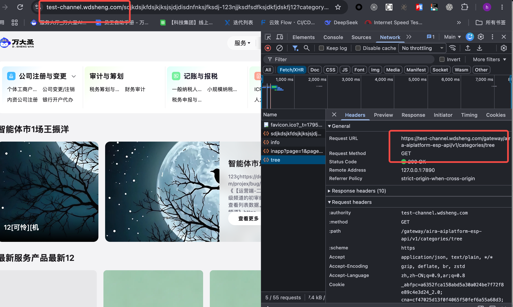

# REQ\-133 二级频道页二次优化\-功能清单

|页面/功能|是否小程序项目已有|工时|备注|人员分配|进度|
|---|---|---|---|---|---|
|二级频道H5页面 11月23日修正，待业务确认 留资表单 按照 web 类似 追加到 二级频道末尾||3d |UI还原\+web逻辑迁移\+~~埋点~~ app内服务详情跳转原生 |王新骏 ||
|服务详情|有|0\.5d |适配app内，浏览器可直接使用，样式适配 |华春风 ||
|引导登陆/注册|有|0\.5d|浏览器可直接使用，样式适配|华春风 ||
|三方应用下载页面|用营销中的页面向外跳转三方链接|0\.5d |应用宝链接 https://microdown\.yyb\.qq\.com/o/simple\.jsp?pkgname=com\.wlit\.esp [https://a\.app\.qq\.com/o/simple\.jsp?pkgname=com\.wlit\.esp](https://a.app.qq.com/o/simple.jsp?pkgname=com.wlit.esp)待确认 ipad浏览器侧效果 如果有问题，同步产品和UI测|华春风 ||
|app端跳转h5||1d|营销位配置的链接跳转（后台配置），和web不同，web是类目跳转 配置是否能跳转，webview是否更换为新版的webview容器，见备注文档链接|华春风 ||
|二次评审新增 11月20日||||||
|服务商详情 |有|0\.5d|浏览器需加上引导app下载以及样式适配 注：有服务商资料，含pdf、图片等显示|华春风 ||
|运营后台限制行数\+配置链接跳转 |后台需增加h5的对应的跳转链接 |1d \+ 1d 开发\+接口联调|运营后台、web主站、移动侧 \+ 接口修改 之前prd说的不跳转，最新的需要跳转 问题：运营后台目前只配置了pc的链接 方案：是否运营后台增加专门的h5的配置字段|王新骏 ||
|流水线dev、test、uat和master||2d|运维测，有问题可咨询一凡老师，需前置|华春风 ||
|域名确认||同步进行|让业务/产品给出对应的域名，待确认 11月23日 和胡老师确认|华春风 ||
|buffer|ipad适配以及其他显示问题 |1d |做h5的时候同步适配 小程序有 rem 转换|华春风/王新骏||
|总记||12||||
|||6||华春风||
|||6||王新俊||

域名确认：

- 重新申请新的域名 m\.wdsheng\.com

注意：

- app内二级频道配置跳转问题

- app对应webview相关文档，有问题可咨询 晨涛老师，[https://codeup\.aliyun\.com/610b3c9d86508f8da8b08436/ai\-platform/es\-app\-main/blob/feature\_2611\_lichentao/docs/integrations/h5/h5\-integration\-guide\.md](https://codeup.aliyun.com/610b3c9d86508f8da8b08436/ai-platform/es-app-main/blob/feature_2611_lichentao/docs/integrations/h5/h5-integration-guide.md)

- 注意：小程序中虽然不做小程序版本的，但是h5链接也是会在微信中打开的，需注意

- 风险点：11月20日晚 prd 中还有业务提出问题，大致流程不更改，下周产品/UI确认

问题：

- 浏览器中 显示 去下载/打开app，无法通过一个状态去判断是否下载app

- 这种情况在app可以知道是否下载，但是浏览器中无法判断是否，方案是顶部显示 横条显示 去打开APP，点击走唤醒app，唤醒时间，唤醒不了走到应用宝的下载页面，也存在唤醒失败的情况，那么也会走到下载页面

- 埋点现在没有，暂不做

- 待明确：app内嵌/浏览器，小程序中打开不考虑

- 待明确：流水线 dev、test、uat、master，域名待业务/产品确认

- 卡片复用 app的

- Ipad 适配

- 白名单，晨涛老师设计方案，暂不考虑这点

进度表：

|日期|功能|进度|备注|
|---|---|---|---|
|11\.23||华春风： 王新俊：||
|11\.24||华春风： 王新俊：||
|11\.25||华春风： 王新俊：||
|11\.26||华春风： 王新俊：||
|11\.27||华春风： 王新俊：||

- 运维测，后续需沟通：

- 域名配置 新的域名 ，比如 h5\.wdsheng\.com，接口也走 h5\.wdsheng\.com/xx/gateway，然后可以 运营配置 走代理走到 真正的接口

- 参考二级频道中，运维测去转发到对应的 dev test uat prod 四个环境上面

    

