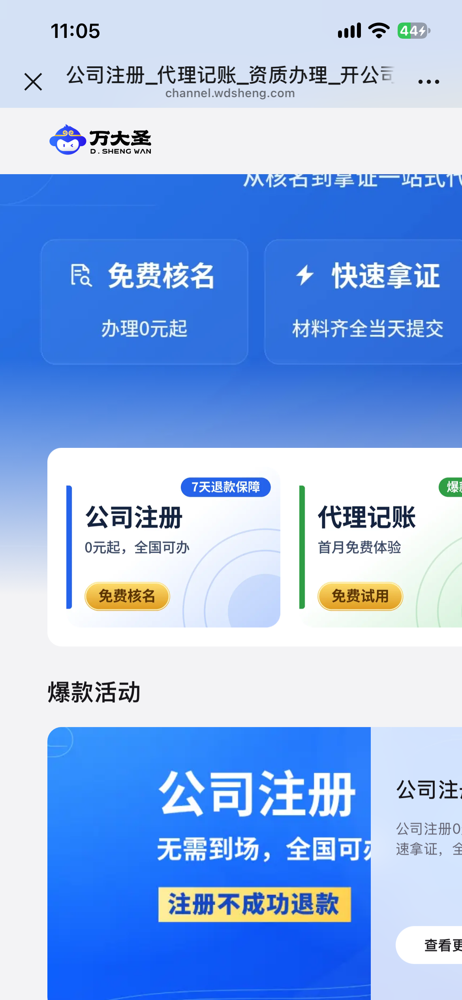
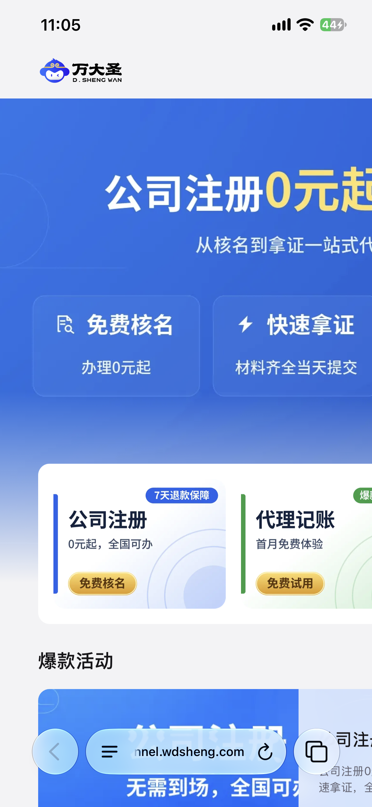
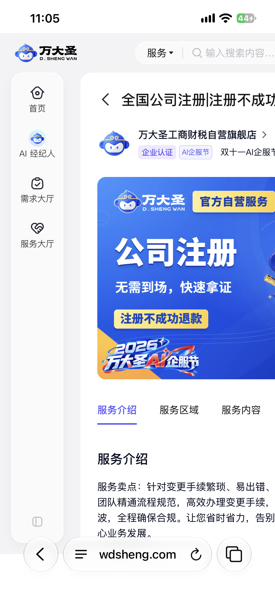
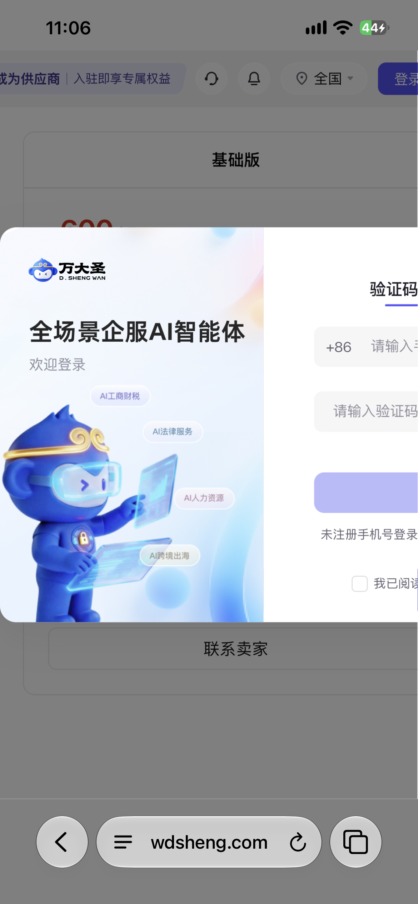
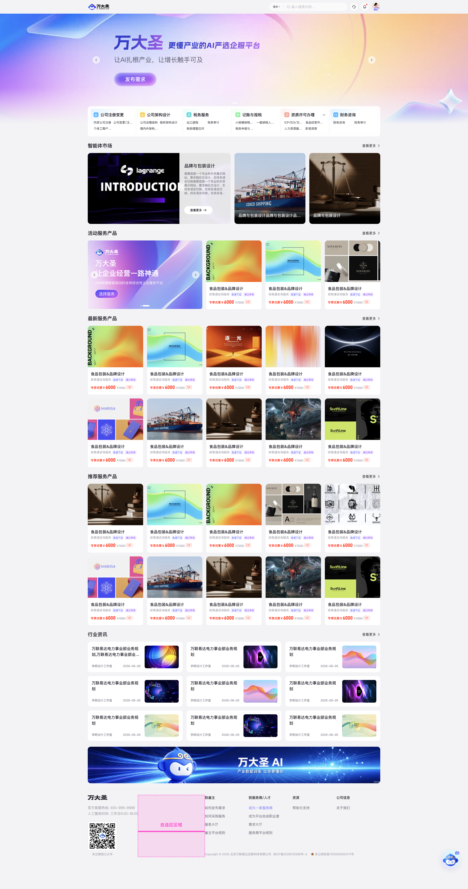
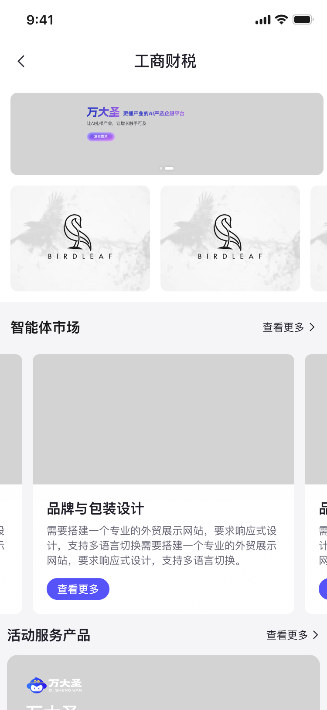
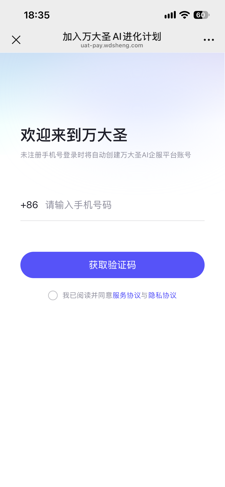
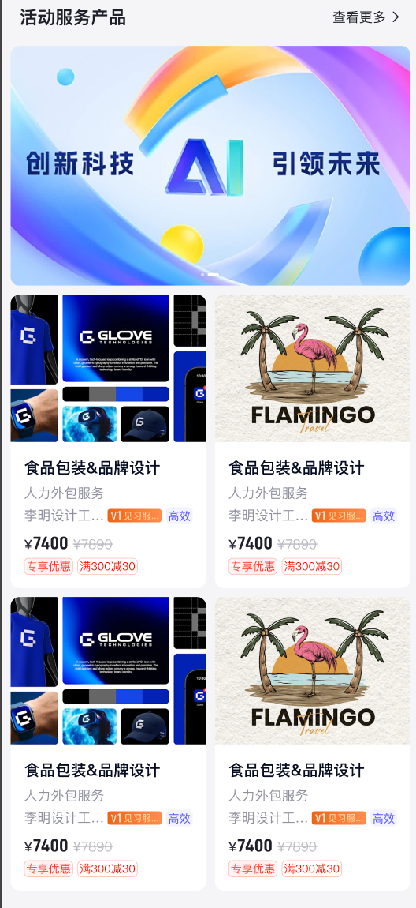

# REQ\-133 二级频道适配APP端/H5浏览器

# 原需求内容

## （MRD）II REQ\-133 二级频道页二次优化（忽略）

优先级\-\-双十二之前

### 一、业务场景

二级频道页在移动端浏览器及 APP 内浏览时缺乏专项适配，存在图片尺寸错位、组件样式与交互不统一、购买路径未衔接登录注册等问题，影响浏览体验与转化效率。同时，频道页缺少按渠道后缀的精细化数据统计能力，以及服务产品展示数量的灵活配置能力。本次进行二次优化，统一双端适配标准，补齐数据埋点与展示配置能力。

### 二、功能模块

前端页面： 二级频道页

运营后台： 二级频道配置

后端服务： 埋点统计服务

### 三、需求规则

1、移动端浏览器适配规则

1）图片尺寸适配。 后台配置的图片在各尺寸移动端浏览器正确展示，不拉伸、不变形、不裁切错位。✅

2）类目列表适配。 类目列表两种展示模式均在移动端浏览器完成适配，正常切换与展示。✅

3）服务大厅筛选适配。 服务大厅类目筛选样式完成适配，视觉及交互参考 APP 端实现。@王宇轩

4）服务卡片适配。 全部服务产品卡片展示完成适配，视觉及交互参考 APP 端。✅

5）服务详情页适配。 视觉及交互参考 APP 端；点击"立即购买""联系卖家""选择数量"均引导至注册 WAP 页，注册后引导下载APP

6）图文组件适配。 智能体市场、活动专区、行业资讯三类图文结合组件完成移动端适配。✅

7）留资模块适配。 留资模块表单填写提交后，引导至注册 WAP 页完成注册。✅

8）底部模块隐藏。 移动端浏览器下，频道页底部模块不展示。✅

2、APP 浏览适配规则

1）图片尺寸适配。 后台配置的图片在 APP 内各机型尺寸正确展示。

2）类目列表适配。 类目列表两种展示模式在 APP 内正常适配展示。

3）服务卡片及详情页适配。 全部服务产品卡片展示及跳转详情页流程完成适配，交互与 APP 原生体验一致。

4）图文组件适配。 智能体市场、活动专区、行业资讯三类组件完成 APP 内适配。

5）留资模块适配。 识别用户登录状态：已登录用户正常提交；未登录用户填写提交后提示登录，登录成功后完成留资提交。

6）底部模块隐藏。 APP 内嵌浏览时，频道页底部模块不展示。

3、访问后缀与埋点统计规则

1）支持任一二级频道页配置不同访问后缀，生成带后缀的频道页链接，用于区分不同投放渠道或批次。

2）按后缀维度埋点统计：频道页 PV/UV、登录用户访问 PV/UV、引导至各服务详情页的访问量。

4、服务产品展示数量配置规则

1）"最新服务产品"与"推荐服务产品"组件支持设置展示数量。

2）实现方案采用设置展示行数方式，运营按行数控制商品展示量，前端按行数渲染对应数量的服务产品卡片。

# 背景与目标

## 背景

现有二级频道页仅提供 PC 端版本。业务提出需同时适配 APP 端与移动端浏览器，使用户在手机上也能浏览频道内容并进入对应服务。

本期适配范围：

**注意：小程序本期不包含。****PAD****、APP、移动端浏览器****本期适配**

## 问题梳理

经在微信内置浏览器与系统浏览器（Safari）中实测，现状问题如下：

- 二级频道页：图片尺寸错位、组件样式与交互不统一、布局未做移动端处理。

- 服务详情页：移动端下展示与操作未适配，购买路径未衔接登录注册。

- 登录注册：移动端弹窗展示不全、相关页面展示异常。

- 数据与配置：无按渠道后缀的访问统计；服务产品展示数量不可配置

以下为图示

|**微信里打开**|**系统浏览器（safari）**|||
|---|---|---|---|
|打开二级频道  |打开二级频道  |服务详情  |登录  |
|**总结** 存在图片尺寸错位、组件样式与交互不统一、购买路径未衔接，登录注册展示不全等问题，影响浏览体验与转化效率||||

## 目标

- 保证页面展示符合移动端使用习惯，不出现错位、展示不全、流程卡顿等影响用户体验的情况。

- 一套响应式 H5 同时覆盖手机移动浏览器与 APP 内 WebView 内嵌，避免双端重复开发。

- 保持现有信息架构、模块顺序、业务规则、卡片字段与跳转链路不变，仅做布局与交互的移动端适配。

- 保证移动端浏览、分类浏览、产品与资讯点击进入详情、发布需求等主路径可用。

- 购买、联系、留资等关键动作与注册引导衔接，提升移动端转化效率。

- 补齐按访问后缀维度的埋点统计，支持评估不同投放渠道或批次的引流效果。

## 非目标（本期不做）

- 不在频道页新增业务功能，不调整模块的业务策略与排序规则。

- 不改造 PC 端既有布局与交互。

- 不做平板端专项深度设计，仅在断点上保证不错乱。

- 不做频道模块的新增、下线或运营位改造。

- 后缀维度的交易转化统计不在本期范围，本期仅统计访问类指标。

## 名词解释

|**名词**|**解释**|
|---|---|
|二级频道页|按服务类目划分、通过访问路径（slug）定位的类目垂直承接页，由运营在运管后台配置内容并按版本发布|
|移动端浏览器（H5）|用户在手机浏览器、微信等第三方内置浏览器中访问频道页的场景|
|APP 内嵌浏览（WebView）|用户在 APP 内通过内嵌容器加载同一响应式 H5 的场景|
|访问后缀（suffix）|为区分不同投放渠道或批次，在频道页链接 URL 参数中附加的渠道标识，同一频道下可配置多个，埋点中以 channel\_suffix 字段上报|
|APlus|wds\-web 现有埋点上报封装体系：页面 PV 走 wandasheng\_page\_view，点击走 trackClk（wandasheng\_clck），自定义事件按 APlus 事件上报|
|pgid|埋点页面标识建议值：注册页 page\_register、登录页 page\_login、二级频道页 page\_channel（以埋点平台规范为准）|
|WAP 注册页|移动端注册落地页，承接移动端浏览器场景下未注册用户的注册引导|
|PV / UV|页面访问次数 / 访问用户去重数，口径定义详见下述说明|
|留资（需求留言）|频道页内供用户填写意向信息的表单模块，现网免登录提交（POST /v1/employer/inquiries）|
|展示行数|运管后台配置的服务产品展示行数，前端按“行数 × 每行卡片数”渲染对应数量的服务产品卡片|
|slug|频道的访问路径标识，用户端按 slug 查询当前生效的已发布频道页|

## 现状\-页面结构

PC端自上而下包含：顶部导航、首屏 Banner、服务分类入口、智能体市场、活动服务产品、最新服务产品、推荐服务产品、行业资讯、底部通栏 Banner 、留资与页脚。

|PC端||APP/浏览器原型||
|---|---|---|---|
|**二级/三级类目**   |**图片专区**  |**二级/三级类目**  |**图片专区**  |

## **交互路径**

二级频道交互流程

现有登录场景

|\#|场景|触发登录的具体操作|
|---|---|---|
|1|发布需求|点击首页发布需求入口、经纪人「填写需求」；修改需求草稿、确认发布单条或多条需求|
|2|购买服务|服务详情点击「立即购买」，或经纪人推荐服务卡片点击下单|
|3|联系服务商/卖家|服务详情点击联系卖家，或经纪人服务卡片点击联系服务商|
|4|查看服务商详情|进入 /employer/find\-service/company/:id，包括从服务详情、经纪人卡片进入|
|5|联系平台客服|点击顶部「客服」、经纪人「联系客服」、服务失效弹窗中的联系客服|
|~~6~~|~~查看消息通知~~|~~点击顶部消息铃铛，或进入通知消息页面~~|
|~~7~~|~~进入「我的」各子页面~~|~~我的需求、订单、售后、评价、合同、发票、福利、信息，以及实名认证、邀请码等页面~~|
|~~8~~|~~抢单~~|~~首页、需求大厅点击「立即抢单」~~|
|~~9~~|~~成为供应商~~|~~点击顶部「成为供应商」入口~~|
|~~10~~|~~进入服务商工作台~~|~~访问 /provider 及其所有子页面~~|
|~~11~~|~~进入供应商工作台~~|~~访问 /supplier 及其所有子页面~~|
|~~12~~|~~经纪人上传附件~~|~~点击上传图片/文件、粘贴图片、拖入符合要求的文件；需对应上传功能已启用~~|
|~~13~~|~~经纪人历史消息~~|~~查看历史消息、搜索聊天记录、通过历史消息定位跳转~~|
|~~14~~|~~经纪人消息反馈~~|~~对回复点赞、点踩，或提交反馈~~|
|15|需求留言|提交成功后，接口返回 openLoginDialog=true 才弹登录；填写表单时不拦截|

|说明|场景|执行操作|图例|
|---|---|---|---|
|直接跳转注册 |二级频道里顶部底部banner/顶部2级3级类目/顶部图片专区/智能体左侧图/活动图片/外链/资讯 |引导注册||
|查看更多|根据配置的链接内容判断（待定）|引导注册||

# 需求范围、适配范围、端形态与技术形态

## 功能模块与涉及端

|**功能模块**|**涉及端**|**改动概述**|
|---|---|---|
|前端页面：二级频道页、服务详情页、服务商详情页|移动端浏览器 H5；APP 内 WebView；PAD|二级频道全部模块响应式适配；服务详情页、服务商详情页完成移动端适配；购买 / 咨询类动作衔接注册引导；底部模块隐藏；按展示行数渲染服务产品卡片；接入 6 个埋点事件|
|运营后台：二级频道配置|运管后台（管理端）|访问后缀管理与带后缀链接生成；最新服务产品由固定策略改为行数控制；推荐服务产品行数参数确认双端生效；按后缀维度统计报表|
|后端服务：埋点统计服务|用户端 BFF、管理端 BFF、核心服务及数据侧|后缀解析与埋点事件采集上报；按频道、后缀维度的统计口径与报表查询|

## 技术形态与两端差异

本期采用一套响应式 H5：手机浏览器直接访问该 H5；APP 内通过 WebView 内嵌同一页面。

两端差异点

|维度|移动浏览器 H5|APP WebView 内嵌|
|---|---|---|
|**页面框架**|H5 自带顶部导航栏（返回、Logo、搜索、消息、头像）|优先复用 APP 原生导航栏；H5 内导航按容器能力隐藏或保留，由客户端与前端确认|
|**返回**|浏览器自带返回；页面内返回按 H5 路由处理|WebView 物理返回与左上角返回由容器接管，H5 需同步路由栈|
|**登录态**|H5 本地登录态|复用 APP 登录态；未登录时的跳转与拉起规则待客户端确认|
|**标题栏文案**|使用页面自身标题|可由 APP 原生导航栏标题承接，文案与页面一致|

# 方案概述

## **双端统一适配基准（适配\+二级页面）**

移动端浏览器与 APP 内嵌共用同一套响应式 H5，视觉与交互以 APP 端实现为参照基准；双端差异集中在导航栏、返回、登录态三方面。产品卡、资讯卡的字段与业务规则与 PC 保持一致，仅做排版与触控适配。本次适配对象包含二级频道页、服务详情页与服务商详情页，三页共用同一套响应式规范与上述双端差异处理规则。

## 访问后缀与数据链路（埋点）

整体数据链路：运营在运管后台为二级频道配置访问后缀（suffix），生成带后缀的频道页链接并投放至不同渠道或批次；用户访问时页面埋点初始化从 URL 参数读取 suffix 并写入 channel\_suffix 字段，随频道页 PV 与服务卡片点击事件统一上报；数据侧按 channel\_suffix 字段过滤，实现按后缀拆分的 PV/UV 与导流访问量统计；运营在后台报表查看各渠道引流效果

## 配置生效链路（运管配置优化）

"最新服务产品"与"推荐服务产品"组件支持设置展示行数，运营按行数控制商品展示量，前端按行数渲染对应数量的服务产品卡片。

# 模块适配规则与通用交互

## 手机端模块布局与交互规则

以下为手机端（手机断点以内）各模块的布局与交互规则，交互参考 APP 端实现；模块顺序与 PC 端保持一致

|**模块**|**手机端布局**|**交互与规则**|
|---|---|---|
|顶部导航|压缩为单行：左侧返回 和标题|点击返回，回到上一级页面|
|首屏 Banner|通栏宽度，上下比例按移动端视觉重排；与 PC 端使用同一张图，等比例缩放，按设计稿|支持手势横滑切换轮播，保留轮播点；单张内容时不显示多余指示点；点击整个 Banner 可跳转|
|服务分类入口（类目列表）|类目 6 项改为单行可横滑；图标与名称保留，副标题按宽度截断为单行或两行；纯图片形式为单行可横滑|点击二级 / 三级类目分别进入对应类目结果页|
|推荐活动（智能体市场）|标题行保留「查看更多」；卡片由左大右两列改为横向滑动卡片流|卡片点击进入对应智能体详情；横滑与滚动需做手势方向判断，避免冲突|
|活动服务产品|左侧大 Banner 轮播通栏置于模块顶部；右侧产品卡改为双列网格|Banner 轮播规则同首屏；产品卡字段完整保留：封面、标题、标签、优惠价、划线原价、折扣角标；点击进入服务详情|
|最新服务产品|由 5 列改为双列网格，卡片大小按设计稿调整|商品卡使用首页同样模板组件；模块标题与「查看更多」保留|
|推荐服务产品|同最新服务产品，双列网格|规则同上；模块标题与「查看更多」保留|
|行业资讯|由三列左文右图改为单列列表，上图下文或左图右文二选一（设计稿确定）；标题、作者、日期保留|点击进入资讯详情；模块标题与「查看更多」保留|
|底部通栏 Banner|通栏等比缩放，文案与形象不裁切失真|点击跳转规则与 PC 一致|
|页脚（底部模块）|移动端浏览器与 APP 内嵌均不展示||

## 通用交互与布局规则

- 触控热区：可点击元素热区不小于 44×44 pt，相邻可点元素保留间距，避免误触。

- 排版：字号、行高、卡片圆角、间距与色值沿用品牌设计规范，移动端具体数值按设计稿输出；文字过长按设计稿处理，不出现横向溢出。

- 手势冲突：横滑轮播与卡片流需识别滑动方向，纵向滑动穿透到页面滚动，横滑才切换卡片；页面整体保持纵向单栏滚动。

- 图片：与 PC 端使用同一套图，按移动端尺寸等比缩放，圆角与轮播点按设计稿；首屏图优先加载，其余图片懒加载；封面比例与卡片容器一致，避免拉伸变形。

- 价格与标签：按首页商品卡组件规范。

- 安全区域：适配手机刘海、底部 Home 指示条与 WebView 容器内边距。

## 状态与异常处理

|**场景**|**表现与处理**|
|---|---|
|首屏 / 模块加载中|展示骨架屏或加载态，避免白屏；骨架结构与最终布局一致|
|接口失败 / 超时 / 弱网|模块级失败提示与「重试」按钮；重试仅重新请求当前失败模块|
|模块无数据|展示对应空态占位与文案|
|图片加载失败|展示默认占位图，不出现裂图或空白框|
|未登录操作受限入口|点击发布需求、消息、头像、下单、咨询等需登录入口时，按PC现有登录校验规则处理|

# 移动端浏览器与 APP 适配需求详述

## 移动端浏览器适配规则

### 图片尺寸适配

后台配置的图片（含 Banner 轮播及各图文组件配图）在各尺寸移动端浏览器正确展示，不拉伸、不变形、不裁切错位。

- 图片按所在容器宽度等比缩放，保持原始宽高比；封面比例与卡片容器一致。

- Banner 与 PC 端使用同一张图，等比例缩放，上下比例按移动端视觉重排，具体按设计稿。

- 同一组件内多图、轮播图采用统一渲染高度，单张内容时不显示多余指示点。

- 超长图、超宽图按视口宽度适配展示，页面不出现横向滚动条。

- 首屏图优先加载，其余图片懒加载；运营按现有规范配置一套图片素材即可，多端自适应。

|顶部banner|底部banner|
|---|---|
| | |

### 顶部类目列表适配

类目列表两种展示模式（图标\+名称形式、纯图片形式）均在移动端浏览器完成适配，正常展示。

- 两种展示模式均可正常展示：图标与名称保留，副标题按宽度截断为单行或两行；纯图片形式为单行可横滑。

|2级/3级类目|图片专区|
|---|---|
| | |

### 服务卡片适配

全部服务产品卡片展示完成适配，参考APP首页组件，交互与 APP 原生体验一致，卡片大小参考UI

| |
|---|

### 服务详情页适配

服务详情页视觉及交互参考 APP 端完成移动端适配。

- 详情页内容、图片排布、操作按钮在移动端正确展示与可点击。

- 点击“立即购买”“联系卖家”“选择数量”（编辑数量）均引导至注册 WAP 页，注册成功后引导下载 APP。

- 详情页内服务商详情入口、联系客服同样引导注册（现网为登录守卫拦截，移动端统一衔接注册引导）。

引导跳转携带来源参数用于链路统计；注册 WAP 页承接形式与 APP 下载引导展示形式见待确认事项。

|APP原生|已注册\-未下载|已注册\-已下载|
|---|---|---|
| | | |

### 服务商详情页适配

> 服务商详情页交互与 APP 原生体验一致。
> 
> 

|APP原生|已注册\-未下载|已注册\-已下载|
|---|---|---|
| | | |

### 图文组件适配

智能体市场、活动专区、行业资讯三类图文结合组件完成移动端适配。

- 智能体市场卡片改为横向滑动卡片流，点击进入智能体详情，横滑与滚动做手势方向判断。

- 活动专区产品卡改为双列网格，Banner 轮播通栏置于模块顶部，点击进入服务详情。

- 行业资讯改为单列列表，标题、作者、日期保留，点击进入资讯详情。

组件内内容为空时按统一空态规则处理，不出现空白区域

|智能体|活动服务|
|---|---|
| | |

### 留资模块适配

留资模块（需求留言）表单填写提交后，引导至注册 WAP 页完成注册。

- 表单字段样式、输入框高度、键盘类型按移动端规范适配。

- 表单校验通过并提交成功后，引导至注册 WAP 页完成注册。

- 提交失败时给出明确失败提示，已填写内容不丢失，可修改后重新提交。

现网逻辑参考：需求留言免登录提交（POST /v1/employer/inquiries），接口返回 openLoginDialog=true 时才弹登录；移动端在提交成功后统一衔接注册引导。

|填写|留言成功|已注册\-未下载|已注册\-已下载|
|---|---|---|---|
| | | | |

### 底部模块隐藏

移动端浏览器访问时，频道页底部模块不展示。

- 通过响应式规则在移动端视口下隐藏频道页底部模块（页脚）。

隐藏仅作用于移动端浏览器场景，PC 端底部模块正常展示，不受影响。

## APP 浏览适配规则

### 图片尺寸适配

后台配置的图片在 APP 内各机型尺寸正确展示，适配规则与移动端浏览器一致：与 PC 同一套图等比缩放、按预设规则裁切、统一渲染高度、懒加载，页面不出现横向滚动条。

|顶部banner|底部banner|
|---|---|
| | |

### 顶部类目列表适配

类目列表两种展示模式（图标\+名称形式、纯图片形式）均在移动端浏览器完成适配，正常展示。

- 两种展示模式均可正常展示：图标与名称保留，副标题按宽度截断为单行或两行；纯图片形式为单行可横滑。

|2级/3级类目|图片专区|
|---|---|
| | |

### 服务卡片适配

全部服务产品卡片展示完成适配，参考APP首页组件，交互与 APP 原生体验一致，卡片大小参考UI

| |
|---|

### 服务详情页适配

服务详情页视觉及交互参考 APP 端完成移动端适配。

- 详情页内容、图片排布、操作按钮在移动端正确展示与可点击。

- 点击“立即购买”“联系卖家”“选择数量”（编辑数量）均引导至注册 WAP 页，注册成功后引导下载 APP。

- 详情页内服务商详情入口、联系客服同样引导注册（现网为登录守卫拦截，移动端统一衔接注册引导）。

引导跳转携带来源参数用于链路统计；注册 WAP 页承接形式与 APP 下载引导展示形式见待确认事项。

|APP原生|已注册\-未下载|已注册\-已下载|
|---|---|---|
| | | |

### 服务商详情页适配

> 服务商详情页交互与 APP 原生体验一致。
> 
> 

|APP原生|已注册\-未下载|已注册\-已下载|
|---|---|---|
| | | |

### 图文组件适配

智能体市场、活动专区、行业资讯三类组件完成 APP 内适配，视觉与交互对齐 APP 端标准，跳转行为正常。

|智能体|活动服务|
|---|---|
| | |

### 留资模块适配

留资模块在 APP 内按用户登录状态区分处理。

- 模块识别用户登录状态（复用 APP 登录态）。

- 已登录用户：填写表单后正常提交，提交结果按统一规则提示。

- 未登录用户：填写并提交后提示登录；登录成功后完成留资提交。

- 补充规则：提示登录时暂存已填写的表单数据；登录成功返回后自动完成留资提交并提示结果，无需重复填写；取消登录返回页面时表单内容保留。

|填写|留言成功|已注册\-未下载|已注册\-已下载|
|---|---|---|---|
| | | | |

### 底部模块隐藏

APP 内嵌浏览时，频道页底部模块不展示。

- 通过 APP 内嵌容器标识识别 APP 场景，隐藏底部模块。

- 识别与判定方式以技术评审为准，需保证准确性，避免 PC 或移动端浏览器被误判隐藏；桥接能力缺失时降级为 H5 行为，页面仍可正常浏览与跳转。

## 修改范围

本次参照需要登陆和不需要登陆两个场景梳理，其中：

1\.需要登录的跳转，标黄部分为app需要考虑适配范围，其余为app参考web形式

2\.不需要登录的跳转，标黄部分为app需要考虑适配范围，其余为app参考web形式

# 运管后台二级频道配置项生效范围

配置入口：运管后台→二级频道管理→二级频道列表，交互参考上文6\.3PC端现状模块盘点

|**模块名称** |**配置项截图**|**WEB效果** **（以工商财税为例）**|**APP效果** |**H5效果**|
|---|---|---|---|---|
|顶部轮播 Banner | | 目前配置的URL是跳转到**对话**|轮播展示生效 URL都可跳，已适配的页面（二级频道、服务详情、服务商详情）自动适配|轮播展示生效 URL都可跳，已适配的页面（二级频道、服务详情、服务商详情）自动适配|
|类目列表|| 目前配置的URL是跳转到**对话**|类目、图片展示生效 URL都可跳，已适配的页面（二级频道、服务详情、服务商详情）自动适配|类目、图片展示生效 URL都可跳，已适配的页面（二级频道、服务详情、服务商详情）自动适配|
|智能体市场 || 目前配置的URL是跳转到**服务详情**|URL都可跳，已适配的页面（二级频道、服务详情、服务商详情）自动适配 |URL都可跳，已适配的页面（二级频道、服务详情、服务商详情）自动适配|
|活动专区|||点击服务正常打开**服务详情页** URL都可跳，已适配的页面（二级频道、服务详情、服务商详情）自动适配|点击服务正常打开**服务详情页** URL都可跳，已适配的页面（二级频道、服务详情、服务商详情）自动适配|
|最新服务产品| ||点击服务正常打开**服务详情页** URL都可跳，已适配的页面（二级频道、服务详情、服务商详情）自动适配|点击服务正常打开**服务详情页** URL都可跳，已适配的页面（二级频道、服务详情、服务商详情）自动适配|
|推荐服务产品| ||服务卡片正常展示 点击服务正常打开**服务详情页** URL都可跳，已适配的页面（二级频道、服务详情、服务商详情）自动适配|服务卡片正常展示 点击服务正常打开**服务详情页** URL都可跳，已适配的页面（二级频道、服务详情、服务商详情）自动适配|
|行业资讯|| 现状为语雀web链接|URL都可跳，已适配的页面（二级频道、服务详情、服务商详情）自动适配|URL都可跳，已适配的页面（二级频道、服务详情、服务商详情）自动适配|
|底部 Banner|||URL都可跳，已适配的页面（二级频道、服务详情、服务商详情）自动适配|URL都可跳，已适配的页面（二级频道、服务详情、服务商详情）自动适配|
|需求留言|||根据开关控制展示 |根据开关控制展示 |
|底部配置|||不展示 |不展示 |

# 设计稿

https://www\.figma\.com/design/JwGwi2jxIsC3gSdSbmfPvx/%E4%B8%87%E5%A4%A7%E5%9C%A3WEB?node\-id=52162\-93147\&t=GhDsa6tcI6KAIwla\-1

# 数据、埋点与衡量

[万大圣待开发埋点规格（6 事件）](https://wanlianyida.feishu.cn/docx/D7p4dQDeBoYaNexrAAPcM8UinNb)@王宇轩

# 运管后台功能优化\-服务产品展示数量配置（行数）

## 现状与调整内容

- 推荐服务产品：现已支持行数控制，本期仅调整该参数，并确认同时作用于 Web 与移动端。

- 最新服务产品：由固定策略改为通过控制行数展示。运管后台组件配置由固定策略调整为行数控制；用户侧二级频道由固定数量展示改为按行数展示；同时作用于 Web 与移动端。

## 后台配置项

- 两组件（最新服务产品、推荐服务产品）的配置面板提供“展示行数”配置项，运营按行数控制商品展示量。

- 配置值为正整数，建议范围 1 至 10 行，默认值待评审确定；配置非法时按默认行数处理。

- 行数与实际展示卡片数量的换算由前端布局决定（移动端每行 2 张、PC 端按现有列数），运营仅按行数配置，无需关心各端每行卡片数。

## 前端渲染规则

- 前端按行数渲染对应数量的服务产品卡片，实际展示数量等于配置行数乘以当前端每行卡片数。

- 展示行数配置对 Web 与移动端（H5、APP）同步生效。

- 实际可展示的服务产品数量不足配置行数对应数量时，按实际数量渲染，不展示空占位卡片。

- 组件未配置或配置非法时按默认行数渲染，不阻断页面展示。

## 需求具体调整内容

### 服务产品展示数量配置规则调整

1. "推荐服务产品"现已支持，仅调整该参数同时作用于web和移动端

### "最新服务产品"调整如下：

运管后台：组件调整， 由**固定策略** 改为 **通过控制行数展示**，并且同时作用于web和移动端

### 用户侧二级频道：最新服务产品由**固定数量展示** 改为 **通过控制行数展示**

[REQ\-133 二级频道页二次优化\-运管后台](https://wanlianyida.feishu.cn/wiki/Nntfw4lBxithI2kNxvBcvHvCn2a?from=from_copylink)@李威

# 其他

|事项|影响|责任方|状态|
|---|---|---|---|
|下游页面（产品 / 智能体 / 资讯详情、搜索结果、分类结果、发布需求、登录注册）是否已做移动端适配|适配移动端现有页面|产品 / 研发|待确认|
|适配机型、系统版本与浏览器范围（含 APP 最低 WebView 版本）|兼容测试。包含PAD。不包含小程序 |产品 / 测试 / 客户端|待确认|
|移动端断点数值、字号间距与组件规范|设计与前端实现依据|UI 设计 / 前端|待设计输出|
|~~频道页接口是否已支持多端复用、是否返回移动端所需图片规格~~|~~影响图片体积与加载性能~~|~~后端 / 前端~~|~~待确认~~|
|~~APP WebView 登录态打通与 JSBridge 能力（返回、分享、消息、标题栏）~~|~~影响端内登录校验与原生能力调用~~|~~客户端 / 前端~~|~~待确认~~|

# **验收标准**

以下验收以手机端（移动浏览器与 APP WebView 各覆盖一轮）为准；每条含成功场景与主要边界场景。

- **页面整体：**给定手机尺寸访问频道页，当页面加载完成，则各模块按第 4 节布局呈现，无横向溢出、无错位、无内容裁切；弱网下先出骨架屏，失败可重试且不影响其他模块。

- **顶部导航：**给定页面已加载，当用户点击搜索图标，则进入现有搜索流程；消息、头像入口的登录校验行为与 PC 一致。边界：未登录点击受限入口时按既定登录规则跳转。

- **Banner 与轮播：**给定 Banner 有多张内容，当用户左右滑动，则按顺序切换且指示点同步；自动播放规则与现有首页配置一致。**单张内容时不显示多余指示点**。

- **分类入口：**给定分类列表，当用户点击某分类，则进入对应分类结果页；带下拉的分类在移动端通过弹层展开子项。边界：分类副标题过长时按规则截断，不挤压图标与名称。

- **产品卡片：**和首页组件一致；点击进入对应详情。封面图缺失时展示占位图。

- **资讯列表：**给定资讯数据，当列表渲染，则标题、作者、日期、缩略图完整；点击进入资讯详情。边界：无数据时展示空态。

- **WebView 内嵌：**给定 APP 内打开页面，当容器提供登录态与桥接能力，则复用端内能力；桥接缺失时降级为 H5 行为，页面仍可正常浏览与跳转。

# **风险与发布建议**

- **主要风险：**下游页面未适配导致移动端落地 PC 版；低版本 WebView 或主流浏览器兼容问题；长标题、多标签、多图在小屏溢出。发布前需按第 8 节依赖逐项确认。

- **发布策略：**建议先在移动浏览器与 APP 内小范围灰度，验证主路径（浏览 → 分类 / 产品 / 资讯点击 → 详情）与加载性能，无阻断问题后全量；如出现布局错乱或跳转落地异常，可按端型 / 容器回退或下线移动端入口。

- **上线后观察：**移动端频道页跳出率、模块点击分布、详情进入转化与报错情况，作为后续模块取舍与体验优化依据。

### 

