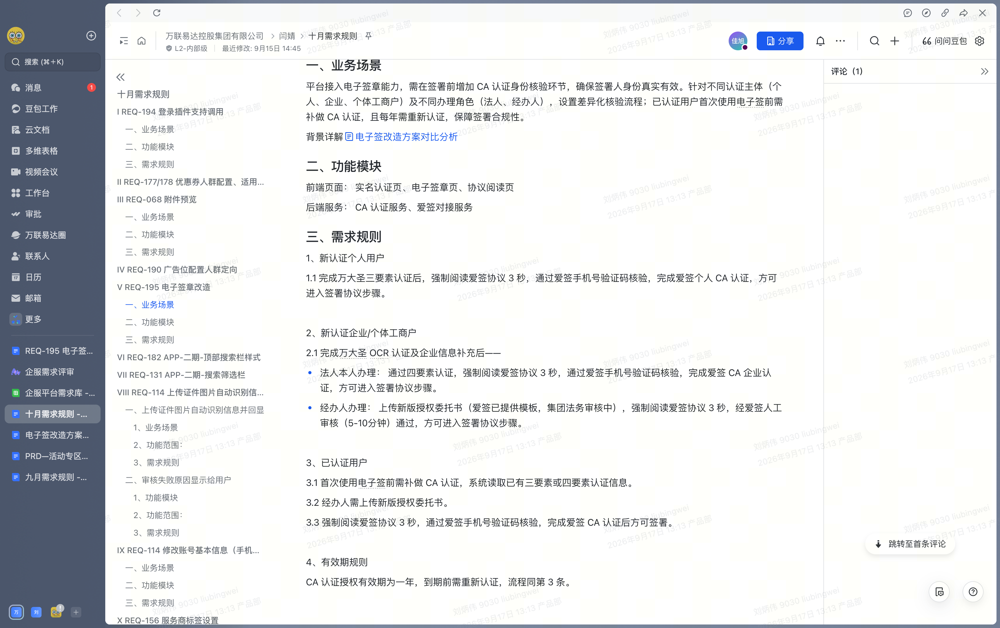
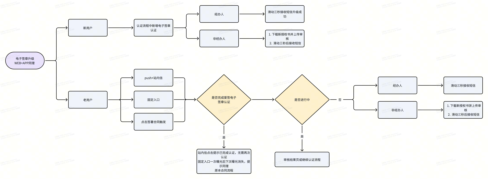
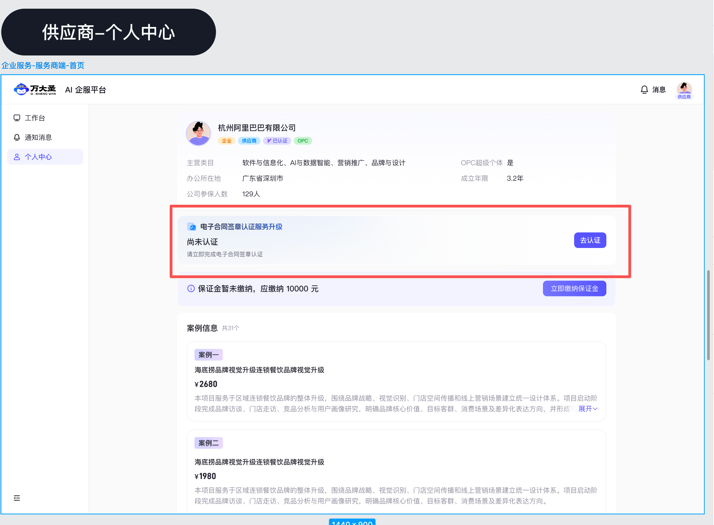
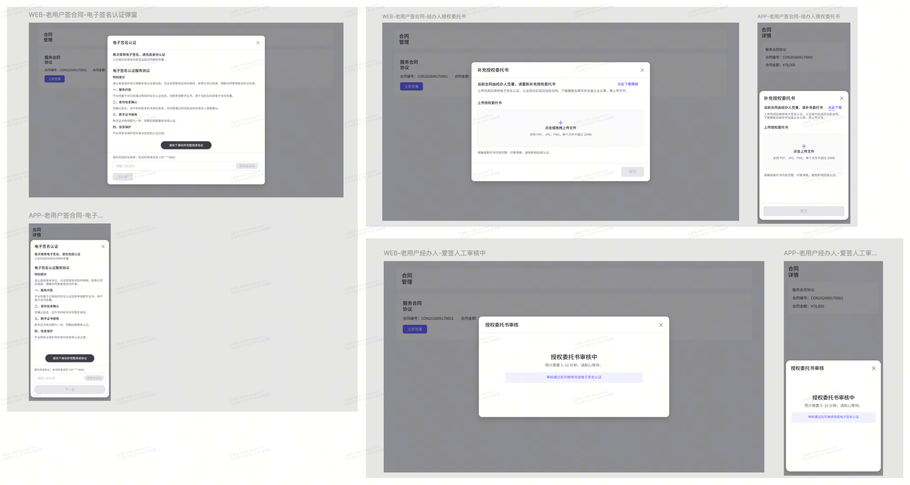
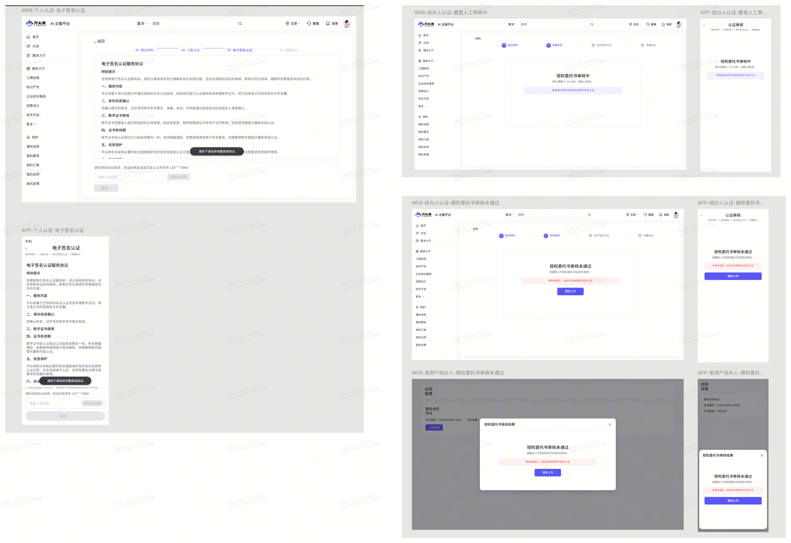
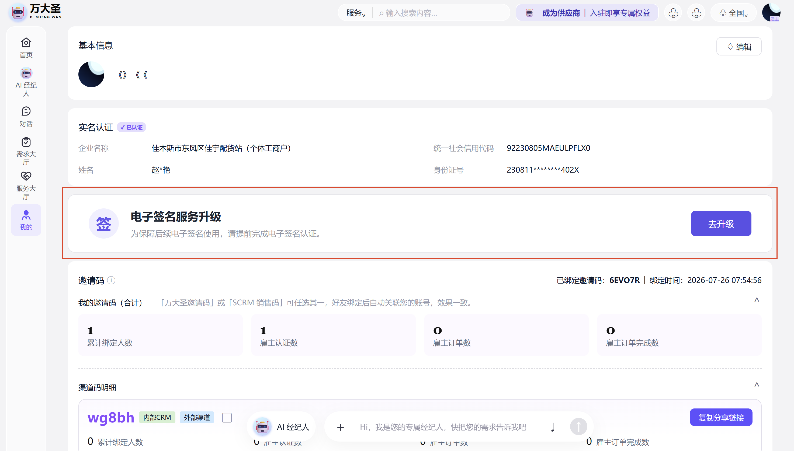
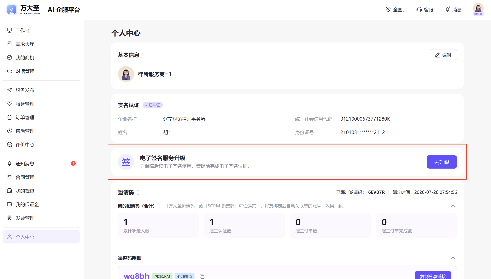

# REQ\-195 电子签章改造（双端）

# 项目信息

1. 项目名称：电子签章改造

2. 需求编号：REQ\-195

3. 云效ID：RZMP\-9021

4. 产品经理：刘炳伟  丁建文

|版本号|时间|修改人|说明|
|---|---|---|---|
|V1\.0|2026\-09\-17|刘炳伟|新建|
|V1\.1|2026\-10\-30|丁建文|新增服务商工作台升级电子签位置及旧版本APP提醒|
|V1.2|2026-11-06|王新骏|按本次确认，取消协议内容滚动及获取验证码前等待 3 秒的交互和埋点要求；保留验证码发送后的重发冷却|

# **需求背景\&目标**

# 需求概述

## 需求范围

本期功能列表：雇主/ 服务商认证；签署合同

# 需求详述

## **功能说明（产品原型设计及说明）**

#### 原型图链接

[https://www.figma.com/design/XG779CFmbRAfdGXUGgf1L0/%E4%BC%81%E6%9C%8D?node-id=768-2&t=apj6oExpR9aXn4sW-1]()

补充：

1. 统一名称：电子合同签章认证

2. 使用旧版本APP用户，签署合同时在正常流程中或认证流程中因未认证或认证过期应进入电子合同签章认证而因版本问题无法完成电子合同签章认证的，提示用户升级APP【请升级APP版本完成电子合同签章认证后方可继续操作】，确定则去升级，取消则回到当前页面

3. 电子合同签章认证流程中的协议为链接，前端需要适配协议展示

4. 文案调整：根据相关规定，使用电子签章前需先完成相关电子认证，认证后即可签署本合同

5. 用户从未使用过爱签与平台签署过电子协议的，需要重新签署协议

6. 授权书审核中时不显示审核时间

7. 服务商端合同管理、雇主端我的合同，只展示待操作的电子合同签章认证动作，认证成功不展示操作

8. 服务商端~~工作台~~、个人中心、雇主端我的增加固定入口展示电子合同签章认证的状态：

    - 去认证

    - 继续认证

    - 审核中，不可点击

    - 重新上传

    - 重新认证

    - 认证成功

补充：供应商 PC 个人中心入口位于主体资料卡下方、保证金提示上方。

|**标题**|**说明**||
|---|---|---|
|**触发角色包含** **雇主\&服务商**|1. 新认证用户（雇主/服务商） 2. 已完成认证但未通过爱签电子签章认证的用户（老用户：雇主/服务商） 3. 电子签章认证过期的用户（雇主/服务商） 注：无论已实名认证用户还是新用户都需通过中台接口查询是否认证过爱签，中台接口会返还用户是否认证过是否过期，未认证过和认证过期的需增加ca认证流程||
|**认证场景流程**||1. 个人     1. 提交材料 ➡️ 人脸认证 ➡️ 电子签章认证 ➡️ 签署协议 2. 个体/企业法人     1. 提交材料 ➡️ 完善信息 ➡️ 电子签章认证 ➡️ 签署协议 ➡️ 系统审核 3. 个体/企业经办人     1. 提交材料 ➡️ 完善信息 ➡️ 电子签章认证 ➡️ 签署协议 ➡️ 系统审核|
|**签署合同场景流程**||1. 未完成电子签章认证     1. 个人/法人：拉起电子签名认证弹窗     2. 经办人：拉起授权委托书补充弹窗，审核通过后继续电子签章认证 2. 电子签章认证有效     1. 全部主体：直接进入合同签署 3. 电子签章认证已到期     1. 个人/法人：重新拉起电子签名认证弹窗     2. 经办人：重新补充授权委托书，审核通过后重新进行电子签章认证 4. 注意事项     1. 用户关闭弹窗后留在当前合同页面，不进入签署。     2. 认证完成后点击通知消息自动返回原合同继续签署。     3. 人工审核期间不能继续签署。     4. 审核通过后用户再次进入合同，点击“立即签署”，自动进入下一流程。|
|**固定入口**|      |1. 入口位置     1. 雇主：展示在“我的合同”页面顶部。     2. 雇主：展示在“我的”认证信息上方     3. 服务商：展示在“合同管理”页面顶部。     4. 服务商：PC端展示在“个人中心”认证信息上方，移动端展示在“我的”我的邀请码上方     5. ~~服务商：PC端展示在工作台重要商机推荐上方，移动端展示在工作台行动中心上方~~     6. 供应商：展示在“个人中心”页面。 2. 入口状态     入口根据当前主体的电子签章认证状态展示：     - 去认证     - 继续认证     - 审核中，不可点击     - 重新上传     - 重新认证     - 认证成功 3. 显示规则     1. 入口仅对已完成平台实名认证且具备主体认证权限的用户展示。     2. 存在以下任一情况时展示入口：         - 尚未完成爱签电子签章认证；         - 已发起认证但尚未完成；         - 授权委托书正在人工审核；         - 授权委托书审核未通过；         - 电子合同签章认证即将到期（剩余小于等于10天）         - 电子签章认证授权已过期。     3. 无主体认证权限的用户不展示入口。     4. 认证状态以主体为唯一维度，同一主体在雇主、服务商、供应商及WEB、APP之间共享。     5. 同一主体通过任一角色完成认证后，其他角色同步更新为认证成功。     6. “认证成功”状态在同一主体下全局仅曝光一次；刷新、再次进入页面或切换至其他角色后，入口不再展示。     7. 同一账号下存在多个主体时，各主体独立判断认证状态，互不影响。     8. 电子签章认证授权有效期为一年；到期后入口重新展示“重新认证”。|
|**认证页逻辑**||1. 新增03电子签名认证环节 2. 页面样式     1. 展示电子签名认证协议，供用户阅读。     2. 获取验证码不要求协议内容滚动或等待 3 秒。 3. 手机号验证码规则     1. 系统自动读取个人实名认证使用的手机号。     2. 页面仅展示脱敏手机号，例如：     > 验证码将发送至138\*\*\*\*8888     >      >      1. 当前页面不提供修改手机号入口。     2. 用户点击“获取验证码”后，向该手机号发送验证码。     3. 验证码发送成功后，按钮进入重新获取倒计时。     4. 用户输入验证码前，“下一步”按钮不可点击。     5. 用户输入完整验证码后，“下一步”按钮变为可点击。 4. 提交与校验     用户点击“下一步”后，系统校验验证码：     - 验证码正确：完成个人电子签章认证，进入“签署协议”步骤。     - 验证码错误：停留在当前页面，验证码输入框显示错误状态，并提示：     > 验证码错误，请重新输入     >      >      用户修改验证码后可再次提交。     为避免重复认证，点击“下一步”并等待校验结果期间，按钮进入提交中状态且不可重复点击。 5. 返回规则     1. 用户点击返回时遵循原页面返回规则。     2. 本次电子签名认证未完成，不记录为电子签章认证成功，用户再次进入时仍需完成协议阅读和手机号验证。 6. 签署合同触发时同上一致|
|**个人、个体/企业（法人）**||同上逻辑|
|**个体/企业（经办人）**||1. 差异     1. 进入电子签名认证前，需要补充新版授权委托书并通过爱签人工审核。     2. 无论新老用户均需重新下载新委托书并上传。     3. 且上传后经人工审核通过后方可进入《电子签名认证服务协议弹窗或页面》     4. 等待审核阶段可退出当前流程，通过后发送站内信机push，通过点击push或原流程可进入结果页（驳回情况下）或协议页面（通过）后续流程一致|
|**到期**||到期情况同已认证用户电子签章认证流程一致，页面中文字提示及标题不一致。具体参考设计稿|
|**经办人授权委托书模版更新**|||
|**消息**||通知\-系统消息中提示电子合同签章相关状态信息|

### 消息通知梳理

|**时机**|**发送对象**|**渠道**|标题|**内容**|**跳转**|
|---|---|---|---|---|---|
|版本升级后 |已完成平台实名认证、未完成爱签电子签章认证，且具备主体认证权限的用户|站内信\+push|电子签章服务升级提醒|平台电子签章服务已升级。为保障后续电子签名使用，请为“\{主体名称\}”完成电子签名认证。 |个人、法人进入电子签名认证页；经办人进入授权委托书上传页|
|新用户认证或补充提交，授权委托书审核通过|提交授权委托书的经办人角色|站内信\+push|授权委托书审核通过|您为“\{主体名称\}”提交的授权委托书已审核通过，请继续完成电子签名认证。|协议阅读及手机号验证页|
|新用户认证或补充提交，授权委托书审核未通过 |提交授权委托书的经办人角色|站内信\+push|授权委托书审核未通过 |您为“\{主体名称\}”提交的授权委托书未通过审核，请重新上传授权委托书后提交审核。爱签返回审核意见时，追加“审核意见：\{审核意见\}”。|审核未通过结果页|
|电子签章认证授权即将到期10天前 |具备主体认证权限的用户 |站内信\+push|电子签章认证授权即将到期|“\{主体名称\}”的电子签章认证授权将于\{到期日期\}到期，请及时重新完成认证，以免影响后续电子签名使用。|个人、法人进入协议阅读页；经办人进入授权委托书上传页|
|老用户，电子签章认证授权已到期当天。|到期前未完成续期，且具备主体认证权限的用户|站内信\+push|电子签章认证授权已到期|“\{主体名称\}”的电子签章认证授权已于\{到期日期\}到期，请重新完成认证后继续使用电子签名。|个人、法人进入协议阅读页；经办人进入授权委托书上传页|
|老用户，电子签章认证完成|完成电子签章认证且具备主体认证权限的用户|站内信\+push|电子签章认证完成|“\{主体名称\}”已完成电子签章认证，认证授权有效期至\{到期日期\}。|对应角色的固定入口页面|

## 埋点需求
"事件名
Event Name"	"页面
Page"	"组件
Component"	"组件属性
Component Properties"	"元素
Element"	"行为
Action"	触发规则
"ESignUpgradeEntryExposure
电子签章升级入口曝光"	"雇主合同管理、服务商合同管理、供应商个人中心
Employer Contracts, Provider Contracts, Supplier Profile"	"电子签章升级入口
E-Sign Upgrade Entry"	"端；业务角色；主体ID；主体类型；入口状态
Platform；BusinessRole；SubjectId；SubjectType；EntryState"	"入口卡片
Entry Card"	"曝光
Exposure"	入口实际展示时上报；无认证权限、入口隐藏或数据未加载完成时不上报。按页面实例及主体去重，刷新或再次进入可重新上报；“认证成功”遵循主体全局仅曝光一次的业务规则。
"ESignUpgradeEntryClick
电子签章升级入口点击"	"雇主合同管理、服务商合同管理、供应商个人中心
Employer Contracts, Provider Contracts, Supplier Profile"	"电子签章升级入口
E-Sign Upgrade Entry"	"端；业务角色；主体ID；主体类型；入口状态；触发来源
Platform；BusinessRole；SubjectId；SubjectType；EntryState；TriggerSource"	"去认证、继续认证、重新上传、重新认证
Authenticate, Continue, Reupload, Reauthenticate"	"点击
Click"	用户点击可操作按钮时上报。“审核中”为不可点击状态，不产生点击事件；“认证成功”是否可点击按最终原型处理，当前不记录点击。
"AuthorizationTemplateDownloadClick
授权委托书模板下载点击"	"授权委托书补充页
Authorization Letter Page"	"模板下载
Template Download"	"端；主体ID；主体类型；认证场景；模板版本
Platform；SubjectId；SubjectType；AuthScenario；TemplateVersion"	"点此下载
Download"	"点击
Click"	经办人点击“点此下载”时上报。仅记录模板版本标识，不采集文件内容及真实文件名。
"AuthorizationLetterUploadClick
授权委托书上传点击"	"授权委托书补充页
Authorization Letter Page"	"文件上传
File Upload"	"端；主体ID；认证场景；上传方式
Platform；SubjectId；AuthScenario；UploadMethod"	"上传区域
Upload Area"	"点击
Click"	用户点击上传区域或WEB端触发拖拽上传时上报；不采集原始附件名称及文件内容。
"AuthorizationLetterUploadResult
授权委托书上传结果"	"授权委托书补充页
Authorization Letter Page"	"文件上传
File Upload"	"端；主体ID；认证场景；结果状态；失败原因码；文件类型；文件大小区间
Platform；SubjectId；AuthScenario；ResultStatus；FailureReasonCode；FileType；FileSizeRange"	"授权委托书
Authorization Letter"	"结果
Result"	文件服务明确返回上传成功或失败时上报。重试每次生成新的尝试标识；不采集原始文件名、图片内容或文档内容。
"AuthorizationReviewSubmitClick
授权委托书提交审核点击"	"授权委托书补充页
Authorization Letter Page"	"人工审核提交
Manual Review Submission"	"端；主体ID；认证场景；提交尝试标识
Platform；SubjectId；AuthScenario；AttemptId"	"提交审核
Submit For Review"	"点击
Click"	文件上传成功且提交按钮可点击时，用户点击提交审核上报。连续点击或重复请求通过AttemptId区分。
"AuthorizationReviewResult
授权委托书审核结果"	"审核结果
Review Result"	"爱签人工审核
AiSign Manual Review"	"主体ID；认证场景；审核结果；审核记录ID；失败原因码
SubjectId；AuthScenario；ReviewResult；ReviewRecordId；FailureReasonCode"	"审核结果
Review Result"	"结果
Result"	收到爱签明确审核结果时上报；审核通过、审核未通过分别记录。审核中、接口超时不得记录为失败。审核意见只记录原因码，不采集原始文本。
"AuthorizationReviewPageExposure
授权委托书审核页曝光"	"审核中、审核未通过页面
Review Pending, Review Rejected Page"	"审核状态
Review Status"	"端；主体ID；认证场景；审核状态
Platform；SubjectId；AuthScenario；ReviewResult"	"审核状态内容
Review Status Content"	"曝光
Exposure"	审核状态实际可见时上报；审核中页面重复进入可再次上报。
"ESignAgreementPageExposure
电子签名协议页曝光"	"电子签名认证页
E-Sign Authentication Page"	"爱签协议
AiSign Agreement"	"端；主体ID；主体类型；办理身份；认证场景；触发来源
Platform；SubjectId；SubjectType；HandlingRole；AuthScenario；TriggerSource"	"协议正文
Agreement Content"	"曝光
Exposure"	协议正文实际展示时上报，不以页面请求开始作为曝光。
"VerificationCodeRequestClick
验证码获取点击"	"电子签名认证页
E-Sign Authentication Page"	"手机验证码
SMS Verification"	"端；主体ID；认证场景；验证码服务方
Platform；SubjectId；AuthScenario；CodeProvider"	"获取验证码
Get Verification Code"	"点击
Click"	按钮可点击时，用户点击上报；禁用状态点击不上报。
"VerificationCodeRequestResult
验证码发送结果"	"电子签名认证页
E-Sign Authentication Page"	"手机验证码
SMS Verification"	"端；主体ID；认证场景；验证码服务方；结果状态；失败原因码
Platform；SubjectId；AuthScenario；CodeProvider；ResultStatus；FailureReasonCode"	"验证码发送
Code Delivery"	"结果
Result"	验证码服务明确返回发送成功或失败时上报；接口超时但结果未知时不得直接记为业务失败。
"CAAuthenticationSubmitClick
CA认证提交点击"	"电子签名认证页
E-Sign Authentication Page"	"CA认证提交
CA Authentication Submission"	"端；主体ID；主体类型；办理身份；认证场景；触发来源；提交尝试标识
Platform；SubjectId；SubjectType；HandlingRole；AuthScenario；TriggerSource；AttemptId"	"下一步
Next"	"点击
Click"	验证码输入完整且“下一步”可点击时上报。按钮提交中不可重复点击。
"CAAuthenticationResult
CA认证结果"	"电子签名认证页
E-Sign Authentication Page"	"CA认证
CA Authentication"	"主体ID；主体类型；办理身份；认证场景；结果状态；失败原因码；认证记录ID
SubjectId；SubjectType；HandlingRole；AuthScenario；ResultStatus；FailureReasonCode；AuthenticationRecordId"	"认证结果
Authentication Result"	"结果
Result"	爱签明确返回CA认证成功或失败时上报。验证码错误属于失败原因之一；超时或状态未知不得直接记为业务失败。
"ESignMessageExposure
电子签章消息曝光"	"站内信
In-App Message"	"电子签章通知
E-Sign Notification"	"端；主体ID；消息类型；消息渠道；消息ID
Platform；SubjectId；MessageType；MessageChannel；MessageId"	"消息卡片
Message Card"	"曝光
Exposure"	站内信卡片实际可见时上报。Push送达率如由推送平台统计，则复用推送平台口径，不在客户端重复计算。
"ESignMessageClick
电子签章消息点击"	"站内信、Push
In-App Message, Push"	"电子签章通知
E-Sign Notification"	"端；主体ID；消息类型；消息渠道；消息ID；点击时认证状态
Platform；SubjectId；MessageType；MessageChannel；MessageId；CurrentAuthState"	"消息或操作按钮
Message Or CTA"	"点击
Click"	用户点击站内信、操作按钮或Push时上报；点击时重新读取主体最新状态，并记录点击时状态。
"ESignMessageRedirectResult
电子签章消息跳转结果"	"消息跳转
Message Redirect"	"状态动态分流
Status-Based Routing"	"端；主体ID；消息类型；目标页面；跳转结果；失败原因码
Platform；SubjectId；MessageType；TargetPage；ResultStatus；FailureReasonCode"	"跳转结果
Redirect Result"	"结果
Result"	成功打开目标页面或明确因已认证、无权限、主体不存在等原因停止跳转时上报。未登录时应在登录完成并恢复跳转后记录最终结果。

属性枚举表
"所属页面/组件
Page / Component"	"属性名称
Property Name"	"数据类型
Data Type"	"是否必填
Required"	"枚举值
Enum Values"	取值说明
"共用
Shared"	"端
Platform"	"字符串
String"	"是
Yes"	Web WEB；App APP	事件发生端。
"共用
Shared"	"业务角色
BusinessRole"	"字符串
String"	"是
Yes"	Employer 雇主；Provider 服务商；Supplier 供应商	当前用户进入页面时使用的业务角色。
"共用
Shared"	"主体ID
SubjectId"	"字符串
String"	"是
Yes"	"不适用
Not Applicable"	使用内部脱敏主体标识，不上传姓名、证件号码或统一社会信用代码。
"共用
Shared"	"主体类型
SubjectType"	"字符串
String"	"是
Yes"	Individual 个人；Enterprise 企业；SoleProprietor 个体工商户	当前CA认证对应主体类型。
"共用
Shared"	"办理身份
HandlingRole"	"字符串
String"	"条件必填
Conditional"	IndividualSelf 个人本人；LegalRepresentative 法人本人；Agent 经办人	CA认证流程事件必填；普通入口曝光可根据业务数据上报。
"共用
Shared"	"认证场景
AuthScenario"	"字符串
String"	"是
Yes"	NewCertification 新认证；ExistingUncertified 已实名未完成CA认证；ExpiredRenewal 到期重认证	区分本次认证触发原因。
"共用
Shared"	"触发来源
TriggerSource"	"字符串
String"	"是
Yes"	EmployerContract 雇主合同；ProviderContract 服务商合同；SupplierProfile 供应商个人中心；ContractSigning 合同签署；InAppMessage 站内信；Push Push；CertificationFlow 实名认证流程	记录用户进入认证流程的来源。
"电子签章升级入口
E-Sign Upgrade Entry"	"入口状态
EntryState"	"字符串
String"	"是
Yes"	ToAuthenticate 去认证；ToContinue 继续认证；Reviewing 审核中；ReviewRejected 重新上传；Authenticated 认证成功；Expired 重新认证	“审核中”为不可点击状态；“认证成功”以主体为维度全局仅曝光一次。
"授权委托书上传
Authorization Letter Upload"	"上传方式
UploadMethod"	"字符串
String"	"是
Yes"	FilePicker 文件选择；DragDrop 拖拽上传	APP仅使用文件选择；WEB根据实际方式上报。
"授权委托书上传
Authorization Letter Upload"	"文件类型
FileType"	"字符串
String"	"是
Yes"	PDF；JPG；PNG；Other 其他	只记录文件扩展类型。
"授权委托书上传
Authorization Letter Upload"	"文件大小区间
FileSizeRange"	"字符串
String"	"否
No"	UpTo5MB；5To10MB；10To20MB；Over20MB	不记录精确文件大小也可；如研发已有统一口径可复用。
"人工审核
Manual Review"	"审核结果
ReviewResult"	"字符串
String"	"是
Yes"	Approved 审核通过；Rejected 审核未通过	审核中不是最终结果，不在该属性中记录。
"共用
Shared"	"结果状态
ResultStatus"	"字符串
String"	"是
Yes"	Success 成功；Failure 失败；Unknown 结果未知	超时且未获得最终业务结果时使用Unknown。
"共用
Shared"	"失败原因码
FailureReasonCode"	"字符串
String"	"条件必填
Conditional"	"不适用
Not Applicable"	失败时必填，复用后端或爱签原因码；不采集自由文本。
"手机验证码
SMS Verification"	"验证码服务方
CodeProvider"	"字符串
String"	"是
Yes"	Platform 平台；AiSign 爱签	根据最终验证码发送方上报。
"电子签章消息
E-Sign Notification"	"消息渠道
MessageChannel"	"字符串
String"	"是
Yes"	InAppMessage 站内信；Push Push；SMS 短信	验证码短信的业务事件主要由验证码事件统计。
"电子签章消息
E-Sign Notification"	"消息类型
MessageType"	"字符串
String"	"是
Yes"	UpgradeReminder 升级提醒；ReviewApproved 审核通过；ReviewRejected 审核未通过；ExpiringReminder 即将到期；ExpiredReminder 已到期；AuthenticationCompleted 认证完成	与消息模板一一对应。
"消息动态分流
Status-Based Routing"	"点击时认证状态
CurrentAuthState"	"字符串
String"	"是
Yes"	Unauthenticated 未认证；Incomplete 未完成；Reviewing 审核中；ReviewRejected 审核未通过；ReviewApproved 审核通过待继续；Authenticated 已认证；Expired 已过期；NoPermission 无权限；SubjectUnavailable 主体不可访问	用户点击消息后实时查询所得状态。
"消息动态分流
Status-Based Routing"	"目标页面
TargetPage"	"字符串
String"	"是
Yes"	AgreementPage 协议页；AuthorizationUploadPage 委托书上传页；ReviewPendingPage 审核中页；ReviewRejectedPage 审核未通过页；EmployerContractPage 雇主合同页；ProviderContractPage 服务商合同页；SupplierProfilePage 供应商个人中心；StatusPrompt 状态提示	记录动态分流后的实际落点。

## 非功能需求
非功能要求
CA认证状态、人工审核状态、有效期及认证成功曝光状态均以主体ID为唯一维度保存，不得按雇主、服务商、供应商角色分别生成认证记录。
WEB和APP读取同一主体状态。任一端完成认证、提交审核、审核通过、审核未通过或完成成功曝光后，其他端再次请求时必须获得最新状态。
页面打开、消息点击及合同签署前均需重新读取主体最新状态，不得仅依赖本地缓存或消息发送时的旧状态。
人工审核结果、CA认证结果及有效期更新后，各入口再次加载时应展示最新状态。
爱签接口、验证码服务或文件服务异常时，页面应保留当前已完成数据并提供明确重试入口，不得将超时直接展示为业务失败。
提交审核、获取验证码、CA认证提交期间按钮进入不可重复点击状态；审核中入口为不可点击样式。
站内信和Push发送前、点击时均校验主体状态和权限；同一主体、同一认证记录、同一消息事件不得重复发送。
已认证、已续期、无权限或主体不可访问时，历史消息不得继续进入旧流程，应展示当前结果或权限提示。
CA认证授权有效期按认证成功时间计算一年。同一主体的所有角色和多端使用同一开始时间及截止时间。
“认证成功”入口状态按主体全局仅曝光一次。任一角色或任一端完成曝光后，刷新、再次进入或切换其他角色均不再展示。
WEB需覆盖项目现有支持的主流浏览器；APP需覆盖当前产品支持的系统版本。具体版本范围沿用现有兼容标准。
关键状态不能只通过颜色区分；按钮、状态文字和错误提示应同时提供可读文本。
爱签调用、验证码发送、人工审核回调、消息发送及跳转失败应具备可追踪的内部记录ID，便于问题定位。
入口状态查询、页面加载和提交响应指标沿用现有平台性能标准；若无统一标准，响应时间指标标记为TBD。

## 三、验收标准
验收标准

### 主体与权限
同一主体具有雇主、服务商、供应商多个角色时，任一角色完成CA认证后，其他角色同步视为已认证。
同一账号管理多个主体时，各主体的认证状态、有效期和入口互不影响。
无主体认证权限的用户在雇主合同、服务商合同、供应商个人中心均不展示电子签章升级入口。
用户通过历史消息或直接链接访问时，服务端仍需校验主体认证权限；无权限时不得进入认证流程。

### 固定入口
验收标准
雇主的电子签章升级入口展示在“我的合同”顶部。
服务商的电子签章升级入口展示在“合同管理”顶部。
供应商的电子签章升级入口展示在“个人中心”。
未认证主体展示“去认证”；中途退出展示“继续认证”；审核中展示灰色不可点击的“审核中”；审核未通过展示“重新上传”；已过期展示“重新认证”。
认证成功后展示一次“认证成功”；该主体在任一角色、任一端曝光一次后，刷新、再次进入和切换角色均不再展示入口。

### 经办人认证流程
验收标准
经办人的流程顺序必须为：上传授权委托书 → 爱签人工审核 → 协议阅读 → 手机验证码 → CA认证完成。
授权委托书人工审核通过前，经办人不能进入协议阅读及手机号验证。
提交授权委托书后，页面及固定入口同步进入“审核中”，审核中按钮不可点击。
审核通过后，固定入口更新为“继续认证”，点击进入协议阅读及手机号验证页面。
审核未通过后展示审核未通过页面，固定入口更新为“重新上传”。
爱签返回明确审核意见时展示审核意见；未返回时不得生成或展示虚构原因。

### 协议与手机验证码
验收标准
用户进入协议页后可查看协议内容；获取验证码不以协议内容滚动或等待 3 秒为条件。
手机号由系统自动读取并脱敏展示，不提供修改入口；验证码发送成功后按接口规则进入重发冷却。
验证码未输入完整时“下一步”不可点击；输入完整后按钮可点击。
验证码错误时停留当前页面并提示“验证码错误，请重新输入”。
CA认证提交期间按钮不可重复点击；只有爱签明确返回成功后才能更新为认证成功。

### 有效期与重新认证
验收标准
CA认证授权有效期从认证成功时间开始计算一年。
同一主体在不同角色和多端展示相同的有效期截止时间。
CA认证授权过期后，雇主、服务商、供应商对应入口重新出现并展示“重新认证”。
个人、法人重新进入协议阅读和手机号验证；经办人重新上传授权委托书并再次接受人工审核。
续期成功后重新计算一年有效期，并同步更新所有角色和端。

### 消息与跳转
验收标准
老用户升级提醒只发送给已完成平台实名认证、未完成爱签CA认证且具备认证权限的用户。
授权委托书审核通过、审核未通过、CA授权即将到期、CA授权已到期及电子签章认证完成，均按消息表配置发送。
同一主体、同一认证记录、同一消息事件不得因多个业务角色重复发送。
点击站内信或Push时，系统重新查询主体状态并动态跳转，不使用消息发送时的旧状态。
已完成认证时点击历史消息，提示已认证及有效期，不重复进入认证流程。
经办人审核中时点击消息进入审核中页；审核未通过进入审核结果页；审核通过但CA未完成进入协议阅读页。
未登录用户完成登录后恢复原消息跳转，并再次校验主体状态和权限。
从具体合同进入认证时，认证成功后返回原合同；从消息或固定入口进入时，返回对应角色的固定入口页面。

### 异常与数据记录
验收标准
文件上传失败时保留当前页面并允许重新上传，不进入人工审核。
爱签、验证码或文件接口超时时，不得直接将状态标记为业务失败。
审核回调、认证结果回调及消息发送重复到达时，不产生重复状态变更或重复消息。
埋点不得包含证件号码、手机号明文、统一社会信用代码、文件原名或文件内容。
埋点事件能够区分入口角色、主体类型、办理身份、认证场景、触发来源、入口状态及最终结果。

