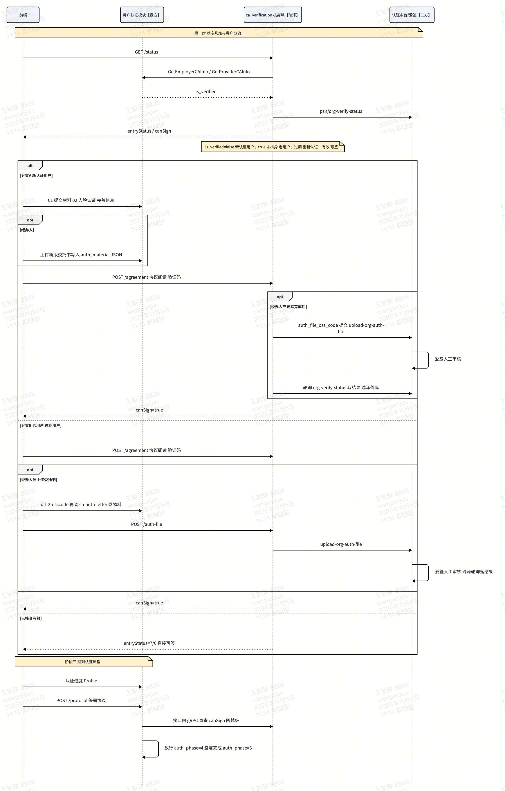

# REQ\-195 电子签章改造 — 用户认证模块技术方案（我的部分）

- **日期**：2026\-11\-04 ｜ **需求**：飞书 wiki `SGXPwbtVcigxrrk2fCPcoqBKn8O`（PRD V1\.1）｜ 云效 RZMP\-9021

- **对齐文档**：瑞泽《爱签核身验证技术方案》飞书 `Vt3wwieUziS5VukeD7acaftPnQb`

- **一句话范围**：新老用户判定口径落地；为核身域提供三要素资料接口；认证流程新增「03 电子签章认证」独立阶段（独立检查点）并串联签署协议准入。

---

## 1\. 职责边界

|范围|负责|内容|
|---|---|---|
|**我的**|用户认证模块|① 新老用户判定出口（`is_verified`）；② 新增 2 个资料 gRPC；③ 认证流程新增 03 电子签章认证阶段（独立检查点、进度下发、签署准入、新注册经办人委托书收集落库）；④ 数据库新增字段|
|**瑞泽的**|核身域 `ca_verification`|7 个核身 gRPC、`esp_ca_verify` 表、中台 8 接口直连（含「是否认证过爱签/是否过期」查询）、前端 HTTP `/v1/{role}/ca-verification/*`、委托书提交中台、轮询取回**爱签**审核结果并落库（审核动作在爱签侧，我方与瑞泽都不审核）|
|**瑞泽的**|合同签署线|与本方案无交集|

红线：认证域不实现核身逻辑、不读写 `esp_ca_verify`、不直连中台；核身域不读 `esp_employer` / `esp_provider`。

---

## 2\. 新老用户判定（PRD 关键判断，全部接口与流程分支的前提）

PRD「触发角色包含」原文口径：

> ① 新认证用户（雇主/服务商）；② 已完成认证但未通过爱签电子签章认证的用户（老用户）；③ 电子签章认证过期的用户。
> 注：已实名认证用户需通过中台接口查询是否认证过爱签，中台接口会返回用户是否认证过、是否过期，未认证过和认证过期的需增加 CA 认证流程。
> 
> 

三类用户的判定条件与路径：

|用户类别|判定条件|判定数据来源|认证路径|经办人委托书路径|
|---|---|---|---|---|
|**新认证用户**|`is_verified=false`（认证流程未完成，主档无 `auth_status=1`）|**我方判定**（资料 RPC 返回）|完整走 01 提交材料 → 02 人脸 → 完善信息 → 03 电子签章认证 → 04 签署协议|认证流程**内**收集新版委托书，我方落库并经 `auth_file_oss_code` 返回给瑞泽|
|**老用户**（已实名未核身）|`is_verified=true` 且中台「未认证过爱签」|我方判实名；**中台判核身**（瑞泽查 `psn/org-verify-status`）|不重走 01/02；固定入口=去认证，直接进入 03|认证已完成、不再经过我方流程 → 经瑞泽 `/auth-file` 直接上传（我方**不返回**`auth_file_oss_code`）|
|**认证过期用户**|中台「认证过爱签但已过期」（`verifyValidityTime ≤ now`）|中台（瑞泽查）|固定入口=重新认证，重走 03|同老用户，经瑞泽 `/auth-file` 重新上传|

分工结论：

|判断|谁做|依据|
|---|---|---|
|认证流程是否完成（新 vs 老用户）|**我方**|资料 RPC 的 `is_verified`（主档 `auth_status=1`）|
|是否认证过爱签 / 是否过期|**中台，经瑞泽查询**|PRD 注释明确指定中台接口返回|
|固定入口 6\+1 态|**瑞泽**（核身域推导）|综合上面两个判断 \+ 本地流程|

这是 `is_verified` 必填、且 `auth_file_oss_code` 仅新注册用户返回的原因——它是新老用户分流到我方或瑞泽收集委托书的开关。

---

## 3\. 改动清单

|仓库|性质|位置|内容|
|---|---|---|---|
|wds\-core\-service|新增|`api/certification/v1/ca_subject_info.proto`|2 个 gRPC 契约（瑞泽文档指定落点）|
|wds\-core\-service|新增|`internal/certification/biz/ca_subject_info.go`|资料双态组装 \+ 新老用户判定出口（§4\.3）|
|wds\-client\-api|修改|Profile / 认证进度接口（`userinfo_vo.go`、`certification_handler.go`）|透传电子签章认证状态 3 字段（§5）|
|wds\-client\-api|修改|协议签署入口（`certification_protocol.go` / espprotocol 进入处）|`canSign` 准入 \+ CA 完成回写 `auth_phase=4`（§5、§6）|
|wds\-client\-api|**新增**|`POST /v1/{role}/certification/ca-auth-letter`|老用户经办人补传委托书落物料表（§5\.2）|
|数据库|ALTER|`esp_employer_audit`、`esp_provider_audit`|`auth_phase` 注释扩展新增枚举值 4（CA 完成），**不加新列**——委托书复用 `auth_material` JSON（§6）|

---

## 4\. 新增接口（2 个 gRPC，字段级）

### 4\.1 接口一：GetEmployerCAInfo

|项|内容|
|---|---|
|接口地址|`certification.v1.CASubjectInfoService/GetEmployerCAInfo`（proto：`api/certification/v1/ca_subject_info.proto`）|
|作用|瑞泽核身域按雇主取三要素资料；`is_verified` 完成新老用户分流；`auth_file_oss_code` 把我方已收集的新版委托书交给瑞泽在三要素完成后提交中台|

入参：

|参数|类型|必填|说明|
|---|---|---|---|
|employer\_id|string|是|雇主 ID，与现有雇主主键的字符串形式一致|

出参（`CASubjectInfoReply`，两接口共用）：

|参数|类型|必返|说明|
|---|---|---|---|
|success|bool|是|true=资料可用；false=主体不存在或材料不足（业务失败，不返回 gRPC 错误）|
|message|string|是|success=false 时的原因文案，调用方可直接弹窗；成功时为空|
|subject\_type|int|是|0 未指定，1 个人，2 个体工商户，3 企业|
|legal\_name|string|是|个人合法姓名，或企业真实名称|
|legal\_id|string|是|个人身份证号，或企业统一社会信用代码|
|phone\_number|string|是|三要素短信发往的手机号（唯一来源）|
|legal\_person\_name|string|否|法人姓名；个人主体留空|
|legal\_person\_id|string|否|法人身份证号；个人主体留空|
|transactor\_name|string|否|经办人姓名；没有经办人必须留空，禁止回填法人|
|transactor\_id|string|否|经办人身份证号；同上|
|is\_verified|bool|是|**新老用户判定出口**：是否已在本系统认证通过（`auth_status=1`）；success=true 必返真实结果|
|auth\_file\_oss\_code|string|否|已收集的新版委托书文件 code；**仅新认证用户返回**，老用户不传|

### 4\.2 接口二：GetProviderCAInfo

|项|内容|
|---|---|
|接口地址|`certification.v1.CASubjectInfoService/GetProviderCAInfo`|
|作用|按服务商取同一套资料，规则与雇主完全相同|

入参：`provider_id`（string，必填）。出参与 4\.1 完全相同。

### 4\.3 组装与失败规则

|规则|要求|
|---|---|
|双态组装|已认证：读主档实名行；认证流程中：从认证材料（OCR JSON）组装同一出参|
|失败口径|仅 ID 不存在 → `success=false`「主体不存在」；材料不足 → `success=false` \+ 明确原因；不返回 gRPC 错误|
|经办人|无经办人 → `transactor_*` 留空，禁止回填法人|
|缺资料|个人缺姓名/身份证号/手机号，企业缺企业名称/信用代码/法人姓名/法人证件号/手机号 → `success=false` \+ 中文说明，瑞泽收到失败不调中台|

---

## 5\. BFF 接口改动（既有接口修改 \+ 1 个新增）

|接口|改动|字段/行为|
|---|---|---|
|「我的\-认证信息」聚合（Profile）与认证步骤条进度|认证信息块**新增 3 个透传字段**（服务端调瑞泽 `GetAsignIdentityVerifyStatus` 后原样下发）|`entryStatus`：int，1 去认证 / 2 继续认证 / 3 审核中\(不可点\) / 4 重新上传 / 5 重新认证 / 6 即将到期 / 7 认证成功；`canSign`：bool；`showSuccessEntry`：bool|
|协议签署入口 `/protocol`（既有）|**新增服务端准入强校验**：`/protocol` 接口内部调 gRPC `GetAsignIdentityVerifyStatus`，`canSign=false` 直接拦截（文案「请先完成电子签章认证」），**防止越级签署——拦截在服务端接口内完成，不依赖前端调 ****`GET /status`**** 自觉**（`GET /status` 只用于固定入口/进度展示）；`canSign=true` 放行并**惰性回写 ****`auth_phase=4`****（CA 完成）**（§6）|法大大 120 通道不受限|

### 5\.2 新增 HTTP 接口：老用户经办人补传委托书

|项|内容|
|---|---|
|接口地址|`POST /v1/employer/certification/ca-auth-letter`、`POST /v1/provider/certification/ca-auth-letter`|
|作用|分支 B（老用户/过期用户）经办人补传的新版委托书**落物料表**：把 oss code 按 CA 委托书 `material_type` 写入最新审核记录的 `auth_material` JSON。**只落物料，不提交中台**（提交中台由瑞泽 `POST /auth-file` 负责，物料归我方、核身域禁写认证域表）|
|背景|老用户认证已完成，不会再经过任何材料提交接口（旧材料上传接口已废弃，材料随 OCR/提交材料接口写入），没有现成入口更新物料表|

入参（JSON，登录态 Bearer）：

|参数|类型|必填|说明|
|---|---|---|---|
|ossCode|string|是|委托书文件 code，由既有 `POST /v1/{role}/certification/url-2-osscode` 产出|

出参：`model=null`，成功即落库完成。

服务端校验与写入规则：

|规则|说明|
|---|---|
|主体校验|登录态对应主体为企业/个体户且当前身份为经办人；个人主体调用返回业务错误|
|写入位置|该主体**最新一条审核记录**的 `auth_material` JSON：已有 CA 委托书元素则覆盖 `url_code`，否则追加元素（行锁/乐观并发防覆盖）|
|文件校验|PDF/JPG/PNG、≤20MB（按 oss code 反查或前端声明，联调定）|
|与瑞泽的顺序|前端先调本接口落物料，再调瑞泽 `POST /auth-file`（`fileUrl` 用 OSS 地址）提交中台审核；两步都成功才算补传完成，第一步失败不调第二步|
|Apifox|开发落地后随 §8 同一口径推送登记|

---

## 6\. 数据库表改动（auth\_phase 新增枚举值，不覆盖原语义）

### 6\.1 阶段模型

认证流程检查点（`auth_phase` 扩展后，双端一致）：

|值|语义|说明|
|---|---|---|
|0|未提交|既有，不动|
|1|身份认证完成|既有，不动|
|2|人脸认证完成|既有，不动|
|3|电子签（协议）完成|**既有语义不变**，指旧的「04 签署协议」阶段|
|**4**|**电子签章认证（CA）完成**|**本次新增枚举值**：新阶段 03，`canSign=true` 时惰性回写，不覆盖 0\~3 任何原值|

> 决策：`auth_phase` 只**追加**未使用的值 `4` 表示 CA 阶段完成，不覆盖、不顺延原有枚举，**零存量迁移**。
> 
> 

### 6\.2 字段变更（不加新列，委托书复用既有 `auth_material` JSON）

既有材料的存储方式：`esp_employer_audit` / `esp_provider_audit` 的 `auth_material` 列是 JSON 数组，元素为 `{material_type, material_name, url_code, created_time, uploaded_time, expire_time}`，**授权书等材料都按 ****`material_type`**** 分类存在这里**，代码已有 `certification.FindAuthMaterialOssCode(authMaterial, materialType)` 按 type 取值（现用值：`MaterialTypeEnterpriseLicense=3`）。

新版电子签 CA 委托书**沿用同一存储**：作为新的 `material_type` 写入 `auth_material` JSON，不加新列、不加新表。

|表|改动|内容|作用|
|---|---|---|---|
|`esp_employer_audit`|`auth_phase` 注释扩展|追加 `4=电子签章认证(CA)完成`|新阶段检查点|
|`esp_employer_audit`|`auth_material` JSON|新增 `material_type = MaterialTypeCASignAuthLetter`（值待定，暂定 10，上线前与材料上传链路核对未占用）|新版委托书 url\_code 存储，`auth_file_oss_code` 数据源|
|`esp_provider_audit`|同上两项|同雇主|同上|

```sql
ALTER TABLE `esp_employer_audit`
  MODIFY COLUMN `auth_phase` tinyint NOT NULL DEFAULT 0 COMMENT '验证阶段（检查点）: 0=未提交, 1=身份认证完成, 2=人脸认证完成, 3=电子签完成, 4=电子签章认证(CA)完成';

ALTER TABLE `esp_provider_audit`
  MODIFY COLUMN `auth_phase` tinyint NOT NULL DEFAULT 0 COMMENT '验证阶段（检查点）: 0=未提交, 1=身份认证完成, 2=人脸认证完成, 3=电子签完成, 4=电子签章认证(CA)完成';
```

### 6\.3 设计说明与已知限制

|问题|结论|
|---|---|
|为什么用 4 而不是顺延（3=CA、4=协议）？|顺延会改变存量 `auth_phase=3`（协议签完）的语义，需要全量订正\+审计所有 `==3` 判断点；追加 4 不碰任何原值，零迁移|
|检查点顺序说明|新流程中 03（CA）在 04（协议）之前，因此检查点写入顺序是 `2 → 4（CA 完成）→ 3（协议完成）`，**数值不保证单调递增**；`==3` 仍表示协议完成，`==4` 仅表示 CA 完成|
|已知限制|用户签完协议后 `auth_phase=3`，无法单从该字段区分「做过 CA 的协议完成」与「老用户的协议完成」——CA 完成事实以瑞泽 `canSign` 实时查询为准，本地 4 只是流程恢复用的检查点；涉及「是否做过 CA」的展示一律走 `GetAsignIdentityVerifyStatus`，不依赖本地值|
|代码审计点|既有 `auth_phase >= 3` 的判断：CA 完成用户（=4）同样命中，语义兼容；`== 3` 判断不受影响（仅协议完成）。上线前对两仓库 `auth_phase` 判断点做一次 grep 审计即可|
|委托书为什么存 `auth_material` JSON？|**既有授权书就存在这里**（按 `material_type` 分类），新版委托书是同一种材料，沿用同一存储与读取函数（`FindAuthMaterialOssCode`），上传链路（`url-2-osscode` \+ 材料提交）零改造；新增列反而造成同一份材料两处存放|
|CA 过程状态落我方库吗？|**不落**。在瑞泽 `esp_ca_verify` 与中台，我方只保留检查点 4 和 `auth_material` 里的委托书 code|
|新增表/列吗？|**不加列、不加表**。仅 `auth_phase` 注释扩展 \+ `auth_material` JSON 内新增一个 `material_type`|

### 6\.4 出参字段 → 数据来源映射

|CASubjectInfoReply 字段|已认证（is\_verified=true，老用户）|认证流程中（is\_verified=false，新认证用户）|
|---|---|---|
|subject\_type|主档 `subject_type`|认证材料判定|
|legal\_name / legal\_id|主档实名行|OCR JSON：`id_card`（个人）/ `business_license`（企业）|
|phone\_number|主档手机号|认证流程手机号|
|legal\_person\_name / legal\_person\_id|主档|OCR JSON 中法人信息|
|transactor\_name / transactor\_id|主档经办人信息；无则空|OCR JSON：`agent_id_card`；无则空|
|is\_verified|`auth_status=1` → true|false|
|auth\_file\_oss\_code|**不传**（老用户委托书走瑞泽 `/auth-file`）|`FindAuthMaterialOssCode(审核记录.auth_material, MaterialTypeCASignAuthLetter)`，空则不传|

---

## 7\. 联合流程（我 \+ 瑞泽）

**第一步永远是状态判定与分流**：进入固定入口或点击签署时先 `GET /status`，由 `is_verified`（我方判认证流程是否完成）\+ 中台核身状态（是否认证过/是否过期，瑞泽查）共同定出用户类别，再走各自分支——**新老用户流程不同**：

|用户类别|判定（§2）|走的分支|
|---|---|---|
|新认证用户|`is_verified=false`|分支 A：完整 01 → 02 → 完善信息（经办人收集委托书）→ 03 → 04|
|老用户（已实名未核身）|`is_verified=true` \+ 中台未认证过|分支 B：**跳过 01/02**，固定入口=去认证，直接 03 → 04|
|认证过期用户|中台已过期|分支 B 变体：入口=重新认证，重走 03 → 04|
|已核身有效|中台有效|无分支：入口=认证成功/即将到期，直接可签|

调用步骤清单（按用户类别分开）：

**公共第一步**：

|步|归属|动作|
|---|---|---|
|0|瑞泽（判）\+ 我方（出参）|`GET /status` → 调我方资料 RPC 取 `is_verified` \+ 中台查核身状态 → 按 §2 表定用户类别与 `entryStatus`|

**分支 A：新认证用户（is\_verified=false）**：

|步|归属|动作|
|---|---|---|
|A1|我方（既有）|01 材料 / 02 人脸 / 完善信息，`auth_phase` 推进 1→2|
|A2|我方（新增）|经办人：上传新版委托书 → 写入 `auth_material` JSON（新 `material_type`）|
|A3|瑞泽|03 电子签章认证：`/agreement` → 协议 → `/send-sms-code` → `/check-sms-code`|
|A4|瑞泽|经办人：用我方 `auth_file_oss_code` 提交中台，**爱签人工审核**，瑞泽轮询落结果|
|A5|汇合|`canSign=true` → 转公共收尾|

**分支 B：老用户（已实名未核身）/ 过期用户**：

|步|归属|动作|
|---|---|---|
|B1|瑞泽|直接 03 电子签章认证（不经过我方任何实名接口）：`/agreement` → 协议 → 验证码|
|B2|我方（新增接口）|经办人：`url-2-osscode` 落 OSS → 调 `POST /certification/ca-auth-letter` 把 oss code 写入最新审核记录 `auth_material` JSON（新 `material_type`）——**物料归我方**|
|B3|瑞泽|前端再调 `POST /auth-file`（fileUrl 为 OSS 地址），瑞泽收件后提交中台，爱签审核，轮询落结果|
|B4|汇合|`canSign=true` → 转公共收尾|

> 为什么需要 B2 这个新接口：老用户认证已完成，**不会再经过任何材料提交接口**（旧的材料上传接口已废弃，材料随 OCR/提交材料接口写入），没有现成入口把补传的授权书写进物料表；且物料归我方、核身域禁写认证域表，所以新增 `ca-auth-letter` 接口负责落物料，瑞泽 `/auth-file` 只负责提交中台。
> 
> 



**公共收尾（所有用户一致）**：

|步|归属|动作|
|---|---|---|
|C1|我方（新增下发）|认证进度/Profile 透传 `entryStatus`/`canSign`/`showSuccessEntry`|
|C2|我方（新增准入）|`/protocol` 接口内**服务端强校验**`canSign=true`（gRPC 直查核身域，防越级签署，非前端判断）→ 回写 `auth_phase=4`（CA 完成）；签署完成写 `auth_phase=3`（既有逻辑不变）|
|C3|瑞泽|业务合同签署（本方案不含）|

---

## 8\. Apifox 同步记录（https://app\.apifox\.com/project/8677491）

|项|内容|
|---|---|
|同步接口|`POST /v1/user/info`（用户个人中心，@Tags 用户信息）——本次唯一有**字段变动**的 HTTP 接口|
|字段变动|`ProfileInfo` 响应模型新增 3 字段：`entryStatus`（integer，1 去认证/2 继续认证/3 审核中/4 重新上传/5 重新认证/6 即将到期/7 认证成功）、`canSign`（boolean）、`showSuccessEntry`（boolean）|
|推送方式|从 `wds-client-api` 代码 swag 生成当前 swagger → 裁剪出该接口及 18 个依赖 schema → 手工追加 3 字段 → `apifox_openapi --overwrite OVERWRITE_EXISTING`|
|推送结果|2026\-11\-04：`schemaUpdated=2`（模型已更新）；`endpointCreated=1, endpointUpdated=0`——**按路径未匹配到既有接口，被当作新建**，需网页端核对（见下）|
|遗留核对|① 网页端确认 `POST /v1/user/info` 是否在「用户信息」原目录外多出一份重复接口（92707146 目录），有则手动删除旧/新之一并核对新字段；② `/employer/protocol`、`/provider/protocol` 仅新增准入行为（字段不变），无需推 Apifox；③ 2 个 gRPC（`GetEmployerCAInfo`/`GetProviderCAInfo`）为服务端内部接口，不进 Apifox；④ 核身域 7×2 HTTP 归瑞泽维护，Apifox 由瑞泽同步|
|后续|开发落地时 DTO 以 Apifox 为准回写 Swagger 注解，再按同一方式推送覆盖，保证两侧一致；新接口 `POST /v1/{role}/certification/ca-auth-letter`（§5\.2）落地后同口径登记推送|

---

## 9\. 待确认项

|优先级|\#|事项|归属|
|---|---|---|---|
|P0|T1|新认证经办人委托书收集挂在「完善信息」阶段的具体页面/接口|PM \+ 我|
|P1|T2|消息通知归属：审核通过/驳回、认证完成的变化检测在瑞泽域，发送走我方 notify——触发方式待对齐|我 \+ 瑞泽|
|P2|T3|升级提醒批量（已实名 \+ 未核身 \+ 有权限）的双方口径|PM \+ 双方|
|—|瑞泽侧|`upload-org-auth-file` 的 `userId`、CA 协议文件 `fileType=20` 来源、`org-verify-status` 审核意见字段（见他文档 §7）|瑞泽|

