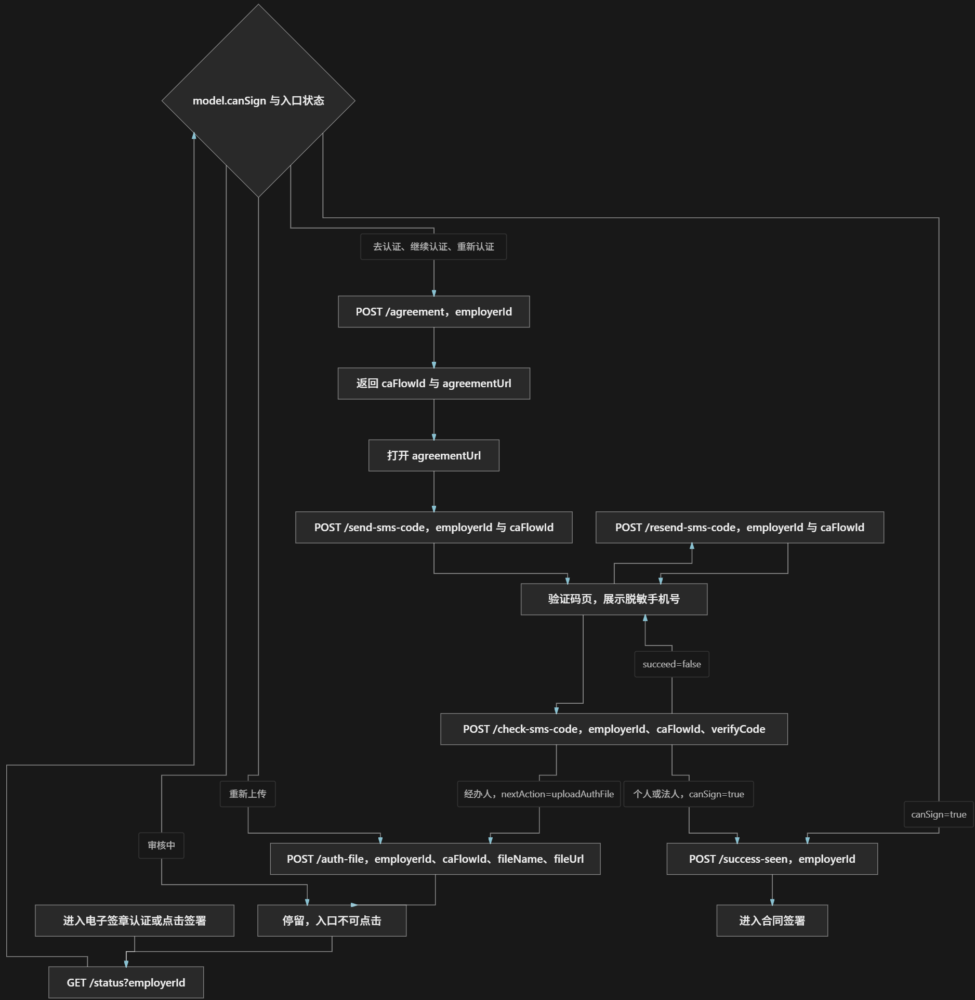

# REQ\-195 电子签章改造\-爱签核身验证技术方案

---


# 爱签核身验证技术方案


个人和企业都走运营商三要素。`verifyType` 固定为 `20`。个人传 `userCertNo`、`userName`、`userTelephone`，不传银行卡。中台接口的全部能力仍见 \[爱签核身接入\]\(爱签核身接入\.md\)。


## 1\. 范围


只覆盖爱签渠道 `channel=151`。不做人脸：不传 `faceAuthMode`、`redirectUrl`，忽略响应里的 `authUrl`、`faceToken`。不做四要素。不调用 `get-verify-page-list`，也不调用中台回调入口。法大大合同保持现有身份接口，不走这套核身。


调用的中台接口：


- `POST /signing/get-agreement-url`

- `POST /signing/psn-verify-status`、`POST /signing/psn-verify-create`

- `POST /signing/org-verify-status`、`POST /signing/org-verify-create`

- `POST /signing/verify-check-code`、`POST /signing/verify-resend`

- `POST /signing/upload-org-auth-file`（仅经办人，且核身已经有效）

`verifyValidityTime` 一律按秒级 Unix 时间戳比较。中台 base URL、超时和这 8 个 path 放在本域自己的配置节，不引用 contracts 的 `AsignClient`。`channel` 在这 8 个调用里写死 `"151"`。


## 2\. 向用户认证模块取资料


本域不读 `esp_employer`、`esp_provider`，也不调用合同域现有的签署人身份 RPC。认证可能还没走完，实名信息这时不一定在这两张表里。


下面两个 gRPC 由用户认证模块实现，不属于 `ca_verification`。契约在 \[api/certification/v1/ca\_subject\_info\.proto\]\(\.\./\.\./api/certification/v1/ca\_subject\_info\.proto\)，本域只调用，不实现。两个接口共用 `CASubjectInfoReply`。


`GetEmployerCAInfo`：按雇主取出做三要素需要的资料。


- 入参：`employerId`，`string`。与现有雇主 ID 一致。

- 认证已经完成，或者还在认证流程里，都要能返回。未完成时从认证流程中的材料组装同一出参，不能因为 `esp_employer` 还没有实名行就当成无此用户。`employerId` 本身不存在，才返回失败。材料还不够组出本次核身所需字段时，也返回明确失败。

`GetProviderCAInfo`：按服务商取出同一套资料，规则与雇主相同。


- 入参：`providerId`，`string`。与现有服务商 ID 一致。

- 同样要覆盖认证已完成和尚未完成。不能因为 `esp_provider` 还没有实名行就当成无此用户。`providerId` 本身不存在，才返回失败。材料不够时返回明确失败。

`CASubjectInfoReply` 出参：


- `success`：`bool`。`true` 表示资料可用；`false` 表示主体不存在或材料不足。这种业务失败不用 gRPC 错误

- `message`：`string`。`success=false` 时的原因，调用方可直接展示；成功时为空

- `subject_type`：`CASubjectType`。0 未指定，1 个人，2 个体工商户，3 企业。取值与雇主、服务商现有主体类型一致

- `legal_name`：`string`。个人合法姓名，或企业真实名称

- `legal_id`：`string`。个人身份证号，或企业统一社会信用代码

- `phone_number`：`string`。身份验证用手机号，三要素短信发到这个号码

- `legal_person_name`：`string`。法人姓名。个人主体留空

- `legal_person_id`：`string`。法人身份证号。个人主体留空

- `transactor_name`：`string`。经办人姓名。没有经办人时留空

- `transactor_id`：`string`。经办人身份证号。没有经办人时留空

- `is_verified`：`bool`，必填。该用户是否已在本系统中认证通过。`success=true` 时必须按真实结果返回

- `auth_file_oss_code`：`string`，可选。授权文件在本系统中的 oss code，仅新注册用户返回。已认证用户或不适用时不传

没有经办人时，认证模块不要把法人姓名和法人身份证号填进 `transactor_name`、`transactor_id`，这两个字段留空。本域调用中台前再补：两个经办人字段都为空时，用法人姓名和法人身份证号填中台的 `transactorName`、`transactorCertNo`。手机号始终用 `phone_number`，不从别处挑。


本域收到这两个 RPC 的失败，或关键字段为空，就弹窗说明，不调用爱签。


本期只有雇主和服务商。供应商不在这两个 RPC 里。


组包规则：


- `subjectType=1`：只使用 `legalName`、`legalId`、`phoneNumber`，分别对应 `userName`、`userCertNo`、`userTelephone`。法人和经办人字段忽略。不传 `userId`、`updaterId`、银行卡。

- `subjectType=2` 或 `3`：走企业接口。`legalName`、`legalId` 对应 `companyName`、`companyCertNo`。`legalPersonName`、`legalPersonId` 对应法人姓名和证件号。经办人按上面的空经办人补全规则填充。`transactorTelephone` 用 `phoneNumber`。不传 `companyId`、`transactorId`、`updaterId`、营业执照文件、银行卡。

- 经办人证件号与法人证件号去空格、忽略大小写后相同，按法人处理。不同则按经办人处理。中台请求里仍然没有「是否法人」字段。

- 同一证件在雇主、服务商、WEB、APP 之间共用中台核身状态。本地可以保留同一证件的多条历史流程，入口看最新一条未作废记录。

资料不全时不发中台请求。个人缺姓名、身份证号或手机号，企业缺企业名称、统一社会信用代码、法人姓名、法人身份证号或手机号，都返回中文弹窗。


## 3\. 调用顺序


```Plain Text
flowchart TD
  loadSubject[GetEmployerCAInfo 或 GetProviderCAInfo] --> kind{个人还是企业}
  kind -->|个人| psnStatus[进入时查 psn-verify-status]
  kind -->|个体或企业| orgStatus[进入时查 org-verify-status]
  psnStatus --> psnOk{已有有效核身}
  orgStatus --> orgOk{已有有效核身}
  psnOk -->|是| psnDone[个人可签署]
  psnOk -->|否| agreement[get-agreement-url]
  orgOk -->|否| agreement
  orgOk -->|是| needFile{需要授权书}
  needFile -->|否| legalDone[法人可签署]
  needFile -->|是| fileState{授权书状态}
  fileState -->|审核成功| agentDone[经办人可签署]
  fileState -->|审核中| auditing[不可签署]
  fileState -->|未上传或失败| upload[upload-org-auth-file]
  agreement --> create[确认协议后 verify-create]
  create --> code[verify-check-code]
  code -->|succeed=true 且是个人或法人| doneNow[三要素完成并可签署]
  code -->|succeed=true 且是经办人| waitFile[三要素完成，进入授权书]
  waitFile --> upload
```


`verify-check-code` 返回 `succeed=true`，就表示前一步三要素已经完成。校验接口成功后不回查 `psn-verify-status` 或 `org-verify-status`，也不用状态接口推翻这次成功。个人和法人因此可以直接签署。经办人因此只表示三要素完成，授权书仍要另走。


两个状态接口只在进入核身、再次打开入口、签署前查询，以及经办人查看授权书审核时使用。紧接验证码成功的那一次查询信本地「验证码已通过」，不再打状态接口。中台若还没把成功记录写出来，也不把用户打回未认证。`verify-check-code` 成功时 `model` 为空，当次拿不到 `verifyValidityTime`。有效期留到用户离开后再次进入时，用状态接口读取。


协议接口的 `redirectUrl` 也不传。响应里的 `agreementUrl` 交给前端展示，`agreementSerialNo` 存本地，确认阅读后再发起核身。发起时带上这个流水号。`verifyType=20`。创建成功只产生 `verifyFlowId`，短信由中台发送。没收到短信再 `verify-resend`。


企业在三要素尚未完成时不上传授权书。经办人要等 `verify-check-code` 成功，或进入时状态接口已经显示核身有效，才上传。上传成功只表示收件。审核通过、审核中、审核失败看之后进入时的 `org-verify-status`，只读授权书字段，不用它复核三要素。审核中不能签署。


再次进入时的准入：个人看 `overallStatus=1` 且 `verifyValidityTime` 大于当前秒。企业核身是否仍有效看 `identityVerifyStatus`，不看 `overallStatus`。法人还要 `needUploadFile=0`。经办人还要 `fileUploadStatus=3`。本地刚刚验证码通过、尚未写入有效期的，个人和法人先按可签署。


剩余有效期小于等于 10 天：入口展示「即将到期」，签署仍放行。到期当天起按无效处理，入口为「重新认证」。


固定入口状态：


- 去认证：无有效记录，且没有进行中的流程

- 继续认证：已拿到协议或 `verifyFlowId`，验证码尚未通过

- 审核中：`fileUploadStatus=2`，不可点击

- 重新上传：`fileUploadStatus=4`，或核身已有效但仍未上传

- 重新认证：已过期

- 即将到期：未过期且剩余小于等于 10 天，可签署

- 认证成功：当前有效，且不在即将到期窗口

「认证成功只曝光一次」按证件维度存在本地标记里。WEB 和 APP 共用。前端展示过后调用标记接口；服务端状态查询仍返回成功，只把 `showSuccessEntry` 置为 false。


## 4\. 服务分层与 RPC


新建 `ca_verification` 域，不放进 contracts。目录按现有域的方式：`api/ca_verification/v1`、`internal/ca_verification/service`、`biz`、`data`。`biz` 做主体分支、经办人补全、准入和弹窗文案。`data` 只调用认证域 gRPC、调用爱签中台、保存流程。不把规则放进公共包，也不调用 `internal/contracts`。


`GetEmployerCAInfo` 和 `GetProviderCAInfo` 由用户认证模块实现。


本域这 7 个都是业务动作。被拦住时返回 `success=false` 和中文 `message`，不返回 gRPC 错误。成功时 `success=true`、`message` 为空。每个请求的 `employer_id` 与 `provider_id` 必须且只能填一个。服务端用它向用户认证模块取资料，不接受调用方自带的姓名、证件号和手机号。


入参和出参：


`GetAsignIdentityVerifyStatus` 按雇主或服务商查询核身进度。`can_sign` 只表示当前能否签署，不代替 `entry_status`。


- 入参 `employer_id`：`string`。雇主 ID。查询雇主时必填，与 `provider_id` 互斥

- 入参 `provider_id`：`string`。服务商 ID。查询服务商时必填，与 `employer_id` 互斥

- 出参 `success`：`bool`。`true` 表示查询完成；`false` 表示主体无效或资料不足

- 出参 `message`：`string`。`success=false` 时的弹窗文案；成功时为空

- 出参 `entry_status`：固定入口状态。0 未指定，1 去认证，2 继续认证，3 审核中且不可点击，4 重新上传，5 重新认证，6 即将到期仍可签署，7 认证成功

- 出参 `can_sign`：`bool`。`true` 表示当前可以进入合同签署

- 出参 `show_success_entry`：`bool`。`true` 表示「认证成功」入口还需要展示一次

- 出参 `masked_phone`：`string`。脱敏后的验证手机号，例如 `138****8888`；没有进行中的流程时为空

`PrepareAsignIdentityVerify` 申请新的核身流程和协议链接。不返回中台 `agreement_serial_no`。


- 入参 `employer_id`：`string`。雇主 ID。雇主发起时必填，与 `provider_id` 互斥

- 入参 `provider_id`：`string`。服务商 ID。服务商发起时必填，与 `employer_id` 互斥

- 出参 `success`：`bool`。`true` 表示已分配流程；`false` 表示当前状态不能开始或资料不足

- 出参 `message`：`string`。`success=false` 时的弹窗文案；成功时为空

- 出参 `ca_flow_id`：`string`。本域流程号。后续发短信、校验、重发、上传授权书都传它

- 出参 `agreement_url`：`string`。协议阅读页地址，由前端打开

`CreateAsignIdentityVerify` 按已有流程发送三要素短信。不返回中台 `verify_flow_id`。


- 入参 `employer_id`：`string`。雇主 ID。与创建该 `ca_flow_id` 时的主体一致，和 `provider_id` 互斥

- 入参 `provider_id`：`string`。服务商 ID。与创建该 `ca_flow_id` 时的主体一致，和 `employer_id` 互斥

- 入参 `ca_flow_id`：`string`。`PrepareAsignIdentityVerify` 返回的流程号

- 出参 `success`：`bool`。`true` 表示短信已提交发送；`false` 表示流程无效或尚未阅读协议

- 出参 `message`：`string`。`success=false` 时的弹窗文案；成功时为空

- 出参 `masked_phone`：`string`。短信实际发往的脱敏手机号

`CheckAsignIdentityVerifyCode` 提交用户输入的短信验证码。`success=true` 且个人或法人时 `can_sign=true`；经办人时 `next_action` 为上传授权书。


- 入参 `employer_id`：`string`。雇主 ID。与 `ca_flow_id` 所属主体一致，和 `provider_id` 互斥

- 入参 `provider_id`：`string`。服务商 ID。与 `ca_flow_id` 所属主体一致，和 `employer_id` 互斥

- 入参 `ca_flow_id`：`string`。本次核身流程号

- 入参 `verify_code`：`string`。用户输入的短信验证码

- 出参 `success`：`bool`。`true` 表示验证码正确且三要素完成；`false` 表示验证码错误、流程作废或不能校验

- 出参 `message`：`string`。失败时的弹窗文案，验证码错误时为「验证码错误，请重新输入」

- 出参 `can_sign`：`bool`。`true` 表示个人或法人现在可以签署；经办人在授权书完成前为 `false`

- 出参 `next_action`：0 没有额外动作，1 经办人下一步上传授权书，2 授权书已收下并等待审核。经办人成功时为 1；其他成功场景为 0

`ResendAsignIdentityVerifyCode` 重发同一次流程的短信验证码。成功不表示三要素已经通过。


- 入参 `employer_id`：`string`。雇主 ID。与 `ca_flow_id` 所属主体一致，和 `provider_id` 互斥

- 入参 `provider_id`：`string`。服务商 ID。与 `ca_flow_id` 所属主体一致，和 `employer_id` 互斥

- 入参 `ca_flow_id`：`string`。本次核身流程号，必须已经发送过短信

- 出参 `success`：`bool`。`true` 表示已重新提交发送；`false` 表示流程无效或尚未发过短信

- 出参 `message`：`string`。`success=false` 时的弹窗文案；成功时为空

`UploadAsignOrgAuthFile` 上传经办人已盖章授权书。只接受授权文件，不在这里接收 CA 协议文件。`success=true` 只表示已收下，不表示审核通过。


- 入参 `employer_id`：`string`。雇主 ID。与 `ca_flow_id` 所属主体一致，和 `provider_id` 互斥

- 入参 `provider_id`：`string`。服务商 ID。与 `ca_flow_id` 所属主体一致，和 `employer_id` 互斥

- 入参 `ca_flow_id`：`string`。三要素已经完成的经办人流程号

- 入参 `file_name`：`string`。授权书文件名，包含后缀，例如「授权委托书\.pdf」

- 入参 `file_url`：`string`。授权书上传完成后的可访问地址

- 出参 `success`：`bool`。`true` 表示授权书已提交审核；`false` 表示还不能上传或文件无效

- 出参 `message`：`string`。`success=false` 时的弹窗文案；成功时为空

- 出参 `next_action`：收件成功时为 2，表示等待审核

`MarkAsignVerifySuccessEntrySeen` 标记认证成功入口已被展示。成功后再次查询状态时 `show_success_entry` 为 `false`。


- 入参 `employer_id`：`string`。雇主 ID。标记雇主入口时必填，与 `provider_id` 互斥

- 入参 `provider_id`：`string`。服务商 ID。标记服务商入口时必填，与 `employer_id` 互斥

- 出参 `success`：`bool`。`true` 表示已记下展示；`false` 表示当前没有可标记的成功入口

- 出参 `message`：`string`。`success=false` 时的说明；成功时为空

`GetEmployerCAInfo`、`GetProviderCAInfo` 由用户认证模块实现，出参都是 `CASubjectInfoReply`。没有经办人时 `transactor_name`、`transactor_id` 必须留空，不要填入法人信息。


- `GetEmployerCAInfo` 入参 `employer_id`：`string`。雇主 ID，与现有雇主主键的字符串形式一致

- `GetProviderCAInfo` 入参 `provider_id`：`string`。服务商 ID，与现有服务商主键的字符串形式一致

- 出参 `success`：`bool`。`true` 表示资料可用；`false` 表示主体不存在或材料不足

- 出参 `message`：`string`。`success=false` 时的原因，调用方可直接展示；成功时为空

- 出参 `subject_type`：主体类型。0 未指定，1 个人，2 个体工商户，3 企业

- 出参 `legal_name`：`string`。个人合法姓名，或企业真实名称

- 出参 `legal_id`：`string`。个人身份证号，或企业统一社会信用代码

- 出参 `phone_number`：`string`。身份验证用手机号，三要素短信发到这个号码

- 出参 `legal_person_name`：`string`。法人姓名。个人主体留空

- 出参 `legal_person_id`：`string`。法人身份证号。个人主体留空

- 出参 `transactor_name`：`string`。经办人姓名。没有经办人时留空，不要回填法人姓名

- 出参 `transactor_id`：`string`。经办人身份证号。没有经办人时留空，不要回填法人身份证号

- 出参 `is_verified`：`bool`，必填。该用户是否已在本系统中认证通过。`success=true` 时必须返回真实结果

- 出参 `auth_file_oss_code`：`string`，可选。授权文件在本系统中的 oss code。仅新注册用户返回；已认证用户或不适用时不传

其中只有 `GetAsignIdentityVerifyStatus` 暴露给用户认证模块调用。另外 6 个只由 esp\-api 转成前端 HTTP，用户认证模块不调用。


`GetAsignIdentityVerifyStatus`：用户认证流程用来查询这个雇主或服务商的电子签章认证做到哪一步。认证模块在展示认证进度、决定能否进入后续「签署协议」之前调用。入参是 `employerId` 或 `providerId`。出参是入口状态、`canSign`、`showSuccessEntry`。`canSign=true` 表示这个主体的电子签章认证已经完成，认证流程可以继续。审核中、未完成、已过期时 `canSign=false`，并带上可展示的状态。


调用顺序：


1. `GetAsignIdentityVerifyStatus`。固定入口和签署前都先调它。内部读取认证资料，再按是否已有本地「验证码已通过」决定要不要打状态接口。返回入口状态，以及当前是否可以签署。可以签署就到此结束。

2. 状态是去认证、继续认证或重新认证时，调 `PrepareAsignIdentityVerify`。内部只调 `get-agreement-url`。每调一次都新建一条流程，分配新的 `caFlowId`，把中台返回的 `agreementSerialNo` 记在这条流程上。返回给调用方的是 `caFlowId` 和 `agreementUrl`。此时不发起三要素，不发短信。

3. 用户看完协议后，调 `CreateAsignIdentityVerify`，只带 `caFlowId`。服务端用这条流程上保存的 `agreementSerialNo` 调 `psn-verify-create` 或 `org-verify-create`，`verifyType=20`，再把中台返回的 `verifyFlowId` 记在同一条流程上。返回脱敏手机号，不返回 `verifyFlowId`。同一个 `caFlowId` 重复发起时复用已记下的 `verifyFlowId`，不向中台再创建一次。

4. 用户输入短信验证码后，调 `CheckAsignIdentityVerifyCode`，带 `caFlowId` 和验证码。服务端取出该流程的 `verifyFlowId`，只调 `verify-check-code`。`succeed=true` 即三要素完成，不回查两个状态接口。个人和法人返回可以签署。经办人返回三要素已完成、下一步上传授权书。验证码错误则 `success=false`。同一个 `caFlowId` 的并发校验只保留一次在途。

5. 没收到短信时，调 `ResendAsignIdentityVerifyCode`，带同一个 `caFlowId`。服务端用它对应的 `verifyFlowId` 调 `verify-resend`，不改变三要素结论。之后仍回到第 4 步。

6. 只有经办人、并且三要素已经完成，才调 `UploadAsignOrgAuthFile`，带 `caFlowId` 和授权文件。内部用该流程的 `verifyFlowId` 调 `upload-org-auth-file`。返回成功只表示收件。审核结果留给之后再次调用第 1 步，那一次才会为授权书去查 `org-verify-status`。

7. 前端把「认证成功」展示过一次后，调 `MarkAsignVerifySuccessEntrySeen`。只改本地曝光标记。之后第 1 步仍返回认证成功，但 `showSuccessEntry=false`。

`GetEmployerCAInfo` 和 `GetProviderCAInfo` 不是本域的 RPC。第 2 步到第 6 步在需要实名资料时，由本域内部调用它们。


签署拦截不改 contracts 的取链 RPC，也不改 `GetSigningURLReply`。前端在向用户展示签署链接之前，先调状态接口。未准入时不要取链。生成合同、上传合同文件、异步取链不因未核身失败。


## 5\. 暴露给前端


HTTP 在 esp\-api，雇主和服务商各一套。雇主前缀 `/v1/employer/ca-verification`，服务商前缀 `/v1/provider/ca-verification`。雇主侧每个请求都传 `employerId`，服务商侧每个请求都传 `providerId`，用字符串。前端全程只有一个流程号 `caFlowId`，是字符串。它在 `POST /agreement` 分配并返回；每调用一次 `/agreement` 都是一次新流程，生成一个新的 `caFlowId`。中台的 `agreementSerialNo` 和 `verifyFlowId` 是两个不同的号，只跟这条 `caFlowId` 存在服务端，不出现在 HTTP 响应里。


响应沿用 esp\-api 现有结构：HTTP 始终 200，体为 `code`、`succeed`、`message`、`model`、`traceId`。字段用现有驼峰。gRPC `success=false` 时 `succeed=false`，`message` 原样给前端弹窗，`model` 为 null。这是雇主端和服务商端，不用管理后台的 `100409`。


前端调用顺序与上一节的 7 个 gRPC 一一对应。下图里的路径都要再接上雇主前缀 `/v1/employer/ca-verification` 或服务商前缀 `/v1/provider/ca-verification`。Header 用现有登录 Bearer。下面示例写成雇主的 `employerId`；服务商把该字段换成 `providerId`。`GET /status` 把这个 ID 放在 query，其余接口放在 JSON 请求体。


```Plain Text
flowchart TD
  enter["进入电子签章认证或点击签署"] --> statusApi["GET /status?employerId"]
  statusApi --> gate{"model.canSign 与入口状态"}
  gate -->|"canSign=true"| seen["POST /success-seen，employerId"]
  seen --> signPage["进入合同签署"]
  gate -->|"审核中"| waitAudit["停留，入口不可点击"]
  gate -->|"去认证、继续认证、重新认证"| agreementApi["POST /agreement，employerId"]
  agreementApi --> gotFlow["返回 caFlowId 与 agreementUrl"]
  gotFlow --> readPage["打开 agreementUrl"]
  readPage --> sendSms["POST /send-sms-code，employerId 与 caFlowId"]
  sendSms --> codePage["验证码页，展示脱敏手机号"]
  codePage --> resendApi["POST /resend-sms-code，employerId 与 caFlowId"]
  resendApi --> codePage
  codePage --> checkApi["POST /check-sms-code，employerId、caFlowId、verifyCode"]
  checkApi -->|"succeed=false"| codePage
  checkApi -->|"个人或法人，canSign=true"| seen
  checkApi -->|"经办人，nextAction=uploadAuthFile"| authFile["POST /auth-file，employerId、caFlowId、fileName、fileUrl"]
  gate -->|"重新上传"| authFile
  authFile --> waitAudit
  waitAudit --> statusApi
```




不需要用户填写内容的：


- `GET /status?employerId=雇主ID`：对应 `GetAsignIdentityVerifyStatus`。`model` 含入口状态、`canSign`、`showSuccessEntry`、脱敏手机号。已可签署则结束。

- `POST /agreement`：对应 `PrepareAsignIdentityVerify`。请求体 `{ "employerId": "雇主ID" }`。`model` 含新分配的 `caFlowId` 和 `agreementUrl`。再次调用会得到另一个 `caFlowId`，旧的未完成流程作废。

- `POST /send-sms-code`：对应 `CreateAsignIdentityVerify`。请求体 `{ "employerId": "雇主ID", "caFlowId": "流程号" }`。`model` 只含脱敏手机号。

- `POST /success-seen`：对应 `MarkAsignVerifySuccessEntrySeen`。请求体 `{ "employerId": "雇主ID" }`。

需要用户输入、必须单独给前端的三个。验证码和重发都要带 `/agreement` 返回的那个 `caFlowId`：


- `POST /check-sms-code`：传入验证码。请求体 `{ "employerId": "雇主ID", "caFlowId": "流程号", "verifyCode": "短信验证码" }`。对应 `CheckAsignIdentityVerifyCode`。成功时个人和法人的 `model.canSign=true`；经办人的 `model.canSign=false`、`model.nextAction=uploadAuthFile`。验证码错误时 `succeed=false`，文案使用服务端返回的「验证码错误，请重新输入」。`caFlowId` 已作废或不存在时，`succeed=false`，文案为「这次认证已失效，请重新开始」。

- `POST /resend-sms-code`：重发验证码。请求体 `{ "employerId": "雇主ID", "caFlowId": "流程号" }`。对应 `ResendAsignIdentityVerifyCode`。成功不改变三要素结论，前端仍停在验证码页。

- `POST /auth-file`：上传授权文件。只给经办人，且这条 `caFlowId` 的三要素已经完成。请求体 `{ "employerId": "雇主ID", "caFlowId": "流程号", "fileName": "授权委托书.pdf", "fileUrl": "已上传后的文件地址" }`。对应 `UploadAsignOrgAuthFile`。这里收的是授权书，`fileType=10`。成功只表示已收下，`model.nextAction=waitAudit`。CA 协议文件 `fileType=20` 的来源仍未定，这个接口先不向前端要第二份文件。重新上传时仍用当前有效的那条 `caFlowId`；如果已经作废，先重新 `POST /agreement`。

## 6\. 本地表


中台是准入事实来源。本地表 `esp_ca_verify` 归本域所有。一次 `POST /agreement` 插入一行。主键是雪花 `id`，`ca_flow_id` 是暴露给前端的唯一流程号。不保存手机号、验证码、银行卡，也不写入合同表。本文只描述表，不新增迁移 SQL。


```SQL
CREATE TABLE `esp_ca_verify` (
  `id` bigint NOT NULL COMMENT '主键，雪花 ID',
  `ca_flow_id` varchar(32) NOT NULL COMMENT '暴露给前端的流程号，一次 /agreement 一个',
  `role_type` tinyint NOT NULL COMMENT '发起角色：1=雇主，2=服务商',
  `role_id` varchar(64) NOT NULL COMMENT '雇主 ID 或服务商 ID',
  `owner_kind` tinyint NOT NULL COMMENT '主体：10=个人，20=个体或企业',
  `owner_cert_no` varchar(64) NOT NULL DEFAULT '' COMMENT '个人身份证号，或企业统一社会信用代码',
  `transactor_cert_no` varchar(32) NOT NULL DEFAULT '' COMMENT '发给中台的经办人证件号；没有经办人时等于法人证件号',
  `agreement_serial_no` varchar(64) NOT NULL DEFAULT '' COMMENT '中台协议流水号，不返回前端',
  `verify_flow_id` varchar(64) NOT NULL DEFAULT '' COMMENT '中台核身流程号，不返回前端',
  `identity_passed` tinyint NOT NULL DEFAULT 0 COMMENT '三要素是否已通过：0=否，1=是。只由验证码校验成功写入',
  `is_superseded` tinyint NOT NULL DEFAULT 0 COMMENT '是否已被更新的 /agreement 作废：0=否，1=是',
  `verify_validity_time` bigint NOT NULL DEFAULT 0 COMMENT '核身有效期，秒级 Unix 时间戳；0=尚未从状态接口读到',
  `success_entry_seen` tinyint NOT NULL DEFAULT 0 COMMENT '认证成功入口是否已曝光：0=否，1=是',
  `is_deleted` tinyint NOT NULL DEFAULT 0 COMMENT '是否删除：0=未删除，1=已删除',
  `creator_id` varchar(64) NOT NULL DEFAULT '' COMMENT '创建人 ID',
  `last_updater_id` varchar(64) NOT NULL DEFAULT '' COMMENT '最后更新人 ID',
  `create_time` datetime NOT NULL DEFAULT CURRENT_TIMESTAMP COMMENT '创建时间',
  `last_update_time` datetime NOT NULL DEFAULT CURRENT_TIMESTAMP ON UPDATE CURRENT_TIMESTAMP COMMENT '更新时间',
  PRIMARY KEY (`id`),
  UNIQUE KEY `uk_ca_flow_id` (`ca_flow_id`),
  KEY `idx_owner_cert` (`owner_kind`, `owner_cert_no`, `is_superseded`)
) ENGINE=InnoDB DEFAULT CHARSET=utf8mb4 COLLATE=utf8mb4_unicode_ci COMMENT='爱签三要素核身流程';
```


- 同一证件可以有多行历史流程。新的 `/agreement` 使该证件更早的未完成流程作废，后续 `/send-sms-code`、`/check-sms-code`、`/resend-sms-code`、`/auth-file` 只接受尚未作废的 `caFlowId`。

- `identity_passed` 只由 `verify-check-code` 成功写入。验证码成功的当次不靠状态接口回填。

- 用户再次进入并实际调用了状态接口时，才用返回的 `verifyValidityTime` 覆盖本地秒级时间戳。证件维度的入口状态看该证件最新一条未作废流程。

## 7\. 联调缺口


- 授权书上传在 Apifox 把 `userId` 标成必填。通话笔记要求状态和发起都不传 `userId`。方案暂定上传也不传，用 `companyCertNo` 加 `verifyFlowId` 定位。联调若拒绝，再补中台用户标识，不改用雇主数字 ID 冒充。

- `fileList` 要求授权文件 `fileType=10` 和 CA 协议文件 `fileType=20`。协议步骤只拿到 H5 链接。方案暂定前端上传已盖章授权书，CA 协议文件来源联调时确认；在来源确定前，不在服务端伪造一份协议文件。

- 授权书审核没有同步结果。上传后只靠再次查询企业状态，不在 esp\-service 接爱签回调。

