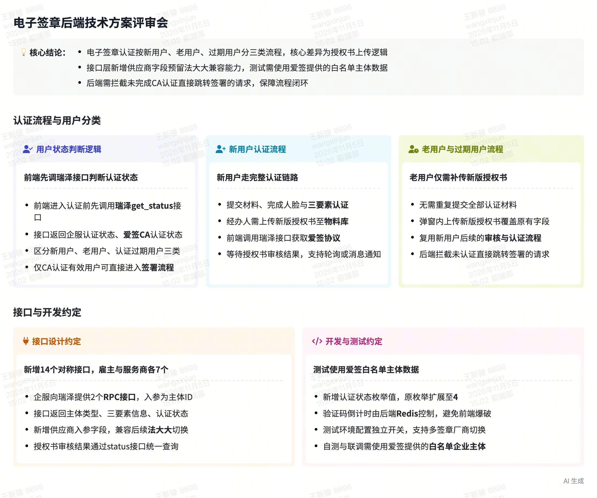
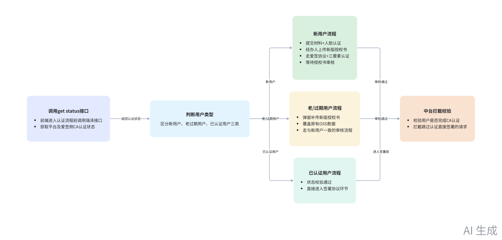
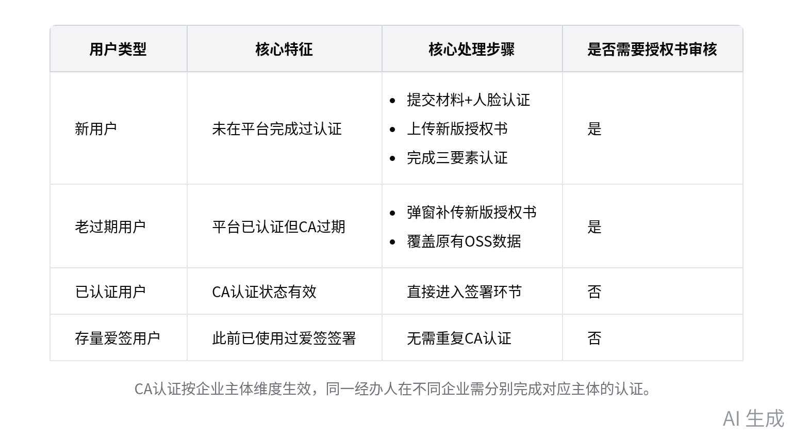
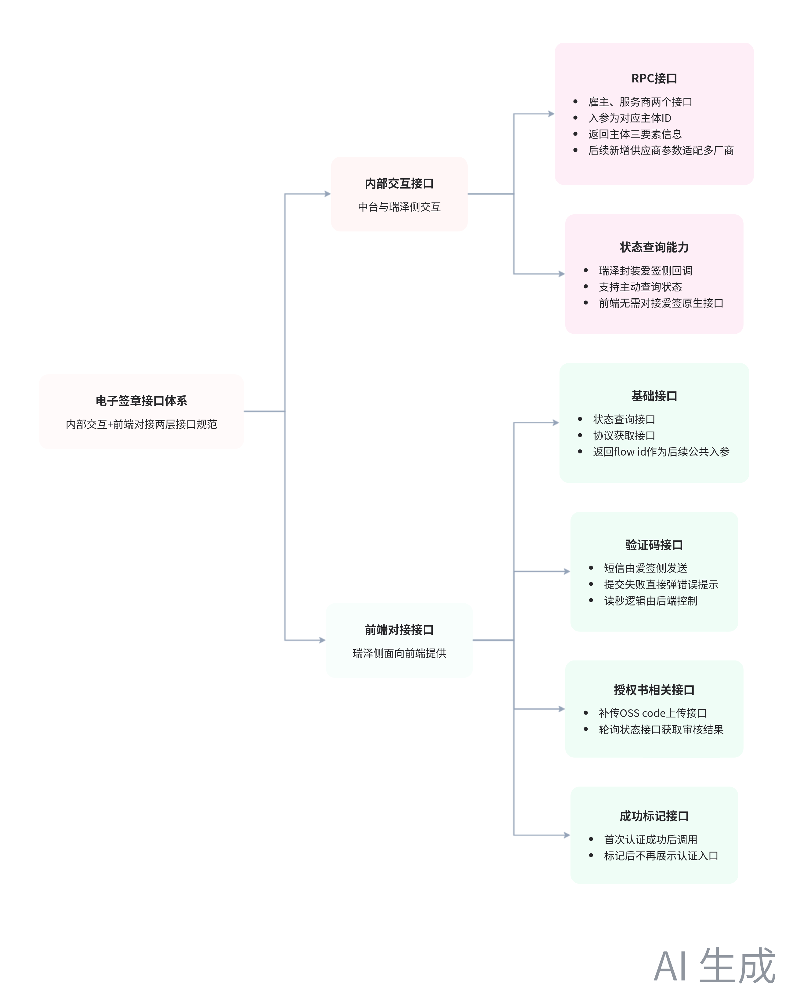

# 智能纪要：【REQ\-195】电子签章\-后端技术方案评审 2026年11月5日

> 会议主题：【REQ\-195】电子签章\-后端技术方案评审
> 
> 会议时间：2026年11月5日（周四） 14:00 \- 14:57 （GMT\+08）
> 
> 参会人：@梁振峰@丁建文@黄海勇@彭诗亮@盛瑞泽@田科举@王天雷@王新骏@张弘年@张立@张小婷@赵东哲@朱东东
> 
> 

> 智能会议纪要由 AI 生成，可能不准确，请谨慎甄别后使用
> 
> 

# 总结

本次会议围绕电子签章CA认证流程、接口设计、测试方案等事项展开对齐，明确各环节规则与落地安排，内容如下：

- **认证核心流程规则**

    - **用户状态判断逻辑**

        - 状态前置校验：前端进入认证流程前，先调用瑞泽的 get status 接口，判断用户在平台及爱签侧的CA认证状态。

        - 新用户流程：需提交材料、人脸认证，经办人上传新版授权书，走爱签协议签署、三要素认证及授权书审核流程。

        - 老用户/过期用户流程：弹窗补充上传新版授权书，覆盖原有数据后走与新用户一致的审核流程。

        - 已认证用户：状态校验通过后直接进入签署协议环节，中台需做拦截防止用户跳过CA认证直接签署。

    - **认证粒度规则**

        - 认证主体级别：CA认证按企业主体维度生效，同一经办人在不同企业需分别完成对应主体的认证。

        - 存量用户规则：此前已使用过爱签签署的存量用户，无需重复做CA认证可直接签署。

- **接口与交互设计**

    - **内部交互接口**

        - 中台与瑞泽交互：中台提供雇主、服务商两个RPC接口，入参为对应ID，返回主体类型、三要素信息，后续新增供应商参数适配多签章厂商。

        - 状态查询逻辑：瑞泽封装爱签侧的状态查询、回调、主动查询能力，前端直接调用瑞泽提供的接口即可，无需对接爱签原生能力。

    - **前端对接接口**

        - 基础接口：前端需先调用状态查询接口获取认证状态，再调用协议接口获取爱签协议页，接口返回的 flow id 需作为后续接口的公共入参。

        - 验证码相关：短信由爱签侧发送，验证码提交失败时前端直接弹错误提示，验证码读秒逻辑由后端控制。

        - 授权书上传：老用户补传授权书后，前端调用对应接口上传OSS code，审核结果通过轮询状态接口获取。

        - 成功标记接口：用户首次认证成功后前端调用标记接口，后端记录后后续不再展示认证入口。

- **落地与测试安排**

    - **开发与排期**

        - 接口数量：本次共新增14个对称接口，对应雇主、服务商两类场景，相关文档将同步更新至API Fox平台。

        - UI进度：相关页面设计已完成，待业务方确认后即可进入开发环节。

    - **测试相关安排**

        - 测试数据要求：爱签侧测试环境仅支持白名单内的企业主体，相关白名单将同步至项目群，法人无额外限制。

        - 测试开关：将配置独立的认证开关，支持测试场景的灵活切换，同时确认是否支持白名单用户重置认证状态。

    - **待跟进事项**

        - 拉取专项小群对齐中台接口开发进度，确认爱签侧的兜底拦截逻辑。

        - 确认验证码倒计时的刷新逻辑，对齐爱签侧的频次控制规则。

# 待办

* [ ] 拉专项对接群：拉上徐雄伟等人组建小群，对接中台接口未开发的相关事项，同步相关问题推进解决

* [ ] 同步接口信息：将新版授权书更新接口的相关信息同步到ApiFox平台中 @梁振峰

* [ ] 接口新增供应商参数：给用于查询爱签认证状态的相关接口补充增加供应商入参，适配后续可能切换法大大等第三方电子签服务商的场景（来自张弘年） @盛瑞泽

* [ ] 页面提醒位置对齐：和岳老师碰一下协议阅读提示的摆放位置，确定合适的页面展示方案，保证页面美观和用户感知度 @盛瑞泽

* [ ] 核实验证码倒计时规则：询问中台和爱签侧关于验证码60秒倒计时的相关控制规则，确定后端倒计时控制的实现方案 @盛瑞泽

* [ ] 同步测试主体白名单：将爱签测试环境可用的白名单公司主体相关信息发到群里，供研发、测试人员自测联调使用 @盛瑞泽

* [ ] 咨询认证重置规则：向爱签侧核实已完成CA认证的测试账号是否可以重置为未认证状态，满足测试造数需求 @盛瑞泽

* [ ] 同步接口相关信息：将本次新增的14个接口的相关链接发到群里，并把自身负责部分的接口信息补充到对应文档中 @盛瑞泽

# 相关链接

- 妙记：[【REQ\-195】电子签章\-后端技术方案评审](https://wanlianyida.feishu.cn/minutes/obcn198jk79nklqwk6f58ciz?from=ai_minutes)

- 文字记录

    - [【REQ\-195】电子签章\-后端技术方案评审 2026年11月5日](https://wanlianyida.feishu.cn/docx/Rzb5dHWSNo8pp3xhDZYcA31bnmf)

