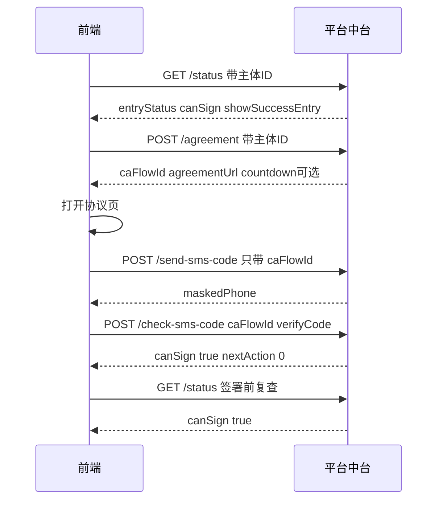
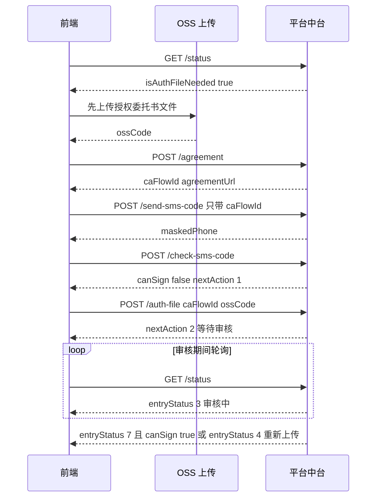
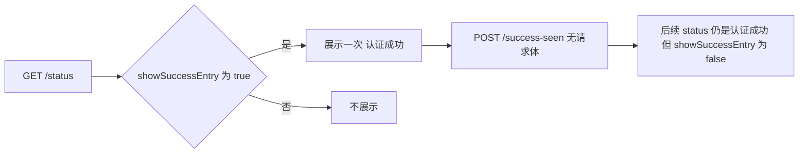

# REQ-195 电子签章（爱签核身）接口契约

> **数据来源**：Apifox 项目 `8677491`「万大圣企业服务平台API接口」— 默认模块，2026 年 11 月 10 日通过 apifox MCP 实拉，字段与描述均为文档原文，非前端推测。
>
> **整理范围**：`/v1/employer/ca-verification/*` 7 个 + `/v1/provider/ca-verification/*` 7 个，共 14 个对称接口。**不含**认证域 `ca-auth-letter`、`url-2-osscode` 等接口。
>
> **与源文档关系**：本文档只做「后端已落地的接口契约」整理，《后端接口契约对齐表-REQ-195.md》内容未做任何改动；两者口径差异不写入本文档，另行口头同步。
>
> **术语分层**：Apifox 分组名「爱签核身」是服务端命名。前端功能名为「电子合同签章认证」，前端只调平台中台接口，由中台内部转调爱签（底层 CA 服务方）。

---

## 目录

- [一、接口总览](#一接口总览)
- [二、公共约定](#二公共约定)
- [三、逐接口契约](#三逐接口契约)
  - [3.1 GET /status 查询核身入口状态](#31-get-status查询核身入口状态)
  - [3.2 POST /agreement 申请协议页并分配流程号](#32-post-agreement申请协议页并分配流程号)
  - [3.3 POST /send-sms-code 发送三要素短信验证码](#33-post-send-sms-code发送三要素短信验证码)
  - [3.4 POST /check-sms-code 提交短信验证码](#34-post-check-sms-code提交短信验证码)
  - [3.5 POST /resend-sms-code 重发短信验证码](#35-post-resend-sms-code重发短信验证码)
  - [3.6 POST /auth-file 提交授权书 oss code](#36-post-auth-file提交授权书-oss-code)
  - [3.7 POST /success-seen 标记认证成功入口已展示](#37-post-success-seen标记认证成功入口已展示)
- [四、两端差异一览](#四两端差异一览)
- [五、枚举与字段语义](#五枚举与字段语义)
- [六、调用时序](#六调用时序)
- [七、契约内的待明确点](#七契约内的待明确点)
- [八、附：复现方式](#八附复现方式)

---

## 一、接口总览

| # | 能力 | 雇主端 | 服务商端 | HTTP | 请求体 schema（雇主 / 服务商） | 响应 model schema |
|---|---|---|---|---|---|---|
| 1 | 查询核身入口状态 | `/v1/employer/ca-verification/status` | `/v1/provider/ca-verification/status` | GET | query 参数，无 body | `StatusModel` |
| 2 | 申请协议页并分配流程号 | `/v1/employer/ca-verification/agreement` | `/v1/provider/ca-verification/agreement` | POST | `EmployerIdBody` / `ProviderIdBody` | `AgreementModel` |
| 3 | 发送三要素短信验证码 | `/v1/employer/ca-verification/send-sms-code` | `/v1/provider/ca-verification/send-sms-code` | POST | `EmployerFlowBody` / `ProviderFlowBody` | `MaskedPhoneModel` |
| 4 | 提交短信验证码 | `/v1/employer/ca-verification/check-sms-code` | `/v1/provider/ca-verification/check-sms-code` | POST | `EmployerCheckSmsBody` / `ProviderCheckSmsBody` | `CheckSmsModel` |
| 5 | 重发短信验证码 | `/v1/employer/ca-verification/resend-sms-code` | `/v1/provider/ca-verification/resend-sms-code` | POST | `EmployerFlowBody` / `ProviderFlowBody` | 无（`model = null`） |
| 6 | 提交授权书 oss code | `/v1/employer/ca-verification/auth-file` | `/v1/provider/ca-verification/auth-file` | POST | `EmployerAuthFileBody` / `ProviderAuthFileBody` | `AuthFileModel` |
| 7 | 标记认证成功入口已展示 | `/v1/employer/ca-verification/success-seen` | `/v1/provider/ca-verification/success-seen` | POST | **无请求体** | 无（`model = null`） |

**主体 ID 只出现在两个接口**：`GET /status`（query）与 `POST /agreement`（body）。其余 5 个接口一律不再传主体 ID —— 主体已绑定在 `caFlowId` 上，或（`success-seen`）由服务端按登录态定位。

> ⚠️ Apifox 同一模块内另有 7 个 **无版本前缀** 的雇主端同名接口（`/employer/ca-verification/*`，服务商侧无此变体）。本文档只覆盖 `/v1/` 前缀的 14 个；前端接入前应与服务端确认这组旧路径是否仍有效、是否计划下线。

---

## 二、公共约定

### 2.1 统一响应外层（`EnvelopeBase`）

所有 14 个接口共用同一外层结构，四个字段在 schema 中均为 `required`：

| 字段 | 类型 | 契约原文含义 |
|---|---|---|
| `code` | integer (int32) | 业务状态码。**成功和可弹窗的业务拦截都是 200** |
| `succeed` | boolean | `true` 表示该动作完成；`false` 表示被业务规则拦住，**前端用 `message` 弹窗** |
| `message` | string | `succeed=false` 时的弹窗文案；成功时为空字符串 |
| `traceId` | string | 链路追踪 ID |

`model` 由各接口各自的 Envelope 追加定义，`EnvelopeBase` 本身不声明 `model` 为 required。

### 2.2 鉴权与请求头

| 头 | 必填 | 说明 |
|---|---|---|
| `Authorization` | 是 | `Bearer <token>`，接口 `security` 声明为 `BearerAuth` |
| `Cookie` | 文档示例中出现 | Apifox 里给的是抓包示例值，非契约要求，浏览器自动携带 |

### 2.3 ID 类型约定

`employerId`、`providerId`、`caFlowId`、`ossCode`、`maskedPhone` **一律 string**。服务端描述明确写「字符串，避免前端精度丢失」。ID 示例：雇主 `10001`、服务商 `20001`、`caFlowId` `2039485761029384756`（19 位，数值型必然丢精度）。

### 2.4 `caFlowId` 生命周期

- 由 `POST /agreement` 生成并返回，同时把当次传入的主体 ID 绑定到这条流程上。
- **每次调用 `/agreement` 都是一次新流程**，旧的未完成 `caFlowId` 立即作废；再用旧号调后续接口会得到「这次认证已失效，请重新开始」。
- 申请协议页时**不发短信**。
- 发短信、校验、重发、提交授权书都只传 `caFlowId`。

### 2.5 服务端下发的固定错误文案

| 场景 | `succeed` | `message` |
|---|---|---|
| 验证码错误 | `false`（HTTP 仍 200） | 验证码错误，请重新输入 |
| `caFlowId` 已作废 | `false` | 这次认证已失效，请重新开始 |

前端直接展示 `message`，不自行拼装文案。

---

## 三、逐接口契约

以下每个能力给出雇主端与服务商端两份路径，二者除主体参数名与 ID 来源外**字段结构完全同构**；`operationId` 见各节。

### 3.1 `GET /status`：查询核身入口状态

- 雇主 `operationId=employerCaVerificationStatus`，服务商 `operationId=providerCaVerificationStatus`
- **调用时机（契约原文）**：进入电子签章认证、再次打开入口、签署前都先调。

**Query 参数**

| 参数 | 类型 | 必填 | 说明 | 示例 |
|---|---|---|---|---|
| `employerId` / `providerId` | string | 是 | 主体 ID，字符串避免前端精度丢失 | `10001` / `20001` |

**响应 `model`（`StatusModel`）**

| 字段 | 类型 | schema required | 说明 |
|---|---|---|---|
| `entryStatus` | integer (1–7) | 否 | 1 去认证 / 2 继续认证 / 3 审核中且不可点击 / 4 重新上传 / 5 重新认证 / 6 即将到期仍可签署 / 7 认证成功 |
| `canSign` | boolean | 否 | 当前是否可以进入合同签署 |
| `showSuccessEntry` | boolean | 否 | 是否还要展示一次「认证成功」入口 |
| `maskedPhone` | string | 否 | 脱敏验证手机号，例如 `138****8888`；**没有进行中的流程时为空** |
| `authStatus` | integer (0–3) | 否 | 用户在本平台的认证状态，整数、不返回枚举名 |
| `authPhase` | integer (0–4) | 否 | **已经完成的检查点**，不是正在做的那一步 |
| `isAuthFileNeeded` | boolean | **是（本 model 唯一 required）** | 是否为经办人需要授权文件 |

**文档示例响应（雇主端原文）**

```json
{
  "code": 200,
  "succeed": true,
  "message": "",
  "model": {
    "entryStatus": 1,
    "canSign": false,
    "showSuccessEntry": false,
    "maskedPhone": ""
  },
  "traceId": "trace-status-001"
}
```

**失败语义**：查询成功 `succeed=true`；**主体无效或资料不足**时 `succeed=false`，`message` 可弹窗。

> ⚠️ 该接口内部存在两处自相矛盾，联调时必须以实际返回为准：① `isAuthFileNeeded` 是唯一 required 字段，但示例响应的 `model` 里没有它，也没有 `authStatus`/`authPhase`；② `StatusEnvelope` 与路径文件里的示例都缺 `StatusModel` 声明的字段。前端按「可能不下发」兜底，不能假设恒有。

### 3.2 `POST /agreement`：申请协议页并分配流程号

- 雇主 `operationId=employerCaVerificationAgreement`，服务商 `operationId=providerCaVerificationAgreement`
- **副作用**：生成新 `caFlowId` 并绑定主体，旧的未完成 `caFlowId` 作废；此时不发短信。

**请求体**（`EmployerIdBody` / `ProviderIdBody`，`required` 整块必填）

| 字段 | 类型 | 必填 | 示例 |
|---|---|---|---|
| `employerId` / `providerId` | string | 是 | `"10001"` / `"20001"` |

**响应 `model`（`AgreementModel`，`caFlowId` 与 `agreementUrl` 均 required）**

| 字段 | 类型 | 必填 | 说明 |
|---|---|---|---|
| `caFlowId` | string | 是 | 本域流程号，后续发短信、校验、重发、提交授权书都传它 |
| `agreementUrl` | string | 是 | 协议阅读页地址，由前端打开 |
| `countdown` | integer | 否（契约标注 optional） | **短信验证码倒计时**。原文：仅在发送过短信验证码且还在发送的 60s 内时有正整数值，0 或无值时认为可以点击发送短信 |

**文档示例响应**

```json
{
  "code": 200,
  "succeed": true,
  "message": "",
  "model": {
    "caFlowId": "2039485761029384756",
    "agreementUrl": "https://example.invalid/agreement"
  },
  "traceId": "trace-agreement-001"
}
```

> 值得注意：`countdown` 挂在 `/agreement` 的响应上，而不是 `/send-sms-code` 或 `/resend-sms-code`。即前端只有重新走一次 `/agreement` 才能拿到倒计时值。

### 3.3 `POST /send-sms-code`：发送三要素短信验证码

- 雇主 `operationId=employerCaVerificationSendSmsCode`，服务商 `operationId=providerCaVerificationSendSmsCode`
- **调用时机（契约原文）**：用户看完协议后调用。
- **幂等（契约原文）**：同一个 `caFlowId` 重复调用不会向中台再创建一次核身。

**请求体**（`EmployerFlowBody` / `ProviderFlowBody`，整块 `required`）

| 字段 | 类型 | 必填 | 说明 |
|---|---|---|---|
| `caFlowId` | string | 是 | `POST /agreement` 返回的流程号。主体已绑在这条流程上，**请求不再传 employerId 或 providerId** |

**响应 `model`（`MaskedPhoneModel`）**

| 字段 | 类型 | 必填 | 说明 |
|---|---|---|---|
| `maskedPhone` | string | 否 | 短信实际发往的脱敏手机号 |

**文档示例响应**

```json
{
  "code": 200,
  "succeed": true,
  "message": "",
  "model": { "maskedPhone": "138****8888" },
  "traceId": "trace-send-001"
}
```

**失败语义**：流程无效时 `succeed=false`。

### 3.4 `POST /check-sms-code`：提交短信验证码

- 雇主 `operationId=employerCaVerificationCheckSmsCode`，服务商 `operationId=providerCaVerificationCheckSmsCode`

**请求体**（`EmployerCheckSmsBody` / `ProviderCheckSmsBody`，整块 `required`）

| 字段 | 类型 | 必填 | 示例 |
|---|---|---|---|
| `caFlowId` | string | 是 | `2039485761029384756`；不传主体 ID |
| `verifyCode` | string | 是 | `123456`，用户输入的短信验证码 |

**响应 `model`（`CheckSmsModel`）**

| 字段 | 类型 | 必填 | 说明 |
|---|---|---|---|
| `canSign` | boolean | 否 | 个人或法人校验成功时为 `true`；**经办人在授权书完成前为 `false`** |
| `nextAction` | integer | 否 | 0 无额外动作 / 1 下一步提交授权书 oss code / 2 授权书已收下并等待审核 |

**结果矩阵（契约原文逐条）**

| 场景 | HTTP | `succeed` | `canSign` | `nextAction` | 下一步 |
|---|---|---|---|---|---|
| 个人或法人成功 | 200 | `true` | `true` | 0 | 可以签署 |
| 经办人三要素通过 | 200 | `true` | `false` | 1 | `POST /auth-file` |
| 验证码错误 | 200 | `false` | — | — | 弹窗「验证码错误，请重新输入」 |
| 流程已作废 | 200 | `false` | — | — | 弹窗「这次认证已失效，请重新开始」，需重新走 `/agreement` |

**文档示例响应**（个人/法人成功态）

```json
{
  "code": 200,
  "succeed": true,
  "message": "",
  "model": { "canSign": true, "nextAction": 0 },
  "traceId": "trace-check-001"
}
```

### 3.5 `POST /resend-sms-code`：重发短信验证码

- 雇主 `operationId=employerCaVerificationResendSmsCode`，服务商 `operationId=providerCaVerificationResendSmsCode`
- **前置（契约原文）**：必须已经对该 `caFlowId` 发过短信。
- **重要语义**：成功**不表示三要素通过**，前端仍停在验证码页。

**请求体**：同 3.3，`EmployerFlowBody` / `ProviderFlowBody`，只有 `caFlowId`（required），不传主体 ID。

**响应**：`EmptyModelEnvelope`，成功时 `model` 为 `null`。

```json
{
  "code": 200,
  "succeed": true,
  "message": "",
  "model": null,
  "traceId": "trace-resend-001"
}
```

> 该接口**不返回 `countdown`**，倒计时字段只在 `/agreement` 里。前端重发后的读秒只能本地计时（契约未给读秒时长，见第七节）。

### 3.6 `POST /auth-file`：提交授权书 oss code

- 雇主 `operationId=employerCaVerificationAuthFile`，服务商 `operationId=providerCaVerificationAuthFile`
- **适用条件（契约原文）**：只给经办人，且该 `caFlowId` 的三要素已经完成（或入口已是「重新上传」）。
- **前置动作**：前端先用现有 OSS 上传接口拿到 `ossCode`，再调本接口。本接口**不收文件、不收 `fileUrl`、不收 `fileName`**。
- **重新上传**：仍复用当前有效的 `caFlowId`，不重新申请流程。

**请求体**（`EmployerAuthFileBody` / `ProviderAuthFileBody`，整块 `required`）

| 字段 | 类型 | 必填 | 说明 | 示例 |
|---|---|---|---|---|
| `caFlowId` | string | 是 | 三要素已完成的经办人流程号 | `2039485761029384756` |
| `ossCode` | string | 是 | 授权书在本系统 OSS 中的 code | `oss-auth-letter-001` |

**响应 `model`（`AuthFileModel`）**

| 字段 | 类型 | 必填 | 说明 |
|---|---|---|---|
| `nextAction` | integer，enum 只列 `[2]` | 否 | 收件成功时为 2，表示等待审核 |

```json
{
  "code": 200,
  "succeed": true,
  "message": "",
  "model": { "nextAction": 2 },
  "traceId": "trace-auth-file-001"
}
```

**失败语义**：`oss code` 无效或还不能上传时 `succeed=false`，`message` 可弹窗。

> 关键：成功**只表示中台已收下材料**，此时仍不能签署，审核结果需回到 `GET /status` 查（`entryStatus=3` 审核中 / `4` 重新上传）。

### 3.7 `POST /success-seen`：标记认证成功入口已展示

- 雇主 `operationId=employerCaVerificationSuccessSeen`，服务商 `operationId=providerCaVerificationSuccessSeen`
- **调用时机**：前端把「认证成功」展示过一次后调用。
- **无请求体**：不传主体 ID，也不传 `caFlowId`，服务端按当前登录用户定位雇主/服务商。

**响应**：`EmptyModelEnvelope`，成功时 `model` 为 `null`。

```json
{
  "code": 200,
  "succeed": true,
  "message": "",
  "model": null,
  "traceId": "trace-seen-001"
}
```

**后续效果（契约原文）**：之后 `GET /status` 仍可能是认证成功，但 `showSuccessEntry=false`。
**失败语义**：当前没有可标记的成功入口时 `succeed=false`。

---

## 四、两端差异一览

| 维度 | 雇主端 | 服务商端 |
|---|---|---|
| 路径前缀 | `/v1/employer/ca-verification` | `/v1/provider/ca-verification` |
| Apifox 分组 | 雇主端爱签核身 | 服务商端爱签核身 |
| 主体参数名 | `employerId` | `providerId` |
| 主体 ID 示例 | `10001` | `20001` |
| 请求体 schema 后缀 | `EmployerXxxBody` | `ProviderXxxBody`（字段与 required 完全一致） |
| `operationId` 前缀 | `employerCaVerificationXxx` | `providerCaVerificationXxx` |
| `authStatus` 来源 | 与 `employer.employerInfo.authStatus` 相同（主档，仅 0 或 1） | 与 `provider.providerInfo.authStatus` 相同：已认证为 1；未认证为最新一条非已认证审核单的 0 / 2 / 3 |
| `authPhase` 来源 | 核身未完成时与 `employer.auditInfo.authPhase` 相同；已认证且个人中心不再返回该审核单时为 3 | 核身未完成时与 `provider.auditInfo.authPhase` 相同；主档已认证时为 3，未认证时为审核单上的 0 / 1 / 2 / 3 |
| `entryStatus` 是否下发 | 未声明 | 未声明 |
| 响应 model schema | 两端**共用同一份**（`StatusModel`/`AgreementModel`/`MaskedPhoneModel`/`CheckSmsModel`/`AuthFileModel`/`EmptyModelEnvelope`） | 同左 |
| 接口数量 | 7 | 7 |

**结论**：除「主体参数名 + `authStatus`/`authPhase` 的数据来源」外，两端契约完全对称；`authPhase=4`（CA 电子签认证完成）在两端描述中均成立。

---

## 五、枚举与字段语义

### 5.1 `entryStatus`（`StatusModel`，enum `[1,2,3,4,5,6,7]`）

| 值 | 语义 | 前端可执行动作 |
|---|---|---|
| 1 | 去认证 | 走 `/agreement` 起流程 |
| 2 | 继续认证 | 恢复流程 |
| 3 | 审核中，**不可点击** | 只展示等待态；轮询查 `/status` |
| 4 | 重新上传 | 原地替换文件后重新 `/auth-file` |
| 5 | 重新认证 | 重走认证 |
| 6 | 即将到期，**仍可签署** | 不拦截签署 |
| 7 | 认证成功 | `canSign=true` |

> 契约中 `entryStatus` **没有 0 值**（服务端 schema 未定义「未指定」）。

### 5.2 `authStatus`（enum `[0,1,2,3]`）

0 未认证 / 1 已认证 / 2 待审核 / 3 已驳回。整数下发，不返回枚举名。

### 5.3 `authPhase`（enum `[0,1,2,3,4]`）

| 值 | 语义 | 与既有认证的关系 |
|---|---|---|
| 0 | 未提交 | 与认证接口相同 |
| 1 | 身份认证完成 | 与认证接口相同 |
| 2 | 人脸认证完成 | 与认证接口相同 |
| 3 | 电子签完成 | 与认证接口相同 |
| 4 | CA 电子签认证完成 | **本接口新增**，爱签核身已完成时返回 4 |

> 语义要点：`authPhase` 表示**已经完成的检查点**，不是正在做的那一步。

### 5.4 `nextAction`

| 值 | 出现接口 | 语义 |
|---|---|---|
| 0 | `check-sms-code` | 无额外动作（个人/法人已完成，可签署） |
| 1 | `check-sms-code` | 下一步提交授权书 oss code（经办人） |
| 2 | `check-sms-code`、`auth-file` | 授权书已收下并等待审核（`auth-file` 的 enum 只列 2） |

---

## 六、调用时序

### 6.1 个人 / 法人（单步）



### 6.2 经办人（两文档动作 + 人工审核）



### 6.3 成功入口一次性曝光



---

## 七、契约内的待明确点

> 仅列契约文本自身读不出来、需要联调或服务端补充的点，不含前端实现方案。

| # | 待明确点 | 契约现状 | 影响 |
|---|---|---|---|
| P-1 | `StatusModel` 各字段是否恒定下发 | `required` 只声明 `isAuthFileNeeded`，但示例响应连它都没有，也没 `authStatus`/`authPhase` | 前端取值兜底策略、经办人首屏分流能否落地 |
| P-2 | `GET /status` 中 `entryStatus` 是否会返回 0 或其他未列值 | enum 只列 1–7，无 0 | 未知值的默认分支 |
| P-3 | `countdown` 为何挂在 `/agreement` 而非短信接口 | `/send-sms-code`、`/resend-sms-code` 均不返回倒计时 | 重发后的读秒只能本地计时，读秒时长契约未给（60s 只在 `countdown` 描述里出现） |
| P-4 | 短信发送频率上限/冷却是否另有拦截与文案 | 契约只说同一 `caFlowId` 重复调用不会重复创建核身 | 频控报错文案与触发条件未知 |
| P-5 | `succeed=false` 时 `model` 是否为 `null` | `EnvelopeBase` 未声明 `model`，失败示例缺失 | 前端解析空值分支 |
| P-6 | 无版本前缀的 `/employer/ca-verification/*` 7 个接口是否仍有效 | 与 `/v1/employer/*` 同时存在于默认模块，服务商侧无此变体 | 前端接入路径选择、后续下线风险 |

---

## 八、附：复现方式

接口内容全部来自 apifox MCP（server `apifox`，工具 `read_project_oas_35ck23` / `read_project_oas_ref_resources_35ck23`），解析链路：

1. 读默认模块 OAS 索引，按 path 关键词 `ca-verification` 筛出 21 条，取 `/v1/` 前缀 14 条；
2. 逐条取 `/paths/_v1_{role}_ca-verification_{action}.json` 得 method、参数、requestBody/response 的 `$ref`、`operationId`、tags、服务端描述；
3. schema 名先经 `/components/schemas/index.json` 定位到 `/components/schemas/{Name}.json`，再取叶子（共 20 个 schema，含 `EnvelopeBase`、`StatusModel`、`AgreementModel`、`MaskedPhoneModel`、`CheckSmsModel`、`AuthFileModel`、`EmptyModelEnvelope` 及 6 个 Envelope 与 8 个请求体）。

Apifox 侧更新后需显式重新拉取，本地缓存不会自动失效。

---

**文档版本**: v1.0

**最后更新**: 2026年11月

**整理人**: 王新骏
