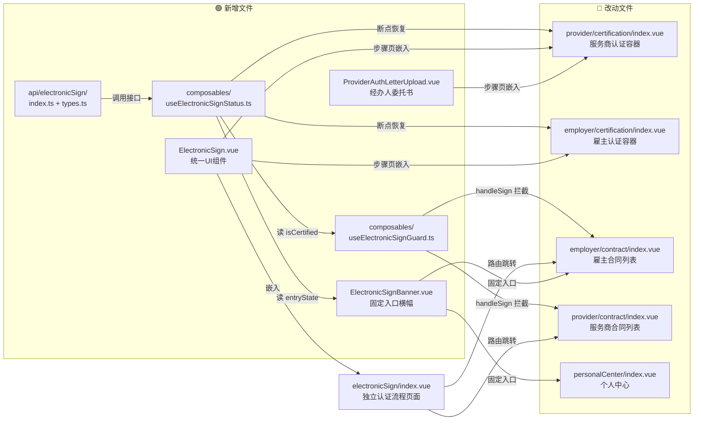
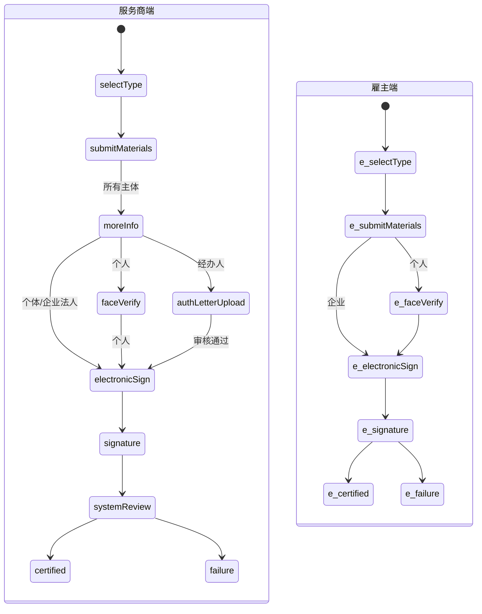
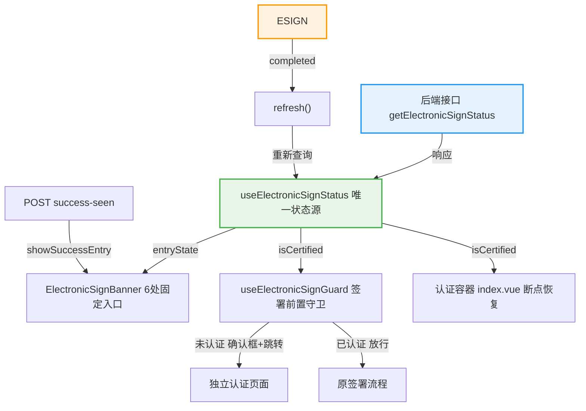

# 阶段2-技术方案-REQ-195

## 目录

- [全局总览](#全局总览)
  - [改动全景图](#改动全景图)
  - [认证流程状态机](#认证流程状态机)
  - [数据流向](#数据流向)
- [新增文件结构](#新增文件结构)
- [现状分析](#现状分析)
- [横向影响检查](#横向影响检查)
- [涉及文件清单](#涉及文件清单)
- [数据结构设计](#数据结构设计)
- [关键逻辑设计](#关键逻辑设计)
- [组件设计](#组件设计)
- [状态管理设计](#状态管理设计)
- [状态机扩展](#状态机扩展)
- [开发顺序建议](#开发顺序建议)
- [风险点](#风险点)
- [后端接口契约确认清单](#后端接口契约确认清单)
- [验证要点](#验证要点)

---

## 全局总览

### 改动全景图

> 🟢 新增文件 🔵 改动文件 → 依赖/消费关系



### 认证流程状态机



### 数据流向



---

## 新增文件结构

> 以下仅展示 REQ-195 **新增**的文件，已有文件的修改不在此树中。
> 路径均相对于 `wds/wds-web/src/`。

```
src/
├── api/
│   └── electronicSign/                  # 🆕 电子合同签章认证 API
│       ├── index.ts                     #   接口封装（状态查询/协议/验证码/委托书）
│       └── types.ts                     #   类型定义骨架（TODO: wxj U-008 确认后定向替换）
│
├── composables/
│   └── electronicSign/                  # 🆕 电子签章认证 composable
│       ├── useElectronicSignStatus.ts   #   统一状态管理（获取/缓存/刷新/曝光标记）
│       └── useElectronicSignGuard.ts    #   签署前置守卫 + confirmAndGoElectronicSign 确认跳转工具函数
│
├── views/
│   └── authentication/
│       └── components/
│           ├── ElectronicSign.vue       # 🆕 统一 UI 组件（协议阅读+滑动+验证码）
│           ├── ProviderAuthLetterUpload.vue  # 🆕 经办人委托书上传+审核结果态
│           └── ElectronicSignBanner.vue      # 🆕 固定入口横幅（6种状态映射）
```

### 文件职责说明

| 文件 | 职责 | 消费方 |
|------|------|--------|
| `api/electronicSign/index.ts` | 封装电子签章能力的实际接口适配，前端不直接对接爱签 | 所有 composable 和组件 |
| `api/electronicSign/types.ts` | 类型骨架，U-008 确认后定向替换 | api/index.ts + composables |
| `useElectronicSignStatus.ts` | **唯一状态源**：响应式状态 + 缓存 + Server 成功曝光标记 | Banner、Guard、认证容器 |
| `useElectronicSignGuard.ts` | 守卫 + UI 工具：`useElectronicSignGuard(role)` 返回 `canSign` 响应式判定；`confirmAndGoElectronicSign(router, route)` 封装 Modal.confirm + 路由跳转（两端合同页共用） | 雇主合同页、服务商合同页 |
| `ElectronicSign.vue` | **统一 UI 组件**：协议阅读 + 滑动检测 + 3s倒计时 + 验证码 + 提交 | 认证流程（步骤页）、签署拦截（弹窗包裹） |
| `ProviderAuthLetterUpload.vue` | 经办人专属：委托书上传 + 审核状态展示 + 审核意见 | 服务商认证流程、签署拦截（经办人分支） |
| `ElectronicSignBanner.vue` | 固定入口横幅：根据状态渲染文案/按钮/样式 | 个人中心、工作台、合同列表等6处 |

### 统一 UI 组件的容器分离模式（v2.8 更新：弹窗→独立页面）

`ElectronicSign.vue` 是纯内容组件，不含外层容器。调用方决定呈现形态：

```
认证流程中（步骤页）：
  <template v-if="currentView === 'electronicSign'">
    <ElectronicSign :subject-id="subjectId" @completed="onSignCompleted" />
  </template>

签署拦截时（独立页面，v2.8 替代原弹窗方案）：
  router.push({ name: 'ElectronicSignPage', query: { returnUrl: currentPath } })
  // 页面内部按步骤渲染：01 授权委托书（经办人）→ 02 电子签章认证
```

> [v2.8 架构变更] 合同签署场景从 `a-modal` 弹窗改为独立路由页面 `/employer/my/electronic-sign`。
> 用户点击"立即签署" → 确认对话框（a-modal.confirm） → "去认证"跳转到独立页面 → 认证完成后自动返回来源页。
> `ElectronicSignModal.vue` 降级为轻量确认对话框或直接使用 `Modal.confirm`，不再包裹 ElectronicSign 内容。

核心交互逻辑（协议阅读、验证码、提交）只存在于 `ElectronicSign.vue` 一份代码中。

---

## 现状分析

### 涉及文件清单（现有）

| 文件路径 | 所属项目 | 当前职责 | 技术栈 |
|---------|---------|---------|--------|
| `views/provider/certification/index.vue` | wds-web | 服务商认证流程容器：ViewType 8种 + 步骤条 + 断点恢复 | Vue3 + TS + Ant Design Vue |
| `views/employer/certification/index.vue` | wds-web | 雇主认证流程容器：ViewType 6种 + 步骤条 + 断点恢复 | Vue3 + TS + Ant Design Vue |
| `views/employer/contract/index.vue` | wds-web | 雇主我的合同列表 + `handleSign` 签署入口 | Vue3 + TS + Ant Design Vue |
| `views/provider/contract/index.vue` | wds-web | 服务商合同管理列表 + `handleSign` 签署入口 | Vue3 + TS + Ant Design Vue |
| `views/authentication/components/ProtocolSignature.vue` | wds-web | 旧协议签署（外链 + 轮询） | Vue3 + TS |
| `views/authentication/components/CertEnterpriseSupplementSection.vue` | wds-web | 经办人补充材料上传（身份证+委托书） | Vue3 + TS |
| `api/provider/certification/index.ts` | wds-web | 服务商认证 API 封装 | TS |
| `api/employer/certification/index.ts` | wds-web | 雇主认证 API 封装 | TS |
| `stores/user.ts` | wds-web | 用户状态 store（现有 authStatus/authPhase） | Pinia |

### 现有实现方式

#### 认证流程状态机

**服务商端** ViewType：`selectType | submitMaterials | moreInfo | faceVerify | signature | systemReview | certified | failure`
- personalSteps = ['提交材料', '完善信息', '人脸认证', '签署协议', '系统审核']
- businessSteps = ['提交材料', '完善信息', '签署协议', '系统审核']
- 断点恢复：`authStatus` + `authPhase` + `subjectType`

**雇主端** ViewType：`selectType | submitMaterials | faceVerify | signature | certified | failure`
- personalSteps = ['提交材料', '人脸认证', '签署协议']
- businessSteps = ['提交材料', '签署协议']
- 断点恢复：`employerAuthStatus` + `employer.auditInfo.authPhase`

#### 合同签署入口

**雇主端** `handleSign(item)`：埋点 → `if (!electronicSignGuard.canSign.value) { confirmAndGoElectronicSign(router, route); return; }` → 原签署逻辑
**服务商端** `handleSign(item)`：埋点 → `if (!electronicSignGuard.canSign.value) { confirmAndGoElectronicSign(router, route); return; }` → 原签署逻辑

> 两端共用 `useElectronicSignGuard` + `confirmAndGoElectronicSign`，不再各自内联 `needElectronicSign()` 和 `Modal.confirm` 重复代码。

---

## 横向影响检查

| 检查维度 | 是否涉及 | 文件/说明 |
|---------|---------|----------|
| 调整页 | 否 | 本次无表单调整页 |
| 查看页 | 否 | 本次无查看页改动 |
| 列表页 | 是 | 雇主我的合同、服务商合同管理（R-003 认证状态过滤） |
| 对账页 | 否 | 不涉及 |
| 付款页 | 否 | 不涉及 |
| 移动端对应页面 | 否 | 本期仅 PC Web |
| 公共组件 | 是 | 新增 ElectronicSign.vue（跨两端复用）、useElectronicSignGuard.ts |
| 接口封装 | 是 | 按最终契约适配电子签章状态、验证码、协议与委托书等能力 |
| 历史旧展示 | 否 | 旧协议签署逻辑不改动，新环节独立插入 |

---

## 涉及文件清单

| 文件路径 | 角色 | 改动类型 | 改动说明 | 旧逻辑处理 |
|---------|------|---------|---------|-----------|
| `views/provider/certification/index.vue` | 认证容器 | 修改 | 新增 `electronicSign` / `authLetterUpload` ViewType；steps 数组插入新步骤；断点恢复逻辑扩展 | 旧 ViewType/steps 注释保留 |
| `views/employer/certification/index.vue` | 认证容器 | 修改 | 新增 `electronicSign` ViewType；steps 数组插入新步骤；断点恢复逻辑扩展 | 旧 ViewType/steps 注释保留 |
| `views/authentication/components/ElectronicSign.vue` | 新组件 | 新增 | 电子合同签章认证页：协议阅读 + 滑动提示 + 3s 倒计时 + 手机号验证码 + 提交 | 不涉及 |
| `views/provider/certification/components/ProviderAuthLetterUpload.vue` | 新组件 | 新增 | 经办人授权委托书上传 + 审核状态展示 + 审核结果态 | 不涉及 |
| `views/authentication/electronicSign/index.vue` | 独立页面 | 新增 | 电子合同签章认证独立页面：步骤进度条 + 01 授权委托书上传（经办人）+ 02 电子签章认证 + 操作按钮组 | 不涉及 |
| `composables/useElectronicSignGuard.ts` | 守卫 | 新增 | `useElectronicSignGuard(role)` 守卫 composable + `confirmAndGoElectronicSign(router, route)` 确认跳转工具函数（两端合同页共用，消除重复 Modal.confirm 代码） | 不涉及 |
| `views/employer/contract/index.vue` | 合同列表 | 修改 | `handleSign` 前置消费 `useElectronicSignGuard('employer')`；`canSign` 为 false 时调用 `confirmAndGoElectronicSign` 弹确认框 → 路由跳转独立认证页 | 旧弹窗逻辑已清理 |
| `views/provider/contract/index.vue` | 合同列表 | 修改 | `handleSign` 前置消费 `useElectronicSignGuard('provider')`；`canSign` 为 false 时调用 `confirmAndGoElectronicSign` 弹确认框 → 路由跳转独立认证页 | 旧弹窗逻辑已清理 |
| `views/authentication/personalCenter/index.vue` | 个人中心 | 修改 | 新增认证入口横幅（按身份区分雇主/服务商） | 不涉及 |
| `views/provider/dashboard/index.vue` | 工作台 | ~~修改~~ 不改动 | 产品确认移除工作台固定入口（2026-11-05 Figma 确认） | 不涉及 |
| `views/supplier/personalCenter/index.vue` | 供应商个人中心 | 条件修改 | 在产品确认的页面位置新增认证入口；状态来源按 U-009 确认后接入 | 不涉及 |
| `api/electronicSign/index.ts` | 接口封装 | 新增 | 适配最终确认的状态、协议、验证码、委托书等业务能力；不预设接口拆分数量 | 不涉及 |
| `stores/user.ts` | 状态管理 | ~~条件修改~~ 不改动 | Server 技术评审确认方案A，不走 user/info 透传；旧 `authPhase` 不改动 | 不涉及 |

---

## 数据结构设计

### 电子签章能力接口（按 2026-11-05 Server 方案）

状态通过 `GET /v1/{role}/ca-verification/status` 获取；协议、短信、验证码、授权书和成功曝光以同一角色前缀下的核身接口完成。旧候选路径只保留在接口契约表中作追溯，不能用于实现。

> 下方为最终契约版函数签名（`caFlowId` 流程制）；v2.2 及更早的候选签名（`subjectId` 单参、无流程号）已废弃，可在接口契约表第三节追溯。
> 接口函数统一 `fetch` 开头，动作语义放末尾；`CaSubjectParams` 含 `role`（employer/provider），主体 ID 按角色二选一。

```ts
// api/electronicSign/index.ts
// 前缀按 role 取 /v1/employer/ca-verification 或 /v1/provider/ca-verification

/** 查询认证状态：query 传 employerId 或 providerId（互斥） */
export function fetchCaVerificationStatus(params: CaSubjectParams, options?: RequestOptions)

/** 申请新流程并取协议链接：每次调用产生新 caFlowId，旧未完成流程作废 */
export function fetchCaAgreement(params: CaSubjectParams, options?: RequestOptions)

/** 按已有流程发送三要素短信 */
export function fetchCaSmsCodeSend(params: CaSubjectParams & { caFlowId: string }, options?: RequestOptions)

/** 校验验证码：succeed=true 即三要素完成，不回查状态接口 */
export function fetchCaSmsCodeCheck(params: CaSubjectParams & { caFlowId: string; verifyCode: string }, options?: RequestOptions)

/** 重发短信：成功不改变三要素结论，仍停留验证码页 */
export function fetchCaSmsCodeResend(params: CaSubjectParams & { caFlowId: string }, options?: RequestOptions)

/** 经办人上传授权书：仅 caFlowId 三要素已完成后可调；成功只表示收件 */
export function fetchCaAuthFileUpload(params: CaSubjectParams & { caFlowId: string; fileName: string; fileUrl: string }, options?: RequestOptions)

/** 老用户/过期用户经办人补传委托书：先落物料（本接口），再 fetchCaAuthFileUpload 提交中台；前一步失败不调后一步 */
export function fetchCaAuthLetterSubmit(params: CaSubjectParams & { ossCode: string }, options?: RequestOptions)

/** 成功入口展示一次后标记；之后 GET /status 仍返回成功但 showSuccessEntry=false */
export function fetchCaSuccessEntrySeen(params: CaSubjectParams, options?: RequestOptions)
```

### 新增类型定义（骨架，待 U-008 确认后定向替换）

```ts
// types/electronicSign.ts

/** 电子合同签章认证状态 */
export interface ElectronicSignStatus {
  entryStatus: 0 | 1 | 2 | 3 | 4 | 5 | 6 | 7
  canSign: boolean
  showSuccessEntry: boolean
  maskedPhone: string
}

/** 协议内容（已确认：URL 外链，C-002） */
export interface ElectronicSignAgreement {
  url: string                  // 协议外链地址
}

/** 委托书审核状态 */
// [2026-11-05] Server 方案无独立审核状态接口：审核结果并入 GET /status 的 entryStatus，
// 此类型仅保留追溯，实现时按 entryStatus 映射，不再单独请求
export interface AuthLetterReviewStatus {
  status: 'pending' | 'approved' | 'rejected'
  opinion?: string             // 审核意见（R-014-2：未返回时禁止虚构）
}
```

---

## 关键逻辑设计

### 逻辑1：认证流程插入 electronicSign 环节

- **触发条件**：用户完成旧协议签署前的最后一个既有步骤（服务商个人：faceVerify 通过；服务商个体/企业法人：moreInfo 通过；服务商经办人：委托书审核通过；雇主个人：faceVerify 通过；雇主企业法人：submitMaterials 通过）。
- **处理步骤**：
  1. 调用 `getElectronicSignStatus` 查询认证状态
  2. 若 `certified === true && !expired` → 跳过，直接进入 signature
  3. 若未完成 → 进入 electronicSign ViewType
  4. 经办人且委托书未审核通过 → 先进入 authLetterUpload ViewType
- **异常处理**：接口超时 → 保留当前页 + 重试按钮（R-014-1）

### 逻辑2：签署合同前置守卫

- **触发条件**：用户点击合同列表"立即签署"按钮
- **处理步骤**：
  1. `handleSign` 开始处调用 `useElectronicSignGuard(subjectId)`
  2. 守卫内部调用 `getElectronicSignStatus`
  3. 若已认证且有效 → 放行，继续原签署流程
  4. 若未认证/已过期 → 拉起 ElectronicSign 弹窗（个人/法人）或 AuthLetterUpload 弹窗（经办人）
  5. 弹窗关闭 → 留在当前合同页（R-008-4）
  6. 认证完成 → 自动返回继续签署（R-008-4）
- **异常处理**：接口超时 → 提示重试，不放行签署（R-014-1）

### 逻辑3：断点恢复扩展

- **触发条件**：用户重新进入认证页
- **处理步骤**：
  1. 先按现有 `authStatus` / `authPhase` 恢复原平台实名认证步骤。
  2. 再按电子签章的独立状态语义映射 `authLetterUpload` / `electronicSign` / 旧 `signature`；不得写入、扩展或重解释原 `authPhase`。
  3. 经办人处于审核中或审核未通过时，进入对应委托书状态；个人/法人未完成时进入电子签章环节。
  4. 已完成电子签章认证且有效时，跳过新环节并继续旧 `signature`；该认证不能替代平台实名认证的 `certified` 结果。
- **注意**：独立恢复状态的字段与枚举由 C-006 确认；未取到状态时保留当前页并重试，不得按已认证处理。

### 逻辑4：固定入口横幅

- **触发条件**：页面加载时
- **处理步骤**：
  1. 调用 `getElectronicSignStatus` 获取状态
  2. 根据 `entryStatus` 映射去认证、继续认证、审核中、重新上传、重新认证、即将到期和认证成功
  3. `showSuccessEntry=true` 时展示一次成功入口，展示后调用 `success-seen`
  4. 渲染横幅组件，绑定点击事件
- **异常处理**：接口失败 → 不展示横幅（降级）

---

## 组件设计

| 组件名 | 用途 | props | events | 复用策略 |
|--------|------|-------|--------|----------|
| `ElectronicSign.vue` | 统一 UI 组件（纯内容，不含容器） | `subjectId`、`returnUrl?` | `@completed`、`@closed` | 新建，跨两端复用；认证流程直接嵌入，签署拦截用 ElectronicSignModal 包裹 |
| `ElectronicSignModal.vue` | ~~弹窗壳子~~ 降级为确认对话框 | ~~封装 a-modal + ElectronicSign~~ 仅用于签署前确认提示 | ~~@signed~~ 确认回调 | 注释保留旧逻辑，改用 Modal.confirm 或轻量确认组件 |
| `ProviderAuthLetterUpload.vue` | 经办人委托书上传+审核结果 | `subjectId`、`mode: 'page' \| 'dialog'` | `@approved`、`@rejected`、`@closed` | 新建，仅服务商端 |
| `ElectronicSignEntry.vue` | 固定入口横幅（原方案命名 ElectronicSignBanner） | 消费内部 mock / useElectronicSignStatus | `@action` | 新建，跨6处入口复用 |

### ElectronicSign.vue 内部结构

```
ElectronicSign.vue
├── 协议阅读区（可滚动，底部轻提示）
├── 滑动检测（IntersectionObserver / scroll 事件）
├── 首次滑动后的 3 秒阅读等待（需求交互）
├── 脱敏手机号展示
├── 验证码输入 + 获取按钮（重发冷却/频控按 Server 最终字段展示）
├── 下一步按钮（条件性可点击）
└── 提交中 loading + 防重复点击
```

### ProviderAuthLetterUpload.vue 内部结构

```
ProviderAuthLetterUpload.vue
├── 模板下载链接（复用 `/files/authorization-letter-template.docx`，已确认 C-003）
├── 文件上传区（PDF/JPG/PNG ≤20MB）
├── 提交按钮
├── 审核中态（灰色不可操作）
├── 审核通过态 → emit approved
└── 审核未通过态 + 审核意见（R-014-2）+ 重新上传按钮
```

> ⚠️ **审核失败不走容器 failure**：委托书审核未通过是 `authLetterUpload` 组件的内部状态（参照 `ProviderSystemReview` 的内部三态模式），不得切到容器的 `failure` ViewType，否则会丢失审核意见与重新上传交互。

### 组件挂载策略

| 端 | 现有材料组件策略 | 新增组件建议 |
|----|-----------------|-------------|
| 雇主端 | `v-if`（切换视图即卸载） | ElectronicSign 用 `v-if`，与现有保持一致 |
| 服务商端 | 材料组件 `v-show`（保留 DOM），FaceVerify/Signature/SystemReview 用 `v-if` | ElectronicSign、AuthLetterUpload 均用 `v-if`（跟 FaceVerify 同档，不需保留上传状态） |

### 并发防护要求

现有认证流程的材料提交使用 `materialRevision` 令牌防重复（精读文档坑点#3）。新增组件涉及异步操作时须遵循相同模式：

- **ElectronicSign.vue**：验证码发送、验证码校验/提交均需防重复点击 + 在途请求失效保护
- **ProviderAuthLetterUpload.vue**：文件上传、委托书提交需防重复提交
- 实现方式：组件内维护 revision 计数器，每次用户操作递增，await 后检查 `isCurrent()`，不匹配则丢弃响应

---

## 状态管理设计

### useElectronicSignStatus.ts（统一状态源）

所有消费方（横幅、守卫、认证容器）统一从此 composable 读取状态，不各自调接口。

```ts
// composables/electronicSign/useElectronicSignStatus.ts

export function useElectronicSignStatus(subjectId: MaybeRef<string>) {
  // --- 响应式状态 ---
  const status = ref<ElectronicSignStatus | null>(null)
  const loading = ref(false)
  const error = ref<string | null>(null)

  // --- 计算属性 ---
  /** 已认证且未过期 */
  const isCertified = computed(() => status.value?.canSign === true)

  /** 映射 Server entryStatus；6=即将到期但仍允许签署 */
  const entryState = computed<EntryState>(() => {
    if (!status.value) return 'hidden'
    return mapEntryStatus(status.value.entryStatus)
  })

  /** 成功入口是否仍需展示，由 Server 按证件维度维护 */
  const shouldShowSuccessEntry = computed(() => status.value?.showSuccessEntry === true)

  // --- 方法 ---
  /** 查询/刷新状态 */
  async function refresh(): Promise<void> { ... }

  /** 成功入口展示后调用 Server 标记接口 */
  async function markSuccessEntrySeen(): Promise<void> { ... }

  // --- 自动初始化 ---
  onMounted(() => refresh())

  return {
    status, loading, error,
    isCertified, entryState, shouldShowSuccessEntry,
    refresh, markSuccessEntrySeen,
  }
}
```

### 数据流向

```
useElectronicSignStatus (唯一状态源)
    │
    ├──→ ElectronicSignBanner.vue   读 entryState + shouldShowSuccessEntry
    ├──→ useElectronicSignGuard.ts  读 isCertified → 决定跳过/拦截
    └──→ 认证容器 index.vue         读 isCertified → 断点恢复时跳过

ElectronicSign.vue 内部自行调用 refresh() 完成认证后刷新状态
  → 其他消费方自动响应式更新
```

## 缓存策略

- 首次进入页面时 `onMounted` 触发查询
- 同一 subjectId 多次实例化共享同一份状态（通过模块级 Map 缓存）
- 认证完成后主动 `refresh()` 确保状态同步
- 成功入口曝光由 `showSuccessEntry` / `success-seen` 在 Server 按证件维度维护；前端不以 localStorage 作为事实源

### 状态数据归属：方案A（独立接口，Server 技术评审确认）

> Server 技术评审结论：电子签章认证状态统一走独立接口 `GET /v1/{role}/ca-verification/status`，**不走 user/info 透传**。v2.4 及更早版本中的“双轨”描述有误，已修正。

| 消费方 | 数据来源 | 实现 |
|--------|---------|------|
| 固定入口横幅、签署守卫、认证容器断点恢复、Profile 认证信息块 | `GET /v1/{role}/ca-verification/status` | `useElectronicSignStatus.ts` 统一调接口，所有消费方从该 composable 读状态 |

---

## 状态机扩展

### 服务商端 ViewType 扩展

```
原：selectType | submitMaterials | moreInfo | faceVerify | signature | systemReview | certified | failure
新：selectType | submitMaterials | moreInfo | faceVerify | authLetterUpload | electronicSign | signature | systemReview | certified | failure
```

steps 变化：
- personalSteps: ['提交材料', '完善信息', '人脸认证', **'电子合同签章认证'**, '签署协议', '系统审核']
- businessSteps 需根据是否经办人动态拼接（见下方代码示例）

```ts
// 服务商端 businessSteps 动态化
const isOperator = computed(() => /* TODO: wxj 经办人判断字段待 C-005 确认 */)
const businessSteps = computed(() => {
  const base = ['提交材料', '完善信息']
  if (isOperator.value) base.push('授权委托书')
  base.push('电子合同签章认证', '签署协议', '系统审核')
  return base
})
```

> ⚠️ **currentStep 联动**：steps 数组动态化后，`currentStep` 的现有 switch-case 必须同步适配 `moreInfo`、`authLetterUpload` 和 `electronicSign` 的索引位置；服务商个人的 `moreInfo` 不能因插入新步骤而被跳过。

### 雇主端 ViewType 扩展

```
原：selectType | submitMaterials | faceVerify | signature | certified | failure
新：selectType | submitMaterials | faceVerify | electronicSign | signature | certified | failure
```

steps 变化：
- personalSteps: ['提交材料', '人脸认证', **'电子合同签章认证'**, '签署协议']
- businessSteps: ['提交材料', **'电子合同签章认证'**, '签署协议']

---

## 开发顺序建议

| 顺序 | 任务 | 原因 |
|------|------|------|
| 1 | `api/electronicSign/index.ts` + `types/electronicSign.ts` | 其他任务依赖接口定义；先用 TODO 占位骨架 |
| 2 | `composables/useElectronicSignGuard.ts` | 守卫是合同入口和认证流程的共用基础 |
| 3 | `ElectronicSign.vue` | 核心新组件，认证流程和签署弹窗都依赖它 |
| 4 | `ProviderAuthLetterUpload.vue` | 仅服务商端经办人分支，依赖 ElectronicSign 完成后衔接 |
| 5 | `views/provider/certification/index.vue` 改造 | 接入新 ViewType + steps + 断点恢复 |
| 6 | `views/employer/certification/index.vue` 改造 | 同上，无经办人分支，较简单 |
| 7 | `ElectronicSignBanner.vue` + 6处固定入口接入 | 依赖状态查询接口 |
| 8 | `views/employer/contract/index.vue` + `views/provider/contract/index.vue` 守卫接入 | 依赖守卫 + 确认对话框 + 路由跳转 |
| ~~9~~ | ~~`stores/user.ts` 扩展~~ | ~~已取消：Server 技术评审确认方案A，不走 user/info 透传，stores/user.ts 无需改动~~ |
| 10 | `views/authentication/electronicSign/index.vue` 独立认证页面 | 依赖 ElectronicSign.vue + ProviderAuthLetterUpload.vue + 路由配置 |

---

## 风险点

| 风险 | 等级 | 影响范围 | 应对方案 |
|------|------|---------|----------|
| 接口契约遗留项 | 中 | T1/倒计时/供应商入参 | C-001/U-008/C-007 核心已确认（见对齐表零章）；剩余：新认证经办人收集入口(T1)、验证码倒计时字段、状态接口供应商入参。页面骨架与状态层可先编码，对应交互按占位处理 |
| 电子签章独立恢复状态未定义 | 高 | 认证流程中断后无法正确恢复，或误落入旧认证分支 | 与后端对齐独立状态语义及映射，禁止扩展 `authPhase`；新状态值不得落入雇主 `phase===3`（终态）或服务商 `phase>=3`（systemReview）的判定区间 |
| 经办人判断方式未确认 | 中 | authLetterUpload 分支无法正确触发 | 不能复用材料阶段的 `needSupplementary`（带副作用 computed setter）；需后端提供独立的经办人身份标识字段（C-005 补充） |
| 新组件异步操作缺少并发防护 | 中 | 验证码/文件上传重复提交导致状态错乱 | 参照 materialRevision 令牌模式，组件内实现防重复机制 |
| 签署入口遗漏 | 中 | 用户绕过认证直接签署 | 本期仅接两个核心入口（PRD 范围），后续迭代补全 |
| 委托书模板已确认复用 | 低 | 无风险 | 现有 `/files/authorization-letter-template.docx` 直接复用，两端已有实现 |
| 双轨实现复杂度 | 低 | 状态管理架构 | C-001 已确认双轨：固定入口/守卫走独立接口，Profile/认证进度走 user/info 透传；两者都要实现，需注意刷新时序一致性 |
| 供应商个人中心入口未定位 | 中 | R-004-6 入口遗漏或状态误取 | 产品确认位置，后端确认供应商主体状态来源后接入 |

---

## 后端接口契约确认清单

> 以下事项均需后端书面确认字段名、类型、嵌套层级和条件性行为。
> 未确认前代码中以 `TODO: wxj` 占位，不落地推测类型。

### C-001 电子签章认证状态数据归属

| 维度 | 内容 |
|------|------|
| **结论（2026-11-05 Server 技术评审）** | ✅ **方案A**：统一走独立接口 `GET /v1/{role}/ca-verification/status`，不走 user/info 透传。所有消费方从 `useElectronicSignStatus.ts` 读状态。 |
| **前端实现** | `useElectronicSignStatus.ts` 调独立接口，不修改 `stores/user.ts`，不改写 `authPhase`。 |
| **影响范围** | `api/electronicSign/index.ts`、`useElectronicSignStatus.ts` |
| **阻塞性** | ✅ 已关闭，可编码 |

### C-002 协议内容获取方式（原 U-007，已确认）

| 维度 | 内容 |
|------|------|
| **问题** | 协议内容是 URL 外链还是富文本内嵌？ |
| **已确认** | **URL 外链**。`ElectronicSign.vue` 用 iframe 或外链跳转展示协议内容 |
| **若后端方案不一致** | 需改为富文本内嵌时，组件预留 `content` 字段渲染分支 |
| **影响范围** | `ElectronicSign.vue` 协议展示区域实现方式 |
| **阻塞性** | 已确认，不阻塞 |

### C-003 授权委托书模板下载来源（原 U-006，已确认）

| 维度 | 内容 |
|------|------|
| **问题** | 授权委托书模板从哪里下载？ |
| **已确认** | **复用现有静态资源**。路径 `/files/authorization-letter-template.docx`，两端 `handleTemplateDownload` 已有实现（`EmployerBusinessSubmitMaterials.vue` L343、`ProviderBusinessSubmitMaterials.vue` L333），新组件 `ProviderAuthLetterUpload.vue` 照搬同样逻辑 |
| **若后端方案不一致** | 后端提供新模板地址时，替换 `link.href` 即可，影响范围仅一个函数 |
| **影响范围** | `ProviderAuthLetterUpload.vue` 模板下载链接 |
| **阻塞性** | 已确认，不阻塞 |

### C-004 消息通知跳转 path 值（原 U-005）

| 维度 | 内容 |
|------|------|
| **问题** | 未登录用户点击消息通知后，登录恢复跳转的具体 path 值是什么？ |
| **我们的预期** | 沿用现有 `inAppNavigate` + `content.path` 机制 |
| **若后端方案不一致** | 需确认新 path 格式，前端适配跳转逻辑 |
| **影响范围** | 消息通知点击处理函数 |
| **阻塞性** | 不阻塞，跳转机制已有 |

### C-005 认证状态字段结构（原 U-008）

| 维度 | 内容 |
|------|------|
| **结论** | Server 独立状态接口返回 `entryStatus`、`canSign`、`showSuccessEntry`、`maskedPhone`；老用户经办人在验证码校验成功后按 `nextAction=uploadAuthFile` 分流。 |
| **待确认** | 新认证经办人委托书在“完善信息”阶段的具体页面/接口仍为 Server T1，不能用 `needSupplementary` 代替。 |
| **影响范围** | `api/electronicSign/types.ts`、`useElectronicSignStatus.ts`、所有状态消费方、服务商认证容器。 |
| **阻塞性** | 状态层可编码；新认证经办人认证页分流仍阻塞。 |

### C-006 电子签章独立恢复状态

| 维度 | 内容 |
|------|------|
| **Server 方案** | CA 事实与入口状态由独立状态接口承载；`authPhase=4` 仅作 CA 完成检查点，旧协议完成仍写回 `authPhase=3`。 |
| **代码事实** | 服务商现有 `authPhase >= 3` 会进入原系统审核；雇主 `authPhase === 3` 会进入原认证成功态。 |
| **前端约束** | 服务商须先识别 `phase===3` 的旧审核语义，再让 `phase===4` 进入旧 `signature`；雇主保持 `phase===3` 为成功，并将 `phase===4` 映射至旧 `signature`。任何页面准入仍以 `canSign` 为准。 |
| **阻塞性** | 服务商恢复分支改造与 `phase=4` 联调验证完成前，不能关闭。 |

### C-007 操作能力接入契约

| 维度 | 内容 |
|------|------|
| **结论（2026-11-05）** | ✅ 核心已确认：每角色 7 个核身 HTTP（status/agreement/send-sms-code/check-sms-code/resend-sms-code/auth-file/success-seen）；老用户经办人另加认证域 `ca-auth-letter` 落物料；`/protocol` 服务端强校验 `canSign`（法大大 120 通道不受限）。契约详见对齐表零章。 |
| **遗留** | 验证码 60s 倒计时字段与频控（纪要待办 @盛瑞泽）；状态接口补供应商入参是否影响本期；新认证经办人「完善信息」收集委托书的页面/接口（T1）。 |
| **影响范围** | `api/electronicSign/index.ts`、`ElectronicSign.vue`、`ProviderAuthLetterUpload.vue`、`useElectronicSignStatus.ts`。 |
| **阻塞性** | 页面骨架与状态层可编码；倒计时字段与 T1 未收口前，对应交互先按占位处理。 |

---

## 验证要点

- [ ] 服务商个人完整链路：提交材料 → 完善信息 → 人脸 → 电子签章认证 → 签署协议 → 系统审核
- [ ] 服务商企业经办人链路：提交材料 → 完善信息 → 委托书上传 → 审核通过 → 电子签章认证 → 签署协议 → 系统审核
- [ ] 雇主个人完整链路：提交材料 → 人脸 → 电子签章认证 → 签署协议
- [ ] 雇主企业完整链路：提交材料 → 电子签章认证 → 签署协议
- [ ] 已认证用户跳过电子签章认证环节
- [ ] 合同签署前置守卫：未认证拦截 → 弹窗 → 完成后继续签署
- [ ] 合同签署前置守卫：已认证放行
- [ ] 6处固定入口横幅状态正确展示
- [ ] "认证成功"全局仅曝光一次
- [ ] 断点恢复：原 `authPhase` 继续恢复实名认证步骤，电子签章独立状态正确恢复到对应 ViewType
- [ ] 第三方接口超时 → 保留数据 + 重试入口（R-014-1）
- [ ] 审核意见缺失时不虚构原因（R-014-2）
- [ ] 文件上传失败留当前页（R-014-3）
- [ ] 未登录消息跳转恢复（R-014-4）

---

<!-- 2026-11-05 源码校准留存：服务商个人链路此前遗漏“完善信息”，且状态图曾将经办人错误接在 faceVerify 后。 -->

**文档版本**: v2.9

**最后更新**: 2026年11月

**整理人**: 王新骏
