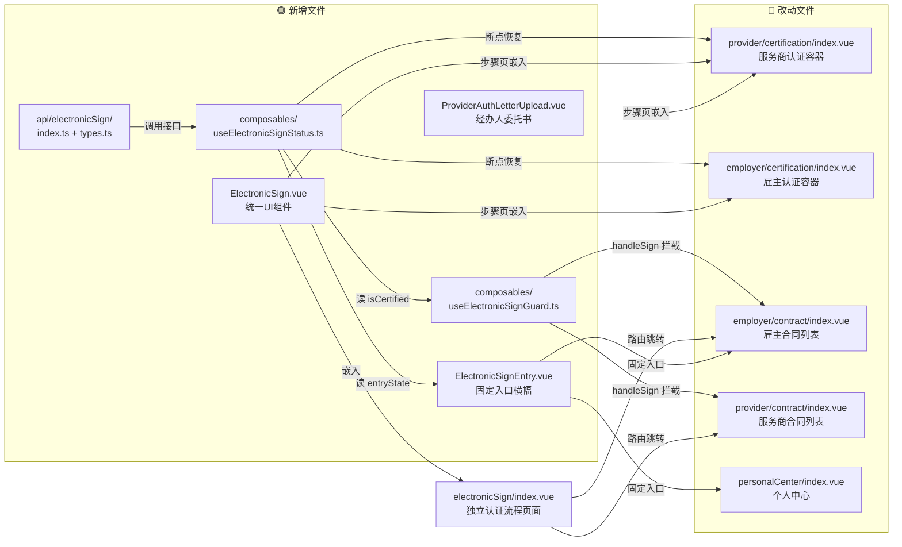
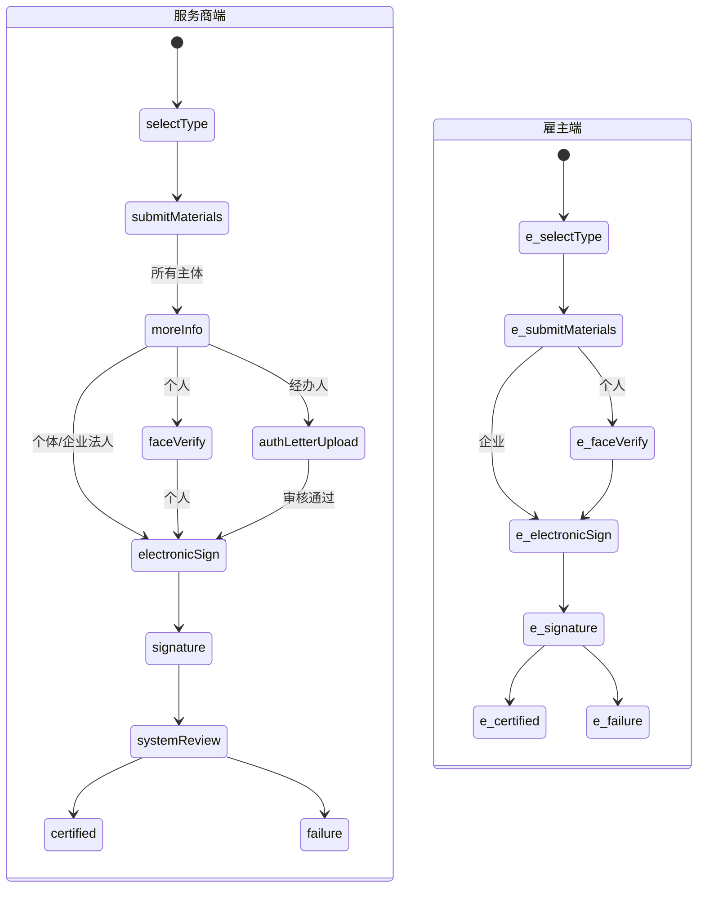
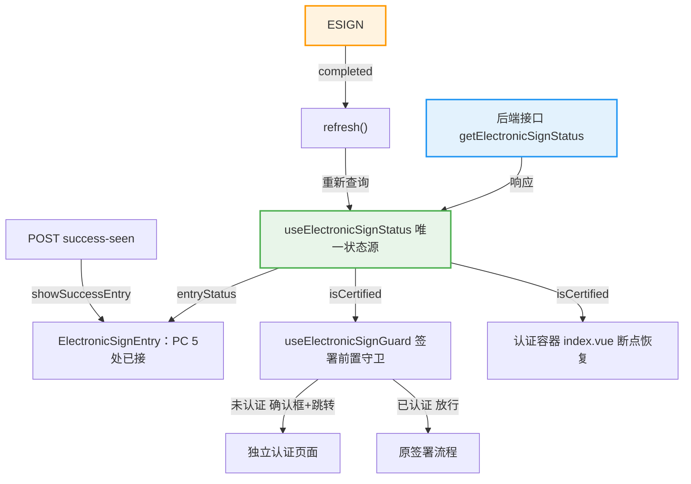

# 阶段2-技术方案-REQ-195

## 目录

- [全局总览](#全局总览)
  - [改动全景图](#改动全景图)
  - [认证流程状态机](#认证流程状态机)
  - [数据流向](#数据流向)
- [新增文件结构](#新增文件结构)
- [现状分析](#现状分析)
- [横向影响检查](#横向影响检查)
- [涉及文件清单](#涉及文件清单)
- [数据结构设计](#数据结构设计)
- [关键逻辑设计](#关键逻辑设计)
- [组件设计](#组件设计)
- [状态管理设计](#状态管理设计)
- [状态机扩展](#状态机扩展)
- [开发顺序建议](#开发顺序建议)
- [风险点](#风险点)
- [后端接口契约确认清单](#后端接口契约确认清单)
- [验证要点](#验证要点)
- [v2.16 修订记录](#v216-修订记录2026-11-11-二轮口径)

---

## v2.16 修订记录（2026-11-11 二轮口径）

> 本节为 2026-11-11 二轮拍板口径，正文旧流程描述与本文冲突时以本节为准；正文保留可追溯。

1. **认证环节送审方式（收集即落库）**：经办人委托书在收集步上传 OSS 后立即调 `ca-auth-letter` 落认证域物料，动态码通过后由 Server 用已落库物料自动送审，前端认证环节**不再调 `/auth-file`**（前端拿不到 oss 资源）；非经办人动态码通过即进下一环节（无审核无等待）。合同签署/固定入口（独立页）经办人可取到 oss 资源，维持短信通过后调 `/auth-file` 送审。
2. **认证成功后的去向**：认证容器中，经办人审核通过后静默等待 5 秒（常量 `CA_AUTH_PASS_ADVANCE_DELAY_MS=5000`，位于 `authentication/const.ts`，页面不展示倒计时）再进入签署协议；非经办人认证通过后按原逻辑直接流转。独立电子签章页（合同/固定入口）在 `/status.entryStatus=7` 时，无论是否经办人均停留在“电子合同签章认证已完成”页面，不自动返回；点击“完成”后返回 `returnUrl` 或上一页。此规则也适用于已认证用户再次进入独立页，不改变认证容器的新用户流程。
3. **P1 重新上传（方案 a）**：重进先见驳回态（断点恢复不把 RE_UPLOAD 分流到收集步）；点重新上传后认证场景调 `user/info`、合同场景调 `/status` 刷状态，仍处 RE_UPLOAD 则回委托书收集步重走（非材料首步）。
4. **雇主认证页补齐收集步**：雇主容器新增 `authLetterUpload` ViewType 与收集步模板（原仅服务商有）；`handleSubmitNext`（企业）/`handleFaceNext`（个人）/`initializePage` 断点续走均按 `isAuthFileNeeded` 分流，收集步与签章认证共用同一步骤位；`ElectronicSign` 接 `:preuploaded-auth-file` 防驳回重走死锁。
5. **实现落点**：`ElectronicSign.vue`（certificationFlow 分支：非经办人放行/经办人刷状态；`scheduleAuthPassAdvance`/`clearAuthPassAdvanceTimer` 5 秒定时；`onBeforeUnmount` 清理）、`ProviderAuthLetterUpload.vue`（collectOnly+persistAuthLetter 收集即落库分支）、两端认证容器分流、`const.ts` 常量、`electronicSign/index.vue`（2026-11-11 验证收尾：恢复 `identityReady` 状态门控 + 收集步改显式 collect-only，旧 reuploading 三元写法注释保留）。验证：`vue-tsc --noEmit` exit=0、改动文件 ESLint 0 error。
6. **新增联调点**：`check-sms-code` 后 Server 自动送审时序（响应能否同步反映送审后状态）；非经办人 `check-sms-code` 响应 `canSign=true` 同步返回；RE_UPLOAD 重走 `check-sms-code` 须返回 `nextAction=UPLOAD_AUTH_FILE`；`ca-auth-letter` 重复落库覆盖语义。**2026-11-11 联调实证**：`/status` 响应（entryStatus=2）未下发 `isAuthFileNeeded`（P-1 契约缺口），已按用户确认做前端兼容降级——独立页门控改为「status 已加载即就绪」，字段缺失按非经办人单步渲染、真经办人靠 `UPLOAD_AUTH_FILE` 兜底，后端补字段后前端无需再改。
7. **三轮缺陷修复（2026-11-11 外部静态 check 复核后，均落 `ElectronicSign.vue`）**：① 5 秒等待触发条件放宽——原 watch 仅「审核中(3)→成功(7)」触发，改为「前值任何非成功态→成功均触发」（覆盖 3→7/2→7/4→7/null→7；`immediate` 首触兜底认证容器中的状态恢复与父子挂载时序；7→7 变化不重复排队）。② 送审确认循环 `confirmAutoSubmit`——认证环节经办人验证码通过后，Server 自动送审与首次 `refresh` 存在时序差（首刷仍 entryStatus=2 时轮询不续排、流程停住），以 `AUTO_SUBMIT_CONFIRM_MAX_RETRIES=5` 次、`AUTH_POLLING_INTERVAL_MS` 间隔重刷确认：查到 REVIEWING 交还 refresh 自动续排轮询、直接成功交还状态 watch 排 5 秒等待、查询失败（R-014-5）不重试交还既有链路；generation 标记使重走协议/切换主体/卸载后的旧确认循环作废。新增联调点：非经办人 `check-sms-code` 返回 `canSign=true` 后父页面 `GET /status` 是否同事务同步。

---

## 全局总览

### 改动全景图

> 🟢 新增文件 🔵 改动文件 → 依赖/消费关系



### 认证流程状态机



### 数据流向



---

## 新增文件结构

> 以下仅展示 REQ-195 **新增**的文件，已有文件的修改不在此树中。
> 路径均相对于 `wds/wds-web/src/`。

```
src/
├── api/
│   └── electronicSign/                  # 🆕 电子合同签章认证 API
│       ├── index.ts                     #   接口封装（状态查询/协议/验证码/委托书）
│       └── types.ts                     #   类型定义骨架（TODO: wxj U-008 确认后定向替换）
│
├── composables/
│   └── electronicSign/                  # 🆕 电子签章认证 composable
│       ├── useElectronicSignStatus.ts   #   统一状态管理（获取/缓存/刷新/曝光标记）
│       └── useElectronicSignGuard.ts    #   签署前置守卫 + confirmAndGoElectronicSign 确认跳转工具函数
│
├── views/
│   └── authentication/
│       └── components/
│           ├── ElectronicSign.vue       # 🆕 统一 UI 组件（协议阅读+验证码）
│           ├── AuthLetterStatus.vue     # 🆕 审核结果态展示（一个组件，多状态独立 DOM 分支 + 共享样式）
│           ├── ProviderAuthLetterUpload.vue  # 🆕 经办人委托书上传
│           └── ElectronicSignEntry.vue       # 固定入口横幅（7种 Server 状态映射）
```

### 文件职责说明

| 文件 | 职责 | 消费方 |
|------|------|--------|
| `api/electronicSign/index.ts` | 封装电子签章能力的实际接口适配，前端不直接对接爱签 | 所有 composable 和组件 |
| `api/electronicSign/types.ts` | 类型骨架，U-008 确认后定向替换 | api/index.ts + composables |
| `useElectronicSignStatus.ts` | **唯一状态源**：响应式状态 + 缓存 + Server 成功曝光标记 | Banner、Guard、认证容器 |
| `useElectronicSignGuard.ts` | 守卫 + UI 工具：`useElectronicSignGuard(role)` 返回 `canSign` 响应式判定；`confirmAndGoElectronicSign(router, route)` 封装 Modal.confirm + 路由跳转（两端合同页共用） | 雇主合同页、服务商合同页 |
| `ElectronicSign.vue` | **统一 UI 组件**：协议阅读 + 验证码 + 提交；通过 `showAuthLetterStatus` 判定是否渲染审核结果态，正常流程与结果态互斥切换 | 认证流程（步骤页）、签署拦截（独立页面） |
| `AuthLetterStatus.vue` | **审核结果态展示组件**：接收 `entryStatus` prop，内部按 v-if/v-else-if 分支渲染各状态完整独立 DOM（审核中 / 审核未通过），共享 BEM 样式；新增状态只需加一个分支 | ElectronicSign.vue |
| `ProviderAuthLetterUpload.vue` | 经办人专属：委托书上传 + 审核状态展示 + 审核意见 | 服务商认证流程、签署拦截（经办人分支） |
| `ElectronicSignEntry.vue` | 固定入口横幅：根据状态渲染文案/按钮/样式 | 两端个人中心、两端合同列表和供应商个人中心共 5 处 |

### 统一 UI 组件的容器分离模式（v2.8 更新：弹窗→独立页面）

`ElectronicSign.vue` 是纯内容组件，不含外层容器。调用方决定呈现形态：

```
认证流程中（步骤页）：
  <template v-if="currentView === 'electronicSign'">
    <ElectronicSign :subject-id="subjectId" @completed="onSignCompleted" />
  </template>

签署拦截时（独立页面，v2.8 替代原弹窗方案）：
  router.push({ name: 'ElectronicSignPage', query: { returnUrl: currentPath } })
  // 页面内部按步骤渲染：01 授权委托书（经办人）→ 02 电子签章认证
```

> [v2.8 架构变更] 合同签署场景从 `a-modal` 弹窗改为独立路由页面 `/employer/my/electronic-sign`。
> 用户点击"立即签署" → 确认对话框（a-modal.confirm） → "去认证"跳转到独立页面 → 认证成功页由用户点击“完成”后返回来源页。
> `ElectronicSignModal.vue` 降级为轻量确认对话框或直接使用 `Modal.confirm`，不再包裹 ElectronicSign 内容。

核心交互逻辑（协议阅读、验证码、提交）只存在于 `ElectronicSign.vue` 一份代码中。

### 电子签章页面三种渲染形态（v2.10 新增）

`ElectronicSign.vue` 根据 `GET /status` 返回的 `entryStatus` 切换渲染内容：

| entryStatus | 渲染内容 | 设计稿 |
|---|---|---|
| 1/2/5（去认证/继续/重新认证） | 协议 iframe + 验证码输入 + 下一步按钮 | 已有实现 |
| 3（REVIEWING 审核中） | 橙色时钟图标 + "授权委托书审核中" + "通过后可继续认证，请耐心等待。" | Figma 173925-71300 |
| 4（RE_UPLOAD 审核未通过） | 红色叉号图标 + "授权委托书审核未通过" + 描述文案 + "重新上传"按钮 | Figma 173925-71378 |

> [v2.10] 审核结果态放在 ElectronicSign.vue 内部根据 entryStatus 切换，不新增容器页 ViewType。
> "重新上传"按钮行为（2026-11-11 修订为 B 口径，推翻 11-10「原地替换」记录）：认证场景重新读取 `user/info` 后回到材料首步；签署合同场景重新读取独立 CA `/status`，确认仍为经办人且 `entryStatus=4` 后回到授权委托书第一步。重新收集后**重走协议+动态码**，凭本轮新 `caFlowId` 调用 `/auth-file`；原「重传 `caFlowId` 来源待 Server 确认」问题关闭。联调点：RE_UPLOAD 重走 `check-sms-code` 须返回 `nextAction=UPLOAD_AUTH_FILE`。
> 合同签署场景：守卫 canSign=false 跳转认证页后，认证页根据 entryStatus 直接展示对应状态。
>
> [v2.11] 审核结果态 UI 抽离为独立组件 `AuthLetterStatus.vue`：
> - 一个组件文件承载所有状态，每个状态各自拥有完整的、独立的 DOM 分支（v-if / v-else-if）
> - 共享样式写在同一个 `<style scoped>` 的 `.auth-letter-status` BEM 块内
> - 新增状态 = 加一个 v-else-if 分支 + 对应 BEM modifier 类名，DOM 完全独立不受其他状态约束
> - ElectronicSign.vue 只保留一个 `<AuthLetterStatus v-if="showAuthLetterStatus">`，容器级仅判"是否进入结果态"

---

## 现状分析

> 原始需求 V1.1 更新稿补充：从未使用爱签与平台签署电子协议的用户需重新签署协议；授权书审核中不显示审核时间；合同拦截提示文案为“根据相关规定，使用电子签章前需先完成相关电子认证，认证后即可签署本合同”。后两项按 PC UI 处理；重签条件与 `GET /status`、`/protocol` 的具体对应关系仍需 Server 校准，前端不增加本地历史签署判断。旧版 APP 升级交互不属于本期 PC 范围。

> 供应商 PC 入口已由补充截图确认：`views/supplier/personalCenter/index.vue` 的主体资料卡与保证金提示之间。供应商是特殊服务商，本期该入口使用 `role=provider` 和当前 `userStore.providerId` 查询状态、标记成功曝光并跳转 `/supplier/my/electronic-sign`（复用认证组件）；`supplierId` 用于供应商业务，不作为本期 CA 参数。独立供应商参数若由 Server 后续扩展，再单独对齐。

### 涉及文件清单（现有）

| 文件路径 | 所属项目 | 当前职责 | 技术栈 |
|---------|---------|---------|--------|
| `views/provider/certification/index.vue` | wds-web | 服务商认证流程容器：ViewType 8种 + 步骤条 + 断点恢复 | Vue3 + TS + Ant Design Vue |
| `views/employer/certification/index.vue` | wds-web | 雇主认证流程容器：ViewType 6种 + 步骤条 + 断点恢复 | Vue3 + TS + Ant Design Vue |
| `views/employer/contract/index.vue` | wds-web | 雇主我的合同列表 + `handleSign` 签署入口 | Vue3 + TS + Ant Design Vue |
| `views/provider/contract/index.vue` | wds-web | 服务商合同管理列表 + `handleSign` 签署入口 | Vue3 + TS + Ant Design Vue |
| `views/authentication/components/ProtocolSignature.vue` | wds-web | 旧协议签署（外链 + 轮询） | Vue3 + TS |
| `views/authentication/components/CertEnterpriseSupplementSection.vue` | wds-web | 经办人补充材料上传（身份证+委托书） | Vue3 + TS |
| `api/provider/certification/index.ts` | wds-web | 服务商认证 API 封装 | TS |
| `api/employer/certification/index.ts` | wds-web | 雇主认证 API 封装 | TS |
| `stores/user.ts` | wds-web | 用户状态 store（现有 authStatus/authPhase） | Pinia |

### 现有实现方式

#### 认证流程状态机

**服务商端** ViewType：`selectType | submitMaterials | moreInfo | faceVerify | signature | systemReview | certified | failure`
- personalSteps = ['提交材料', '完善信息', '人脸认证', '签署协议', '系统审核']
- businessSteps = ['提交材料', '完善信息', '签署协议', '系统审核']
- 断点恢复：`authStatus` + `authPhase` + `subjectType`

**雇主端** ViewType：`selectType | submitMaterials | faceVerify | signature | certified | failure`
- personalSteps = ['提交材料', '人脸认证', '签署协议']
- businessSteps = ['提交材料', '签署协议']
- 断点恢复：`employerAuthStatus` + `employer.auditInfo.authPhase`

#### 合同签署入口

**雇主端** `handleSign(item)`：埋点 → `if (!electronicSignGuard.canSign.value) { confirmAndGoElectronicSign(router, route); return; }` → 原签署逻辑
**服务商端** `handleSign(item)`：埋点 → `if (!electronicSignGuard.canSign.value) { confirmAndGoElectronicSign(router, route); return; }` → 原签署逻辑

> 两端共用 `useElectronicSignGuard` + `confirmAndGoElectronicSign`，不再各自内联 `needElectronicSign()` 和 `Modal.confirm` 重复代码。

---

## 横向影响检查

| 检查维度 | 是否涉及 | 文件/说明 |
|---------|---------|----------|
| 调整页 | 否 | 本次无表单调整页 |
| 查看页 | 否 | 本次无查看页改动 |
| 列表页 | 是 | 雇主我的合同、服务商合同管理（R-003 认证状态过滤） |
| 对账页 | 否 | 不涉及 |
| 付款页 | 否 | 不涉及 |
| 移动端对应页面 | 否 | 本期仅 PC Web |
| 公共组件 | 是 | 新增 ElectronicSign.vue（跨两端复用）、useElectronicSignGuard.ts |
| 接口封装 | 是 | 按最终契约适配电子签章状态、验证码、协议与委托书等能力 |
| 历史旧展示 | 否 | 旧协议签署逻辑不改动，新环节独立插入 |

---

## 涉及文件清单

| 文件路径 | 角色 | 改动类型 | 改动说明 | 旧逻辑处理 |
|---------|------|---------|---------|-----------|
| `views/provider/certification/index.vue` | 认证容器 | 修改 | 新增 `electronicSign` / `authLetterUpload` ViewType；steps 数组插入新步骤；断点恢复逻辑扩展 | 旧 ViewType/steps 注释保留 |
| `views/employer/certification/index.vue` | 认证容器 | 修改 | 新增 `electronicSign` ViewType；steps 数组插入新步骤；断点恢复逻辑扩展 | 旧 ViewType/steps 注释保留 |
| `views/authentication/components/ElectronicSign.vue` | 新组件 | 新增 | 电子合同签章认证页：协议展示 + 手机号验证码 + 提交 | 不涉及 |
| `views/provider/certification/components/ProviderAuthLetterUpload.vue` | 新组件 | 新增 | 经办人授权委托书上传 + 审核状态展示 + 审核结果态 | 不涉及 |
| `views/authentication/electronicSign/index.vue` | 独立页面 | 新增 | 电子合同签章认证独立页面：步骤进度条 + 01 授权委托书上传（经办人）+ 02 电子签章认证 + 操作按钮组 | 不涉及 |
| `composables/useElectronicSignGuard.ts` | 守卫 | 新增 | `useElectronicSignGuard(role)` 守卫 composable + `confirmAndGoElectronicSign(router, route)` 确认跳转工具函数（两端合同页共用，消除重复 Modal.confirm 代码） | 不涉及 |
| `views/employer/contract/index.vue` | 合同列表 | 修改 | `handleSign` 前置消费 `useElectronicSignGuard('employer')`；`canSign` 为 false 时调用 `confirmAndGoElectronicSign` 弹确认框 → 路由跳转独立认证页 | 旧弹窗逻辑已清理 |
| `views/provider/contract/index.vue` | 合同列表 | 修改 | `handleSign` 前置消费 `useElectronicSignGuard('provider')`；`canSign` 为 false 时调用 `confirmAndGoElectronicSign` 弹确认框 → 路由跳转独立认证页 | 旧弹窗逻辑已清理 |
| `views/authentication/personalCenter/index.vue` | 个人中心 | 修改 | 新增认证入口横幅（按身份区分雇主/服务商） | 不涉及 |
| `views/provider/dashboard/index.vue` | 工作台 | ~~修改~~ 不改动 | 产品确认移除工作台固定入口（2026-11-05 Figma 确认） | 不涉及 |
| `views/supplier/personalCenter/index.vue`、`router/routes/supplier/index.ts` | 供应商个人中心与认证路由 | 修改 | 在主体资料卡下方、保证金提示上方新增认证入口；使用服务商 `providerId` 状态，从 `/supplier/my/electronic-sign` 进入复用认证组件 | 不涉及 |
| `api/electronicSign/index.ts` | 接口封装 | 新增 | 适配最终确认的状态、协议、验证码、委托书等业务能力；不预设接口拆分数量 | 不涉及 |
| `stores/user.ts` | 状态管理 | 本期不改动 | CA 状态由独立状态 composable 读取，不在 `user/info` DTO/store 中新增 CA 快照；既有 `authPhase` 语义保持 | 不涉及 |

---

## 数据结构设计

### 电子签章能力接口（按 2026-11-05 Server 方案）

状态通过 `GET /v1/{role}/ca-verification/status` 获取；协议、短信、验证码、授权书和成功曝光以同一角色前缀下的核身接口完成。

> 下方为最终契约版函数签名（`caFlowId` 流程制）。
> 接口函数统一 `fetch` 开头，动作语义放末尾；`CaSubjectParams` 含 `role`（employer/provider），主体 ID 按角色二选一。

```ts
// api/electronicSign/index.ts
// 前缀按 role 取 /v1/employer/ca-verification 或 /v1/provider/ca-verification

/** 查询认证状态：query 传 employerId 或 providerId（互斥） */
export function fetchCaVerificationStatus(params: CaSubjectParams, options?: RequestOptions)

/** 申请新流程并取协议链接：每次调用产生新 caFlowId，旧未完成流程作废 */
export function fetchCaAgreement(params: CaSubjectParams, options?: RequestOptions)

/** 按已有流程发送三要素短信 */
export function fetchCaSmsCodeSend(params: CaSubjectParams & { caFlowId: string }, options?: RequestOptions)

/** 校验验证码：succeed=true 即三要素完成，不回查状态接口 */
export function fetchCaSmsCodeCheck(params: CaSubjectParams & { caFlowId: string; verifyCode: string }, options?: RequestOptions)

/** 重发短信：成功不改变三要素结论，仍停留验证码页 */
export function fetchCaSmsCodeResend(params: CaSubjectParams & { caFlowId: string }, options?: RequestOptions)

/** 经办人上传授权书：仅 caFlowId 三要素已完成后可调；成功只表示收件 */
export function fetchCaAuthFileUpload(params: CaSubjectParams & { caFlowId: string; fileName: string; fileUrl: string }, options?: RequestOptions)

/** 老用户/过期用户经办人补传委托书：先落物料（本接口），再 fetchCaAuthFileUpload 提交中台；前一步失败不调后一步 */
export function fetchCaAuthLetterSubmit(params: CaSubjectParams & { ossCode: string }, options?: RequestOptions)

/** 成功入口展示一次后标记；之后 GET /status 仍返回成功但 showSuccessEntry=false */
export function fetchCaSuccessEntrySeen(params: CaSubjectParams, options?: RequestOptions)
```

### 新增类型定义

```ts
// types/electronicSign.ts

/** 电子合同签章认证状态 */
export interface ElectronicSignStatus {
  entryStatus: 0 | 1 | 2 | 3 | 4 | 5 | 6 | 7
  canSign: boolean
  showSuccessEntry: boolean
  maskedPhone: string
  /** 用户确认由状态接口返回，用于首屏判断是否展示委托书步骤；响应层级待联调 */
  isAuthFileNeeded: boolean
}

/** POST /agreement 返回值 */
export interface ElectronicSignAgreement {
  caFlowId: string
  agreementUrl: string
}
```

---

## 关键逻辑设计

### 逻辑1：认证流程插入 electronicSign 环节

- **触发条件**：用户完成旧协议签署前的最后一个既有步骤（服务商个人：faceVerify 通过；服务商个体/企业法人：moreInfo 通过；服务商经办人：UI 已上传委托书、待协议和短信核身；雇主个人：faceVerify 通过；雇主企业法人：submitMaterials 通过）。
- **处理步骤**：
  1. 调用 `getElectronicSignStatus` 查询认证状态
  2. 若 `certified === true && !expired` → 跳过，直接进入 signature
  3. 若未完成 → 进入 electronicSign ViewType
  4. `isAuthFileNeeded=true` 且未完成委托书页面上传 → 先进入 authLetterUpload ViewType；页面上传后进入协议和短信验证，验证码成功后再提交委托书审核，审核通过后方可签署
- **异常处理**：接口超时 → 保留当前页 + 重试按钮（R-014-1）

### 逻辑2：签署合同前置守卫

- **触发条件**：用户点击合同列表"立即签署"按钮
- **处理步骤**：
  1. `handleSign` 开始处调用 `useElectronicSignGuard(subjectId)`
  2. 守卫内部调用 `getElectronicSignStatus`
  3. 若已认证且有效 → 放行，继续原签署流程
  4. 若未认证/已过期 → 确认提示后跳到独立电子签章认证页；经办人展示“委托书上传 → 协议与短信”两步，其他身份展示单步
  5. 取消确认提示或从认证页返回 → 留在来源合同页，不打开签署 URL
  6. 认证完成 → 返回来源合同页；用户再次点击“立即签署”时重新查询 `canSign` 后进入原签署流程
- **异常处理**：接口超时 → 提示重试，不放行签署（R-014-1）

### 逻辑3：断点恢复扩展

- **触发条件**：用户重新进入认证页
- **处理步骤**：
  1. 先按现有 `authStatus` / `authPhase` 恢复原平台实名认证步骤。
  2. 再按电子签章的独立状态语义映射 `authLetterUpload` / `electronicSign` / 旧 `signature`；不得写入、扩展或重解释原 `authPhase`。
  3. 经办人处于审核中或审核未通过时，进入对应委托书状态；个人/法人未完成时进入电子签章环节。
  4. 已完成电子签章认证且有效时，跳过新环节并继续旧 `signature`；该认证不能替代平台实名认证的 `certified` 结果。
- **注意**：独立恢复状态的字段与枚举由 C-006 确认；未取到状态时保留当前页并重试，不得按已认证处理。

### 逻辑4：固定入口横幅

- **触发条件**：页面加载时
- **处理步骤**：
  1. 先判平台实名认证是否完成（R-006-1），未完成直接不渲染；再调用 `getElectronicSignStatus` 获取状态
  2. 根据 `entryStatus` 映射去认证、继续认证、审核中、重新上传、重新认证、即将到期和认证成功。〔2026-11-12〕文案与配色按 Figma 组件集 `PC电子签入口`（node `173925:63471`）收口：「即将到期」设计稿无变体，已在 `STATUS_CONFIG` 整块注释（该状态入口不渲染）；审核中与认证成功两态无按钮
  3. `showSuccessEntry=true` 时展示一次成功入口，展示后调用 `success-seen`
  4. 渲染横幅组件，绑定点击事件
- **异常处理**：接口失败 → 不展示横幅（降级）

### 错误提示分层口径（2026-11-12 收口，适用于本需求全部 CA 链路）

- **响应判定**：CA 接口即使返回 `code=200`，仍以显式的 `succeed=false` 判为业务失败；仅在响应未提供 `succeed` 时沿用请求层的 `code` 兼容判断。静默接口也必须把失败返回给调用方。
- **请求层提示**：协议、发送/重发短信、委托书提交失败由请求层提示；页面和组件不重复弹出。
- **状态接口静默**：`GET /status` 始终使用 `silentBusinessError + errorMessageMode:'none'`，自动查询与 5 秒轮询不弹提示；用户主动操作后查询失败，由操作所在页面提示一次。`success-seen` 失败同样静默。
- **验证码校验**：`check-sms-code` 静默，失败文案只在验证码输入框下方展示，不再弹顶部错误。
- **本地错误**：缺流程号、响应缺必要字段、业务状态与流程不一致等由当前组件提示；合同守卫查询失败也由合同页提示一次，不使用 `apiNotified` 分支。
- **接口未返数据时不得推断**：`success-seen` 失败不提示但也不得写回成功状态；`/status` 失败保留旧状态且 `canSign=false` 拒绝放行（R-014-5）。

### 逻辑5：授权书审核结果轮询（设计，U-011 待确认）

> 现有实现范式参考 `.repoWiki/kb/wds-web/modules/views/authentication.md` 7.7（5 套轮询对照、三段范式代码与坑点）；本文只落**设计决策**，不复制代码事实。

- **唯一需要持续轮询的场景**：经办人授权书人工审核。上传 `/auth-file` 成功仅表示收件（`nextAction = 2`（已收件等待审核）），审核无同步返回、无回调，只能在 `entryStatus = 3`（审核中，入口不可点）期间重复查状态。
- **不轮询**：验证码 `succeed=true` 后不回查状态接口；有效期在再次进入时读；签署前 / 消息点击实时查一次；验证码 60 秒是重发倒计时，不是轮询。
- **数据源**：每轮 `await useElectronicSignStatus.refresh()`（内部 `fetchCaVerificationStatus`，`GET /status`），刷新统一状态源后再读 `entryStatus` / `canSign`；不得读缓存、旧 store 或 `authPhase = 4`（CA 完成检查点）。
- **启停**：`watch(entryStatus, { immediate: true })`，`3` 启动、非 `3` 停止；`immediate` 保证进入审核结果态立即首查一次，不留空窗。终态包括 `4`（重新上传）、`2`（继续认证）、`7`（认证成功）、`5`（重新认证）；`6`（即将到期，仍可签）是可签署态，不触发轮询。实现上用「等于 `3` 才继续」收敛判断，不枚举所有停止值。
- **防重入**：递归 `setTimeout`（`await` 完成再排下一轮）或 `inFlight` 标志，不用裸 `setInterval + async`，避免单轮超时后请求堆积。
- **失败降级**：查询失败只置 `error`、**保留定时器**并提供重试入口（R-014-1）；不得推断为「审核未通过」（R-014-2），审核中期间 `canSign=false` 不放行签署（R-014-5）。埋点结果状态用 `Unknown`（结果未知）而非 `Failure`（失败）。
- **清理时机**：`watch(isLoggedIn)` 登录态转 false、`watch(subjectId)` 服务商主体切换（停旧启新，不用旧 ID 打新轮询）、`onUnmounted` 清定时器并置 null。
- **UI 关系**：审核结果态由 `AuthLetterStatus.vue` 按 `entryStatus` 渲染（U-010 已闭环）；轮询只负责把 Server 最新状态搬回统一状态源，不额外引入本地审核状态，审核意见缺失不虚构原因。
- **轮询频率（U-011 已确认 2026-11-10 最终口径）**：产品确认与既有认证统一 5 秒轮询，复用 `views/authentication/const.ts` 的 `AUTH_POLLING_INTERVAL_MS = 5000`（与个人中心系统审核、人脸、协议签署等既有场景同一常量同一口径），直到查到结果（审核通过或拒绝）后停止。终止条件：仅 `entryStatus = 3`（审核中）续排，出结果即停。

---

## 组件设计

| 组件名 | 用途 | props | events | 复用策略 |
|--------|------|-------|--------|----------|
| `ElectronicSign.vue` | 统一 UI 组件（纯内容，不含容器） | `subjectId`、`returnUrl?` | `@completed`、`@closed` | 新建，跨两端复用；认证流程直接嵌入，签署拦截用 ElectronicSignModal 包裹 |
| `ElectronicSignModal.vue` | ~~弹窗壳子~~ 降级为确认对话框 | ~~封装 a-modal + ElectronicSign~~ 仅用于签署前确认提示 | ~~@signed~~ 确认回调 | 注释保留旧逻辑，改用 Modal.confirm 或轻量确认组件 |
| `ProviderAuthLetterUpload.vue` | 经办人委托书上传+审核结果 | `subjectId`、`mode: 'page' \| 'dialog'` | `@approved`、`@rejected`、`@closed` | 新建，仅服务商端 |
| `ElectronicSignEntry.vue` | 固定入口横幅（原方案命名 ElectronicSignBanner） | `role`、`context?`、`authCompleted?`（可选，不传则按 `role` 从用户 store 取雇主/服务商口径）；消费 useElectronicSignStatus | `@action` | 已接 PC 5 处；平台实名认证未完成时不渲染（R-006-1）；文案按 Figma 6 变体收口，即将到期已注释；无局部 toast，失败提示归接口层 |

### ElectronicSign.vue 内部结构

```
ElectronicSign.vue
├── 协议展示区
├── 脱敏手机号展示
├── 验证码输入 + 获取按钮（发送后的重发冷却/频控按 Server 最终字段展示）
├── 下一步按钮（条件性可点击）
└── 提交中 loading + 防重复点击
```

### ProviderAuthLetterUpload.vue 内部结构

```
ProviderAuthLetterUpload.vue
├── 模板下载链接（复用 `/files/authorization-letter-template.docx`，已确认 C-003）
├── 文件上传区（PDF/JPG/PNG ≤20MB）
├── 提交按钮
├── 审核中态（灰色不可操作）
├── 审核通过态 → emit approved
└── 审核未通过态 + 审核意见（R-014-2）+ 重新上传按钮
```

> ⚠️ **审核失败不走容器 failure**：委托书审核未通过是 `authLetterUpload` 组件的内部状态（参照 `ProviderSystemReview` 的内部三态模式），不得切到容器的 `failure` ViewType，否则会丢失审核意见与重新上传交互。

### 组件挂载策略

| 端 | 现有材料组件策略 | 新增组件建议 |
|----|-----------------|-------------|
| 雇主端 | `v-if`（切换视图即卸载） | ElectronicSign 用 `v-if`，与现有保持一致 |
| 服务商端 | 材料组件 `v-show`（保留 DOM），FaceVerify/Signature/SystemReview 用 `v-if` | ElectronicSign、AuthLetterUpload 均用 `v-if`（跟 FaceVerify 同档，不需保留上传状态） |

### 并发防护要求

现有认证流程的材料提交使用 `materialRevision` 令牌防重复（精读文档坑点#3）。新增组件涉及异步操作时须遵循相同模式：

- **ElectronicSign.vue**：验证码发送、验证码校验/提交均需防重复点击 + 在途请求失效保护
- **ProviderAuthLetterUpload.vue**：文件上传、委托书提交需防重复提交
- 实现方式：组件内维护 revision 计数器，每次用户操作递增，await 后检查 `isCurrent()`，不匹配则丢弃响应

---

## 状态管理设计

### useElectronicSignStatus.ts（统一状态源）

所有消费方（横幅、守卫、认证容器）统一从此 composable 读取状态，不各自调接口。

```ts
// composables/electronicSign/useElectronicSignStatus.ts

export function useElectronicSignStatus(subjectId: MaybeRef<string>) {
  // --- 响应式状态 ---
  const status = ref<ElectronicSignStatus | null>(null)
  const loading = ref(false)
  const error = ref<string | null>(null)

  // --- 计算属性 ---
  /** 已认证且未过期 */
  const isCertified = computed(() => status.value?.canSign === true)

  /** 映射 Server entryStatus；6=即将到期但仍允许签署 */
  const entryState = computed<EntryState>(() => {
    if (!status.value) return 'hidden'
    return mapEntryStatus(status.value.entryStatus)
  })

  /** 成功入口是否仍需展示，由 Server 按证件维度维护 */
  const shouldShowSuccessEntry = computed(() => status.value?.showSuccessEntry === true)

  // --- 方法 ---
  /** 查询/刷新状态 */
  async function refresh(): Promise<void> { ... }

  /** 成功入口展示后调用 Server 标记接口 */
  async function markSuccessEntrySeen(): Promise<void> { ... }

  // --- 自动初始化 ---
  onMounted(() => refresh())

  return {
    status, loading, error,
    isCertified, entryState, shouldShowSuccessEntry,
    refresh, markSuccessEntrySeen,
  }
}
```

### 数据流向

```
useElectronicSignStatus (唯一状态源)
    │
    ├──→ ElectronicSignEntry.vue    读 entryStatus + shouldShowSuccessEntry
    ├──→ useElectronicSignGuard.ts  读 isCertified → 决定跳过/拦截
    └──→ 认证容器 index.vue         读 isCertified → 断点恢复时跳过

userStore（平台实名认证态，与 CA 状态另一个数据源）
    └──→ ElectronicSignEntry.vue    雇主/服务商口径由组件自取，供应商口径由 supplier 个人中心页以 authCompleted 传入
                                        未完成时入口不渲染，不发成功曝光写请求（R-006-1）

ElectronicSign.vue 内部自行调用 refresh() 完成认证后刷新状态
  → 其他消费方自动响应式更新
```

## 缓存策略

- 首次进入页面时 `onMounted` 触发查询
- 同一 subjectId 多次实例化共享同一份状态（通过模块级 Map 缓存）
- 认证完成后主动 `refresh()` 确保状态同步
- 成功入口曝光由 `showSuccessEntry` / `success-seen` 在 Server 按证件维度维护；前端不以 localStorage 作为事实源

### 状态数据归属：独立接口

> 本期前端 Profile、固定入口、认证恢复和签署守卫统一读取 `GET /v1/{role}/ca-verification/status`。Server 认证模块方案写有 `user/info` 透传，是否继续实施待 Server 复核；前端不据此新增 DTO/store。

| 消费方 | 数据来源 | 实现 |
|--------|---------|------|
| 固定入口横幅、签署守卫、认证容器断点恢复、Profile 认证信息块 | `GET /v1/{role}/ca-verification/status` | `useElectronicSignStatus.ts` 统一调接口，所有消费方从该 composable 读状态 |

---

## 状态机扩展

### 服务商端 ViewType 扩展

```
原：selectType | submitMaterials | moreInfo | faceVerify | signature | systemReview | certified | failure
新：selectType | submitMaterials | moreInfo | faceVerify | authLetterUpload | electronicSign | signature | systemReview | certified | failure
```

steps 变化：
- personalSteps: ['提交材料', '完善信息', '人脸认证', **'电子合同签章认证'**, '签署协议', '系统审核']
- businessSteps 固定为 ['提交材料', '完善信息', '电子合同签章认证', '签署协议', '系统审核']。经办人上传委托书是“电子合同签章认证”环节内的页面操作，不增加总步骤。

```ts
const businessSteps = ['提交材料', '完善信息', '电子合同签章认证', '签署协议', '系统审核']
// authLetterUpload 和 electronicSign 在平台认证进度条中都对应索引 2。
```

> `isAuthFileNeeded` 仅决定认证环节内先展示委托书上传还是直接展示协议与短信；独立认证页仍按经办人双步、其他身份单步显示自己的步骤条。经办人审核从“审核中”变为认证成功且 `canSign=true` 时，平台认证容器沿用现有 `next` 事件和状态复查进入原协议签署；不新增成功态按钮。〔2026-11-23 现行口径：独立页进入或重进已是认证成功态时均展示成功结果页，不自动回退；点击“完成”后返回来源。〕

### 雇主端 ViewType 扩展

```
原：selectType | submitMaterials | faceVerify | signature | certified | failure
新：selectType | submitMaterials | faceVerify | electronicSign | signature | certified | failure
```

steps 变化：
- personalSteps: ['提交材料', '人脸认证', **'电子合同签章认证'**, '签署协议']
- businessSteps: ['提交材料', **'电子合同签章认证'**, '签署协议']

---

## 开发顺序建议

| 顺序 | 任务 | 原因 |
|------|------|------|
| 1 | `api/electronicSign/index.ts` + `types/electronicSign.ts` | 其他任务依赖接口定义；先用 TODO 占位骨架 |
| 2 | `composables/useElectronicSignGuard.ts` | 守卫是合同入口和认证流程的共用基础 |
| 3 | `ElectronicSign.vue` | 核心新组件，认证流程和签署弹窗都依赖它 |
| 4 | `ProviderAuthLetterUpload.vue` | 仅服务商端经办人分支，依赖 ElectronicSign 完成后衔接 |
| 5 | `views/provider/certification/index.vue` 改造 | 接入新 ViewType + steps + 断点恢复 |
| 6 | `views/employer/certification/index.vue` 改造 | 同上，无经办人分支，较简单 |
| 7 | `ElectronicSignEntry.vue` + PC 5 处固定入口接入 | 依赖状态查询接口 |
| 8 | `views/employer/contract/index.vue` + `views/provider/contract/index.vue` 守卫接入 | 依赖守卫 + 确认对话框 + 路由跳转 |
| 9 | `stores/user.ts` | 本期不新增 CA 状态字段；Profile 与认证恢复直接消费独立状态接口 |
| 10 | `views/authentication/electronicSign/index.vue` 独立认证页面 | 依赖 ElectronicSign.vue + ProviderAuthLetterUpload.vue + 路由配置 |

---

## 风险点

| 风险 | 等级 | 影响范围 | 应对方案 |
|------|------|---------|----------|
| 接口契约遗留项 | 中 | T1/倒计时 | C-001/U-008/C-007 核心已确认（见对齐表零章）；剩余：新认证经办人收集入口(T1)、验证码倒计时字段。页面骨架与状态层可先编码，对应交互按占位处理 |
| 电子签章独立恢复状态未定义 | 高 | 认证流程中断后无法正确恢复，或误落入旧认证分支 | 与后端对齐独立状态语义及映射，禁止扩展 `authPhase`；新状态值不得落入雇主 `phase===3`（终态）或服务商 `phase>=3`（systemReview）的判定区间 |
| 经办人状态字段待联调 | 中 | 状态字段缺失或层级变化时双步分流错误 | 用户已确认 `GET /status` 返回布尔值 `isAuthFileNeeded`；不得复用 `needSupplementary`，需以 Server 实际响应校验层级与缺省规则 |
| 新组件异步操作缺少并发防护 | 中 | 验证码/文件上传重复提交导致状态错乱 | 参照 materialRevision 令牌模式，组件内实现防重复机制 |
| 签署入口遗漏 | 中 | 用户绕过认证直接签署 | 本期仅接两个核心入口（PRD 范围），后续迭代补全 |
| 委托书模板已确认复用 | 低 | 无风险 | 现有 `/files/authorization-letter-template.docx` 直接复用，两端已有实现 |
| 状态来源一致性 | 低 | 状态管理架构 | Profile、认证恢复、固定入口和签署守卫均走独立状态接口；不引入 `user/info` CA 快照双来源 |
| 供应商个人中心入口 | 低 | R-004-6 入口状态或回跳错位 | 使用服务商 `providerId` 状态、`role=provider` 和已确认位置；联调核对切换身份后回跳 |
| 审核结果轮询频率与终止条件（U-011 已确认 5 秒） | 低 | 授权书审核中态刷新过快/过慢、停轮询条件遗漏 | 已按 2026-11-10 产品最终口径落地：复用既有 `AUTH_POLLING_INTERVAL_MS = 5000`，与既有认证场景统一；终止条件按「`entryStatus = 3`（审核中）才继续」收敛，查到通过/拒绝即停；实现范式见知识库 L5 7.7 |
| 轮询残留与请求堆积 | 中 | 切页/登出/主体切换后持续请求，或超时叠加并发 | 递归 `setTimeout` 防重入 + 三处清理（登录态/主体/卸载）；失败不停轮询，避免照抄 `FaceVerify.vue` 的失败即停写法 |

---

## 后端接口契约确认清单

> 以下事项均需后端书面确认字段名、类型、嵌套层级和条件性行为。
> 未确认前代码中以 `TODO: wxj` 占位，不落地推测类型。

### C-001 电子签章认证状态数据归属

| 维度 | 内容 |
|------|------|
| **结论** | ✅ 本期前端 CA 状态统一读取 `GET /v1/{role}/ca-verification/status`；Server 认证模块方案中的 `user/info` 透传另待复核。 |
| **前端实现** | `useElectronicSignStatus.ts` 调独立接口；`stores/user.ts` 不新增 CA 状态快照，`authPhase` 仅用于实名认证步骤恢复。 |
| **影响范围** | `api/electronicSign/index.ts`、`useElectronicSignStatus.ts` |
| **阻塞性** | ✅ 已关闭，可编码 |

### C-002 协议内容获取方式（原 U-007，已确认）

| 维度 | 内容 |
|------|------|
| **问题** | 协议内容是 URL 外链还是富文本内嵌？ |
| **已确认** | **URL 外链**。`ElectronicSign.vue` 用 iframe 或外链跳转展示协议内容 |
| **若后端方案不一致** | 需改为富文本内嵌时，组件预留 `content` 字段渲染分支 |
| **影响范围** | `ElectronicSign.vue` 协议展示区域实现方式 |
| **阻塞性** | 已确认，不阻塞 |

### C-003 授权委托书模板下载来源（原 U-006，已确认）

| 维度 | 内容 |
|------|------|
| **问题** | 授权委托书模板从哪里下载？ |
| **已确认** | **复用现有静态资源**。路径 `/files/authorization-letter-template.docx`，两端 `handleTemplateDownload` 已有实现（`EmployerBusinessSubmitMaterials.vue` L343、`ProviderBusinessSubmitMaterials.vue` L333），新组件 `ProviderAuthLetterUpload.vue` 照搬同样逻辑 |
| **若后端方案不一致** | 后端提供新模板地址时，替换 `link.href` 即可，影响范围仅一个函数 |
| **影响范围** | `ProviderAuthLetterUpload.vue` 模板下载链接 |
| **阻塞性** | 已确认，不阻塞 |

### C-004 消息通知跳转 path 值（原 U-005）

| 维度 | 内容 |
|------|------|
| **问题** | 未登录用户点击消息通知后，登录恢复跳转的具体 path 值是什么？ |
| **我们的预期** | 沿用现有 `inAppNavigate` + `content.path` 机制 |
| **若后端方案不一致** | 需确认新 path 格式，前端适配跳转逻辑 |
| **影响范围** | 消息通知点击处理函数 |
| **阻塞性** | 不阻塞，跳转机制已有 |

### C-005 认证状态字段结构（原 U-008）

| 维度 | 内容 |
|------|------|
| **结论** | Server 原方案返回 `entryStatus`、`canSign`、`showSuccessEntry`、`maskedPhone`；用户补充确认 `GET /status` 还返回布尔 `isAuthFileNeeded` 作首屏经办人判断。验证码成功后以 `nextAction=uploadAuthFile` 触发委托书送审，不把它用于事前身份判断。 |
| **待确认** | `isAuthFileNeeded` 在实际响应中的层级和缺省行为待联调；新认证经办人委托书在“完善信息”阶段的具体页面/接口仍为 Server T1，不能用 `needSupplementary` 代替。 |
| **影响范围** | `api/electronicSign/types.ts`、`useElectronicSignStatus.ts`、所有状态消费方、服务商认证容器。 |
| **阻塞性** | 首屏分流字段已明确，可按用户确认修正文档和代码方案；实际接口返回与新认证经办人收集入口仍需联调。 |

### C-006 电子签章独立恢复状态

| 维度 | 内容 |
|------|------|
| **Server 方案** | CA 事实与入口状态由独立状态接口承载；`authPhase=4` 仅作 CA 完成检查点，旧协议完成仍写回 `authPhase=3`。 |
| **代码事实** | 两端恢复流程对 `pending + authPhase=4` 优先进入 CA/签署协议分流；服务商与雇主签署组件均仅以 `authPhase === 3` 判断协议已签。 |
| **前端约束** | 服务商须先识别 `phase===3` 的旧审核语义，再让 `phase===4` 进入旧 `signature`；雇主保持 `phase===3` 为成功，并将 `phase===4` 映射至旧 `signature`。任何页面准入仍以 `canSign` 为准。 |
| **阻塞性** | 服务商恢复分支改造与 `phase=4` 联调验证完成前，不能关闭。 |

### C-007 操作能力接入契约

| 维度 | 内容 |
|------|------|
| **结论（2026-11-05）** | ✅ 核心已确认：每角色 7 个核身 HTTP（status/agreement/send-sms-code/check-sms-code/resend-sms-code/auth-file/success-seen）；老用户经办人另加认证域 `ca-auth-letter` 落物料；`/protocol` 服务端强校验 `canSign`（法大大 120 通道不受限）。契约详见对齐表零章。 |
| **遗留** | 验证码 60s 倒计时字段与频控（纪要待办 @盛瑞泽）；供应商独立入参属于后续扩展，不阻塞本期入口；新认证经办人「完善信息」收集委托书的页面/接口（T1）。 |
| **影响范围** | `api/electronicSign/index.ts`、`ElectronicSign.vue`、`ProviderAuthLetterUpload.vue`、`useElectronicSignStatus.ts`。 |
| **阻塞性** | 页面骨架与状态层可编码；倒计时字段与 T1 未收口前，对应交互先按占位处理。 |

---

## 验证要点

- [ ] 服务商个人完整链路：提交材料 → 完善信息 → 人脸 → 电子签章认证 → 签署协议 → 系统审核
- [ ] 服务商企业经办人链路：提交材料 → 完善信息 → UI 上传委托书 → 协议阅读与短信验证 → 验证码通过后提交委托书审核 → 审核通过 → 签署协议 → 系统审核
- [ ] 雇主个人完整链路：提交材料 → 人脸 → 电子签章认证 → 签署协议
- [ ] 雇主企业完整链路：提交材料 → 电子签章认证 → 签署协议
- [ ] 已认证用户跳过电子签章认证环节
- [ ] 合同签署前置守卫：未认证拦截 → 确认框 → 独立认证页 → 返回原合同 → 再次点击签署并重查 `canSign`
- [ ] 合同签署前置守卫：已认证放行
- [ ] PC 5 处固定入口状态正确展示，供应商复用服务商主体状态并完成回跳
- [ ] "认证成功"全局仅曝光一次
- [ ] 断点恢复：原 `authPhase` 继续恢复实名认证步骤，电子签章独立状态正确恢复到对应 ViewType
- [ ] 第三方接口超时 → 保留数据 + 重试入口（R-014-1）
- [ ] 审核意见缺失时不虚构原因（R-014-2）
- [ ] 文件上传失败留当前页（R-014-3）
- [ ] 未登录消息跳转恢复（R-014-4）
- [ ] 审核结果轮询：`entryStatus = 3`（审核中）立即首查并按确认后的间隔持续查询；审核通过/驳回后自动停轮询；`entryStatus = 4`（重新上传）与 `7`（认证成功）正确渲染结果态
- [ ] 轮询异常与清理：接口失败不停止轮询、不记为审核失败、提供重试入口且 `canSign=false` 不放行；登录态转 false、服务商主体切换、页面卸载后无残留请求；单轮超时不产生并发叠加
- [ ] [v2.16] 认证环节经办人：收集步「收集即落库」（`ca-auth-letter`），动态码通过后不调 `/auth-file`，轮询等待审核结果，页面无倒计时展示
- [ ] [v2.16] 认证环节非经办人：动态码通过即进下一环节（无审核无 5 秒等待）
- [ ] [v2.16] 经办人审核通过后静默等待 5 秒（`CA_AUTH_PASS_ADVANCE_DELAY_MS`）再进下一环节；等待期间重复触发只排一次，页面卸载/主体切换清理定时器
- [ ] [v2.16] 独立页/合同场景经办人：短信通过调 `/auth-file` 后轮询，通过后 5 秒回退 returnUrl/back
- [ ] [2026-11-23] 独立页进入或重进已是认证成功态：经办人与非经办人均显示成功页，点击“完成”后返回来源，不自动回退
- [ ] [v2.16] P1 方案 a：驳回重进先见驳回卡片；点重新上传后认证场景调 `user/info`，仍处 RE_UPLOAD 则回委托书收集步重走
- [ ] [v2.16] 雇主认证容器：企业提交材料/个人人脸通过后按 `isAuthFileNeeded` 分流到收集步；收集步与签章认证共用同一步骤位；`preuploaded-auth-file` 传递确保驳回重走不卡结果态

---

<!-- 2026-11-05 源码校准留存：服务商个人链路此前遗漏“完善信息”，且状态图曾将经办人错误接在 faceVerify 后。 -->
<!-- 2026-11-11 v2.16：二轮口径修订（收集即落库 / 5 秒静默等待 / P1 方案 a / 雇主页补收集步），详见「v2.16 修订记录」节。 -->

<!-- 2026-11-12 v2.17：按 R-006-1 将平台实名认证前置门控收敛回 ElectronicSignEntry.vue 内部（可选 prop authCompleted + 三处短路）。此前消费页 v-if 已全部移除，导致该规则失去实现依托。 -->

<!-- 2026-11-12 v2.18：固定入口文案按 Figma PC电子签入口 收口，即将到期无设计变体故整块注释（入口不渲染）；disabled 字段与禁用态样式下线。 -->

<!-- 2026-11-12 v2.19：错误提示按接口拆分；/status 与 success-seen 静默，验证码校验内联提示，其余用户操作接口由请求层提示。 -->

<!-- 2026-11-16 v2.20：① 认证环节送审统一 /auth-file（废弃「Server 自动送审」口径，旧 certificationFlow 分支与 confirmAutoSubmit 轮询已按用户正向化清理指令物理删除）；② 授权委托书模板改接口下发 GET /v1/ca-verification/auth_file_template（两端共用、无角色前缀、无入参、无需登录，成功 model.url，未配置 code=11001），本文 U-006「复用现有静态资源」结论作废，契约见 Apifox 契约文档第九节；③ 即将到期入口恢复放开（v2.18「整块注释、入口不渲染」口径作废，设计变体是否补图仍开口 U-016）；④ 独立页落地对齐已过期：IS_IN_SIGN_STATUS 移出 EXPIRING_SOON，经办人先落委托书收集步再进协议+短信，跳转链路与 returnUrl 消费不变。①②③ 已随 19fe1c2f7 提交推送，④ 已暂存待提交。本文正文为历史快照不改写，以本注记与 workflow-state 为准。 -->

<!-- 2026-11-16 v2.21：用户逐项裁决落地注记。① A1：succeed 误判（code=200 && succeed=false）裁决不改，本文错误提示分层口径中的 succeed 判定未实施，风险登记为已知项（service/index.ts 禁改）；② A7：入口未实名短路 GET /status——ElectronicSignEntry.vue 改 autoRefresh:false + 门控 watch（immediate）承接首查/主体切换/实名晚加载，共享 composable 零改动；③ A8：即将到期与已过期落地页完全相同，StepBar 仅一组数据（steps.length<=1）时隐藏（用户自改）；④ A4：4 文件 5 处文案统一「电子合同签章认证」（旧文案注释保留）；⑤ U-016（C1 按设计图手动还原，无需补图，v2.20 注记中「设计变体仍开口」作废）/U-018（C3 成功描述没问题）关闭；⑥ A2/R-02 短信通道恢复待定（11-17 找 Server），A3/R-03 判伪关闭（success-seen body {} 符合契约），本需求所有埋点不处理。本轮 5 文件未暂存 + 暂存区 1 文件（落地对齐 + StepBar），提交待确认。本文正文为历史快照不改写，以本注记与 workflow-state 为准。 -->

<!-- 2026-11-17 v2.22：用户确认现行短信恢复实现没有问题，R-02 前端待改项关闭；保持 countdown 冷却后调用 /send-sms-code，接口行为仍随联调验收。 -->

<!-- 2026-11-23 v2.24：独立电子签章页 entryStatus=7 对经办人和非经办人统一展示认证完成页，点击“完成”返回来源；不再自动回退。认证容器自动流转和新用户流程保持原样。 -->

**文档版本**: v2.24

**最后更新**: 2026年11月

**整理人**: 王新骏
